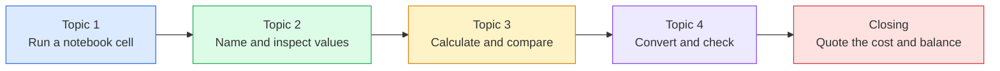
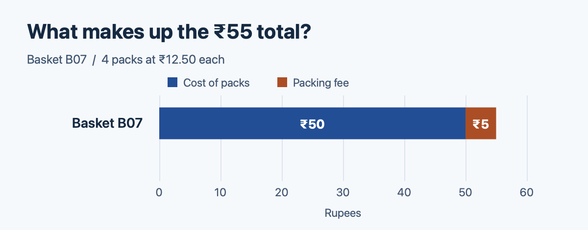
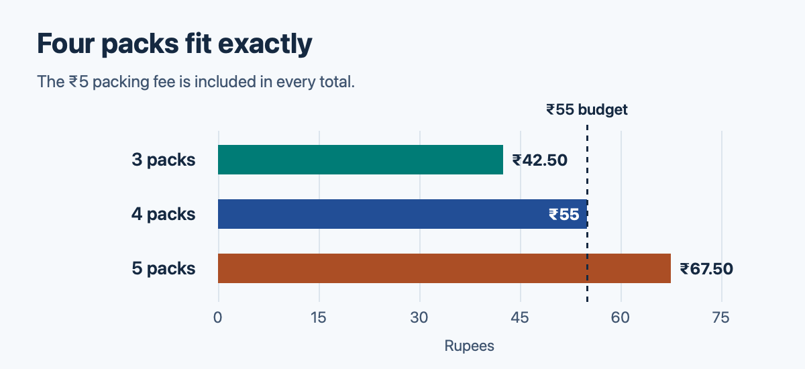
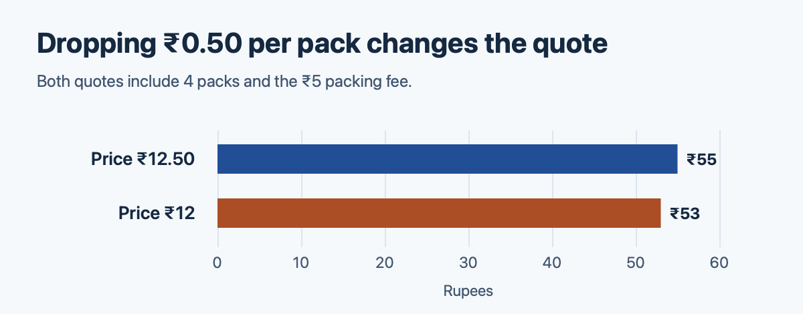
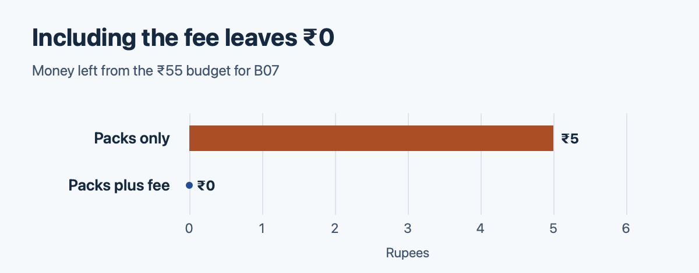

# <font color='#1d4ed8'>Lecture Script: Python and Colab: Variables, Data Types, and Expressions</font>

---

## <font color='blue'>Agenda</font>

The lecture runs as four topics. Each topic ends with a quiz.

| Topic | What we do | Learning objectives covered | Minutes |
|:-:|:--|:--|:-:|
| 1 | Run Python in Google Colab | Work in a Google Colab notebook and run Python code | 24 |
| 2 | Name values and inspect data types | Use variables and the core data types: int, float, string, and boolean | 25 |
| 3 | Build and test a budget expression | Build expressions with arithmetic and comparison operators | 31 |
| 4 | Convert inputs and inspect the result | Convert between types and avoid common beginner errors<br>Print and inspect results to check your work | 28 |
| — | Closing: Outcome & Summary | | 12 |
| | **Total** | | **120** |

> <font color="red">**🎯 Instructor Note**</font> Let everyone run and rerun a cell in Topic 1. Give Topic 3 time for the boundary check and Topic 4 time to diagnose a printed value before repairing it.

---

## <font color='blue'>Scenario</font>

**Basket card on the collection counter**

> Basket B07 · Oats · 4 packs at ₹12.50 each<br>
> Packing fee ₹5 per basket · Customer's budget ₹55

The counter is in a DMart-style store. The basket fits when its total, including the fee, is at or below the budget.

> <font color="red">**🎯 Instructor Note**</font> The fee, budget and basket data were invented for teaching. Use the card in the live notebook. The matching basket and optional practice rows are in `data/pickup_baskets.csv`.

---

## <font color='blue'>Problem Statement</font>

A customer at the collection counter asks how much money will be left after paying for basket B07. The clerk quotes ₹50 for the packs and says the customer will have ₹5 left. The customer reaches for another pack before the clerk notices that the quote left out the packing fee.

> <font color='purple'>**Can the customer pay for B07 within ₹55, and how much money will be left?**</font>

> <font color="red">**🎯 Instructor Note**</font> Poll. “For the original basket, is there ₹5 left, nothing left, or is the basket over budget?” Give learners 30 seconds to respond in chat. Reveal the answer in the Closing.

---

## <font color='blue'>What We Will Use</font>

We will work in one Python notebook and check the output below each cell.

| Topic | Tools | In one line |
|:-:|:--|:--|
| 1 | Google Colab, code cells, `print()` | Run a cell and read its output. |
| 2 | Variables, `int`, `float`, `str`, `bool`, `type()` | Give each value a name and check what kind of value it holds. |
| 3 | `*`, `+`, `-`, `<=`, `<`, `==` | Calculate the cost and test the budget. |
| 4 | `int()`, `float()`, `str()`, `print()`, `type()` | Turn text into usable inputs and check the receipt. |

---

## <font color='blue'>How: Walking Through a Pickup Basket</font>



---

## <font color='blue'>Topic 1: Run Python in Google Colab</font> `24 min`

> <font color='purple'>**How can we get the basket ID from the card onto our screen?**</font>

> <font color="red">**🎯 Instructor Note**</font> Give learners 8 minutes to open a notebook and run the first example, 10 minutes to edit and rerun, and 6 minutes for the quiz.

### <font color='green'>Example: run the first cell</font>

Open Google Colab in your browser and create a new notebook from the File menu. A notebook holds cells. A code cell sends instructions to the Python runtime, and its output appears underneath. If the runtime is disconnected, connect it. Click in the first code cell, enter the following line, and use the run button on its left.

**Predict before running: What will happen?**

> <font color="red">**🎯 Instructor Note**</font> The output is `Basket B07`. Point to the quoted text in the cell and then to the output below it.

```python
print("Basket B07")
```

**Output**

```
Basket B07
```

#### <font color='#c2410c'>Code Explanation</font>

- **Line 1** `print()` displays the text inside its parentheses. The quotes mark the start and end of the text in the code.

> <font color='green'>**Result**</font> The output shows the ID from the basket card.

### <font color='green'>Extending it: edit and rerun</font>

> <font color='purple'>**What will the output say after we add the item name?**</font>

Use **+ Code** to add a cell. Enter `print("Basket B07")` and run it. In that same cell, edit the line to match the one below and look at the output before and after running the cell again.

**Predict before running: What will happen?**

> <font color="red">**🎯 Instructor Note**</font> Before the rerun the old output still says `Basket B07`. After the rerun it says `Basket B07: Oats`.

```python
print("Basket B07: Oats")
```

**Output**

```
Basket B07: Oats
```

#### <font color='#c2410c'>Code Explanation</font>

- **Line 1** The text now includes the item name. Running the edited cell executes the updated instruction.

> <font color='green'>**Result**</font> The output now shows the ID and the item. After editing a cell, rerun it to check the change.

### <font color='purple'>Quiz 1</font>

**Question:** A cell last ran with `print("Basket B07")`. You edit it to `print("Basket B07: Oats")`. What action updates the output below that cell?

**Options:**

- A) Run the edited code cell using its run button.
- B) Click outside the edited cell.
- C) Rename the notebook to “Basket B07: Oats.”
- D) Run a different code cell.

**Correct Answer:** A

**Explanation:**

- **A)** Running that cell executes the new `print()` call.
- **B)** Leaving the cell changes the focus only.
- **C)** The notebook name has no effect on the cell's output.
- **D)** The other cell runs its own instructions.

---

## <font color='blue'>Topic 2: Variables and Data Types</font> `25 min`

> <font color='purple'>**Our cell shows the basket and item together. How can we give the count, price and pickup status their own names?**</font>

> <font color="red">**🎯 Instructor Note**</font> Use 10 minutes for the example, 9 minutes for learners to predict and check the two types, and 6 minutes for the quiz.

### <font color='green'>Example: name the values on the card</font>

A variable is a name you can use to refer to a value. Read `quantity = 4` as “give the value `4` the name `quantity`.” For the current basket, use a whole number for the count, a decimal number for the price, text for the basket ID and a true-or-false value for whether it is for pickup.

**Predict before running: What will happen?**

> <font color="red">**🎯 Instructor Note**</font> Expect the four values on one line and their types on the next. Ask learners to match each type to its value in order.

```python
basket_id = "B07"
quantity = 4
unit_price = 12.50
is_pickup = True
print(basket_id, quantity, unit_price, is_pickup)
print(type(basket_id), type(quantity), type(unit_price), type(is_pickup))
```

**Output**

```
B07 4 12.5 True
<class 'str'> <class 'int'> <class 'float'> <class 'bool'>
```

#### <font color='#c2410c'>Code Explanation</font>

- **Line 1** `"B07"` is a string (`str`), the type for text.
- **Line 2** `4` is an integer (`int`), the same type as `0` and `-2`.
- **Line 3** `12.50` is a `float`, a type that can represent numbers with a fractional part. Python displays this value as `12.5`.
- **Line 4** `True` is a boolean (`bool`). Its two possible values are `True` and `False`, written with the first letter capitalized and without quotes.
- **Lines 5 and 6** `print()` with commas displays values separated by spaces. `type()` tells us the kind of each value.

> <font color='green'>**Result**</font> Each part of the basket now has a name, a value and a type we can inspect.

### <font color='green'>Extending it: reuse a value in a new cell</font>

> <font color='purple'>**If we copy the count from a text field, can we tell it apart from the whole number just by printing it?**</font>

Add a code cell below the previous one. It can use `quantity` while the same runtime is active and the cell assigning that name has already run.

**Predict before running: What will happen?**

> <font color="red">**🎯 Instructor Note**</font> Both values print as `4`. The first type is `str` and the second is `int`.

```python
quantity_text = "4"
print(quantity_text, quantity)
print(type(quantity_text), type(quantity))
```

**Output**

```
4 4
<class 'str'> <class 'int'>
```

#### <font color='#c2410c'>Code Explanation</font>

- **Line 1** The quotes make `"4"` a string.
- **Line 2** `print()` shows the contents of the string and then the integer value.
- **Line 3** The type check tells the two values apart.

> <font color='green'>**Result**</font> Two values can look identical in the output while having different types.

> <font color='#b45309'>**Common mistake**</font> If Python says a variable name is undefined, check its spelling and rerun the cell that assigns it. After a runtime restart, run the cells in order from the top.

### <font color='purple'>Quiz 2</font>

**Question:** Which assignment stores the quantity as an `int`?

**Options:**

- A) `quantity = "4"`
- B) `quantity = 4`
- C) `quantity = 4.0`
- D) `quantity = True`

**Correct Answer:** B

**Explanation:**

- **A)** The quotes make the value a string.
- **B)** A whole-number literal written this way has type `int`.
- **C)** The decimal point makes this literal a `float`.
- **D)** `True` has type `bool`.

---

## <font color='blue'>Topic 3: Build Arithmetic and Comparison Expressions</font> `31 min`

> <font color='purple'>**Now that we have a numeric count and price, how do we include the fee and decide whether B07 fits the budget?**</font>

> <font color="red">**🎯 Instructor Note**</font> Use 8 minutes for the example, 7 for the exact limit, 10 for learners to check the neighboring quantities, and 6 for the quiz.

### <font color='green'>Example: calculate the basket total</font>

> <font color='purple'>**What does the customer pay for four packs and the packing fee?**</font>

An expression combines values or names to produce a value. Use `*` to multiply, `+` to add and `<=` to test whether the total is at or below the limit.

$$
\boxed{\text{total}=\text{quantity}\times\text{unit price}+\text{packing fee}}
$$

**Predict before running: What will happen?**

> <font color="red">**🎯 Instructor Note**</font> Expect a subtotal of ₹50, a fee of ₹5 and a total of ₹55. The budget test is true because the rule includes equality.

```python
packing_fee = 5
budget = 55
subtotal = quantity * unit_price
total = subtotal + packing_fee
fits_budget = total <= budget
print("Subtotal:", subtotal)
print("Fee:", packing_fee)
print("Total:", total)
print("Fits budget:", fits_budget)
```

**Output**

```
Subtotal: 50.0
Fee: 5
Total: 55.0
Fits budget: True
```

#### <font color='#c2410c'>Code Explanation</font>

- **Lines 1 and 2** The fee and budget are whole numbers in rupees.
- **Line 3** Multiply the count by the price to get the cost of the packs.
- **Line 4** Add the fee once per basket.
- **Line 5** Compare the full total with the budget. The expression produces a boolean.
- **Lines 6 to 9** Print the intermediate amounts and the result so we can check each one against the card.

> <font color='green'>**Result**</font> The basket costs exactly ₹55 including the fee, so it fits.

<p align="center"></p>

### <font color='green'>Extending it: test the exact limit</font>

> <font color='purple'>**How does the answer change if we ask whether the total is strictly below the budget?**</font>

Use `<` for strictly below, `==` for equality and `-` to calculate the money left. One equals sign assigns a value. Two equals signs compare values.

**Predict before running: What will happen?**

> <font color="red">**🎯 Instructor Note**</font> The total is below the budget only if there is money left. Expect `False`, then `True` for equality, then `0.0`.

```python
print("Below budget:", total < budget)
print("Exactly at budget:", total == budget)
print("Money left:", budget - total)
```

**Output**

```
Below budget: False
Exactly at budget: True
Money left: 0.0
```

#### <font color='#c2410c'>Code Explanation</font>

- **Line 1** The strict comparison returns `False` because the numbers are equal.
- **Line 2** The equality test checks the numbers and returns `True`.
- **Line 3** Subtract the full cost from the budget to find the balance.

> <font color='green'>**Result**</font> Paying ₹55 uses the entire ₹55 budget.

### <font color='green'>Extending it: try one fewer and one more pack</font>

> <font color='purple'>**Does the same expression work for basket sizes just below and just above four packs?**</font>

Ask learners to write an expression for one fewer pack using `quantity`, `unit_price` and `packing_fee`. Give learners 30 seconds to respond in chat. Then ask them to predict which totals fit. Use `>` when asking whether a total goes over the budget.

**Predict before running: What will happen?**

> <font color="red">**🎯 Instructor Note**</font> Three packs cost ₹42.50 and fit. Five packs cost ₹67.50 and go over the limit.

```python
fewer_total = (quantity - 1) * unit_price + packing_fee
more_total = (quantity + 1) * unit_price + packing_fee
print("3 packs:", fewer_total, fewer_total <= budget)
print("4 packs:", total, total <= budget)
print("5 packs:", more_total, more_total <= budget)
```

**Output**

```
3 packs: 42.5 True
4 packs: 55.0 True
5 packs: 67.5 False
```

#### <font color='#c2410c'>Code Explanation</font>

- **Lines 1 and 2** Parentheses change the pack count before multiplication. Multiplication happens before the final addition.
- **Lines 3 to 5** Show the total and test it against the same budget for each count.

> <font color='green'>**Result**</font> Three and four packs fit, while five packs cost ₹12.50 over budget.

<p align="center"></p>

### <font color='purple'>Quiz 3</font>

**Question:** With four packs at ₹12.50, a ₹5 fee and a ₹55 budget, which expression correctly tests whether the full total fits a rule that includes equality?

**Options:**

- A) `quantity * unit_price + packing_fee < budget`
- B) `quantity * (unit_price + packing_fee) <= budget`
- C) `quantity * unit_price + packing_fee <= budget`
- D) `quantity * unit_price + packing_fee > budget`

**Correct Answer:** C

**Explanation:**

- **A)** It checks a strict limit and rejects the basket at exactly ₹55.
- **B)** It adds the fee to every pack and computes ₹70.
- **C)** It includes the fee once and returns `True` at ₹55.
- **D)** It tests whether the basket exceeds the budget.

---

## <font color='blue'>Topic 4: Convert Inputs and Inspect Results</font> `28 min`

> <font color='purple'>**Our budget test worked with numbers. What should we check if the count and unit price arrive as text?**</font>

> <font color="red">**🎯 Instructor Note**</font> Use 8 minutes for the example, 7 minutes for each variation, and 6 minutes for the quiz.

### <font color='green'>Example: convert the text before doing arithmetic</font>

The basket's count and unit price can arrive as `"4"` and `"12.50"`. Multiplying a string by a positive integer repeats the text. Multiplying a string by a `float` raises a `TypeError`. Choose `int()` for whole-number text and `float()` for price text that includes a decimal point.

**Predict before running: What will happen?**

> <font color="red">**🎯 Instructor Note**</font> Doubling the text gives `44`. The converted values have types `int` and `float`, and the total is ₹55.

```python
price_text = "12.50"
print("Text doubled:", quantity_text * 2)
converted_quantity = int(quantity_text)
converted_price = float(price_text)
print("Count:", converted_quantity, type(converted_quantity))
print("Price:", converted_price, type(converted_price))
converted_total = converted_quantity * converted_price + packing_fee
print("Total:", converted_total)
```

**Output**

```
Text doubled: 44
Count: 4 <class 'int'>
Price: 12.5 <class 'float'>
Total: 55.0
```

#### <font color='#c2410c'>Code Explanation</font>

- **Lines 1 and 2** Store the price as text and demonstrate what happens when the count string is repeated twice.
- **Lines 3 and 4** Read the text as numbers and give the resulting values new names.
- **Lines 5 and 6** Print each converted value and its type so the output confirms both.
- **Lines 7 and 8** Use the converted values in the same total expression and print the result.

> <font color='green'>**Result**</font> Converting the text restores the numeric total of ₹55.

> <font color='#b45309'>**Common mistake**</font> `int("12.50")` raises a `ValueError` because the string has a decimal point. Use `float("12.50")` to keep the price.

### <font color='green'>Extending it: catch a conversion that loses part of the price</font>

> <font color='purple'>**What would our printed checks show if someone converted the price from `float` to `int`?**</font>

**Predict before running: What will happen?**

> <font color="red">**🎯 Instructor Note**</font> `int(12.5)` gives `12`, so this version of the quote is ₹53. Ask learners which printed value first shows the error.

```python
truncated_price = int(converted_price)
truncated_total = converted_quantity * truncated_price + packing_fee
print("Expected unit price:", converted_price)
print("Truncated unit price:", truncated_price, type(truncated_price))
print("Expected total:", converted_total)
print("Incorrect total:", truncated_total)
```

**Output**

```
Expected unit price: 12.5
Truncated unit price: 12 <class 'int'>
Expected total: 55.0
Incorrect total: 53
```

#### <font color='#c2410c'>Code Explanation</font>

- **Line 1** Converting a `float` to `int` discards the fractional part, moving the value toward zero.
- **Line 2** The total uses the shortened price for every pack.
- **Lines 3 and 4** Comparing the printed prices shows where the value changed.
- **Lines 5 and 6** Comparing the totals shows the effect on the quote.

> <font color='green'>**Result**</font> Keeping the price as a `float` preserves the total. Dropping ₹0.50 per pack reduces the quote by ₹2.

<p align="center"></p>

### <font color='green'>Extending it: turn a count into text for the receipt</font>

> <font color='purple'>**How can we join the label and the count into one message without changing the stored count?**</font>

**Predict before running: What will happen?**

> <font color="red">**🎯 Instructor Note**</font> The first line reads `Packs: 4`. The second line shows that the numeric count still has type `int`.

```python
count_label = "Packs: " + str(converted_quantity)
print(count_label)
print(type(converted_quantity))
```

**Output**

```
Packs: 4
<class 'int'>
```

#### <font color='#c2410c'>Code Explanation</font>

- **Line 1** `str()` makes a text value that `+` can join to the label.
- **Lines 2 and 3** Display the label and check that the original count stays numeric.

> <font color='green'>**Result**</font> The receipt has a readable label and the calculation still has a numeric count.

> <font color='#b45309'>**Common mistake**</font> Adding a string to an integer with `+` raises a `TypeError`. Convert to text to join strings, or pass the label and value to `print()` with a comma.

> <font color="red">**🎯 Instructor Note**</font> If learners finish early, have them take the count and unit price from row B09 of the CSV. In a new cell, have them print the result of `int("6") * float("8.50") + packing_fee`. Expect ₹56, which is ₹1 over budget.

### <font color='purple'>Quiz 4</font>

**Question:** Which expression gives the correct subtotal when `quantity_text = "4"` and `price_text = "12.50"`?

**Options:**

- A) `quantity_text * price_text`
- B) `int(quantity_text) * int(price_text)`
- C) `int(quantity_text) * int(float(price_text))`
- D) `int(quantity_text) * float(price_text)`

**Correct Answer:** D

**Explanation:**

- **A)** Python cannot multiply two strings.
- **B)** `int("12.50")` raises a `ValueError`.
- **C)** The second `int()` drops the fractional part of the price, giving a subtotal of ₹48.
- **D)** The two conversions give the numeric values `4` and `12.5`, so the subtotal is ₹50.

---

## <font color='blue'>Closing: Outcome & Summary</font> `12 min`

> <font color='purple'>**1. Where do we put the final budget check, and how do we know it ran?**</font>

Add one code cell below the existing cells in the same notebook. Its printed checks will appear underneath when it runs.

> <font color='purple'>**2. Which fields should we inspect before working out how much money is left?**</font>

Check the basket ID, the numeric count and price, then include the fee in the total and compare the full amount with the budget.

**Predict before running: What will happen?**

> <font color="red">**🎯 Instructor Note**</font> Ask learners to say “zero rupees left” before running the cell and to name the printed line that verifies it.

```python
print("Basket:", basket_id)
print("Count and unit price:", converted_quantity, converted_price)
print("Input types:", type(converted_quantity), type(converted_price))
print("Total including fee:", converted_total)
print("Fits budget:", converted_total <= budget)
print("Money left without fee:", budget - converted_quantity * converted_price)
print("Money left with fee:", budget - converted_total)
```

**Output**

```
Basket: B07
Count and unit price: 4 12.5
Input types: <class 'int'> <class 'float'>
Total including fee: 55.0
Fits budget: True
Money left without fee: 5.0
Money left with fee: 0.0
```

#### <font color='#c2410c'>Code Explanation</font>

- **Line 1** Use the stored ID to identify which basket the cell checked (Topics 1 and 2).
- **Lines 2 and 3** Check the converted count, price and their types against the basket card (Topics 2 and 4).
- **Lines 4 and 5** Display the checked total and compare it with the inclusive limit (Topics 3 and 4).
- **Lines 6 and 7** Subtract the two amounts separately to see how including the fee changes the money left (Topic 3).

<p align="center"></p>

### <font color='green'>Outcome</font>

| | Packs only | Packs plus fee |
|:--|:-:|:-:|
| Amount in the quote | ₹50 | ₹55 |
| Money left from ₹55 | ₹5 | ₹0 |
| Fits the budget? | Yes | Yes |

> <font color='green'>**Therefore,**</font> B07 fits the budget exactly. The customer can collect the four packs and will have ₹0 left. Adding a fifth pack would take the total to ₹67.50.

> <font color="red">**🎯 Instructor Note**</font> Reveal the opening poll answer beside the table. There is nothing left because the fee is part of the total.

### <font color='green'>Summary</font>

| Learning objective | Takeaway |
|:--|:--|
| Run Python in Google Colab | Run a code cell and read its output underneath. Rerun it after an edit. |
| Use variables and types | Name values and use `type()` to distinguish `int`, `float`, `str` and `bool`. |
| Build expressions | Calculate the full amount and use `<=` when an exact match fits. |
| Convert between types | Convert whole-number text with `int()`, decimal text with `float()`, and a value to text with `str()`. |
| Print and inspect | Print labeled inputs, types and intermediate results to find where an unexpected result starts. |
| **Practical value** | Check a basket, expense or budget line before quoting a price or adding an item. |

---

# <font color='red'>Launch the Feedback Poll</font>

> <font color="red">**🎯 Instructor Note**</font> Launch the feedback poll and ask learners which check they would run first if a quote looked wrong.
