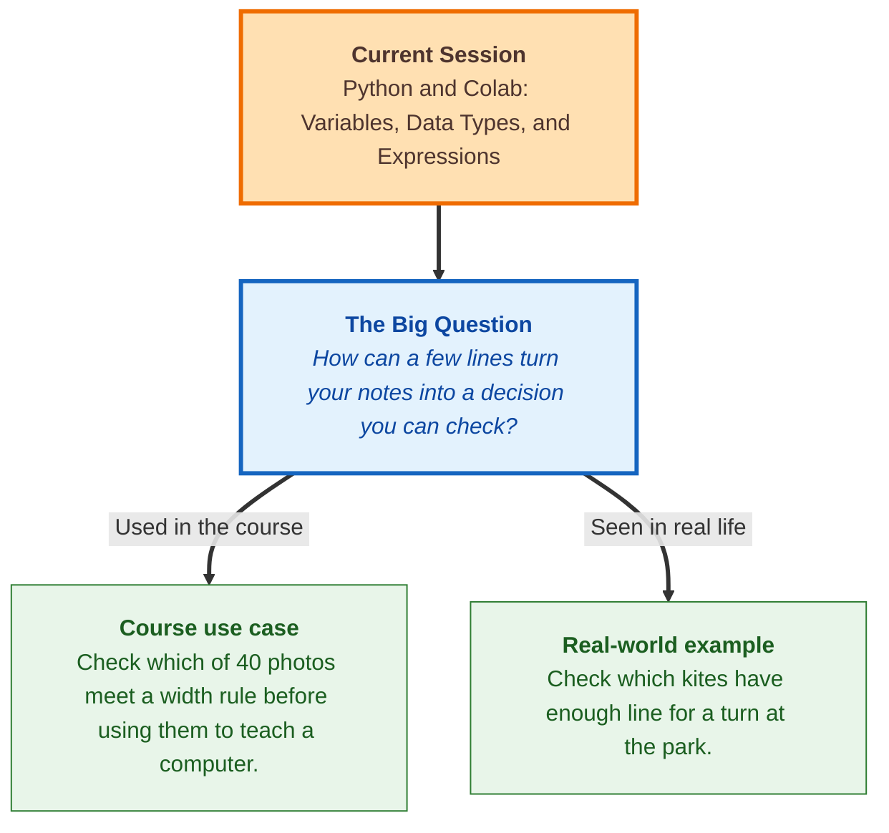

## <span style="color:#2F7DDE">Python and Colab: Variables, Data Types, and Expressions</span>

### <span style="color:#2F7DDE">Mental Map</span>



---

### <span style="color:#2F7DDE">What You'll Learn</span>

Have you ever wondered how a few lines on a screen could tell you whether your kite has enough line?

By the end of this session, you will be able to:

- <span style="color:#D9660B">**Use**</span> a notebook to run three lines about the Cedar kite.
- <span style="color:#D9660B">**Demonstrate**</span> how to name and store Cedar's label, ribbon count, line length, and yes-or-no result.
- <span style="color:#D9660B">**Determine**</span> how to turn Cedar's written length from text into a number before subtracting.
- <span style="color:#D9660B">**Calculate**</span> how much line Cedar has to spare and tell whether it meets the 12.5-metre mark.
- <span style="color:#D9660B">**Check**</span> your work by printing Cedar's result and comparing it with your notes.

> <span style="color:#2F7DDE">**Topics you will meet:**</span> Python, Google Colab, Variables, Data Types, Expressions.
>
> Join the session to learn each of these in detail.

---

### <span style="color:#2F7DDE">Why You Are Learning This Topic</span>

You bring three kites to the park with a friend. One of the lines broke last time.
You measure the line left on each reel and write it down beside the kite's name.
Your friend picks 12.5 metres as the least line a kite needs for a turn.
You want a quick way to tell which kites meet that mark.

An <span style="color:#D9660B">**expression**</span> means a piece of code that gives you a value, such as a number or a yes-or-no result.

In this course, you'll use short bits of code to turn notes like these into results you can check.

> <span style="color:#2F7DDE">**Think about it:**</span> What should your notebook show so your friend can check your choice?

---

### <span style="color:#2F7DDE">The Kite Day Puzzle</span>

You jot down the counts and lengths before the first flight.

| Kite | Tail ribbons | Line left (metres) |
|:----:|:------------:|:------------------:|
| Cedar | 3 | 15.5 |
| Comet | 2 | 12.5 |
| Mango | 4 | 9.0 |

<span style="color:#D9660B">**What you want to happen:**</span>

- Keep each line length with the right kite name.
- Show how far each length is above or below the mark.
- Print a yes-or-no result for each kite.

Here is how it might start. You do not need to understand it yet.

```python
kite_name = "Cedar"
line_note = "15.5"
print(kite_name, float(line_note))
```

> <span style="color:#D9660B">**Wonder about this:**</span>
>
> - Why might the marks around `"15.5"` matter before you subtract?
> - What would you check first if the screen showed Cedar next to 9.0?

---

### <span style="color:#2F7DDE">Think It Through</span>

There is no wrong first try. Keep your guesses for the session.

**1. How could you find how much line Cedar has to spare?**
Hint: Look at the length on Cedar's reel and the mark your friend picked.

**2. What result would you expect for Comet at exactly 12.5 metres?**
Hint: Think about what your friend meant by the least line a kite needs.

**3. What would you check if Cedar's line length came out as 15?**
Hint: Compare the printed value with the number you wrote down for Cedar.

---

### <span style="color:#2F7DDE">One Question to Carry Into the Session</span>

> <span style="color:#2F7DDE">**How could you tell whether a surprising result came from your notes or your code?**</span>
>
> Which value would you print first to find out?
