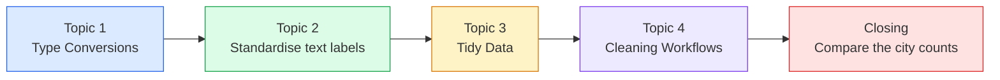
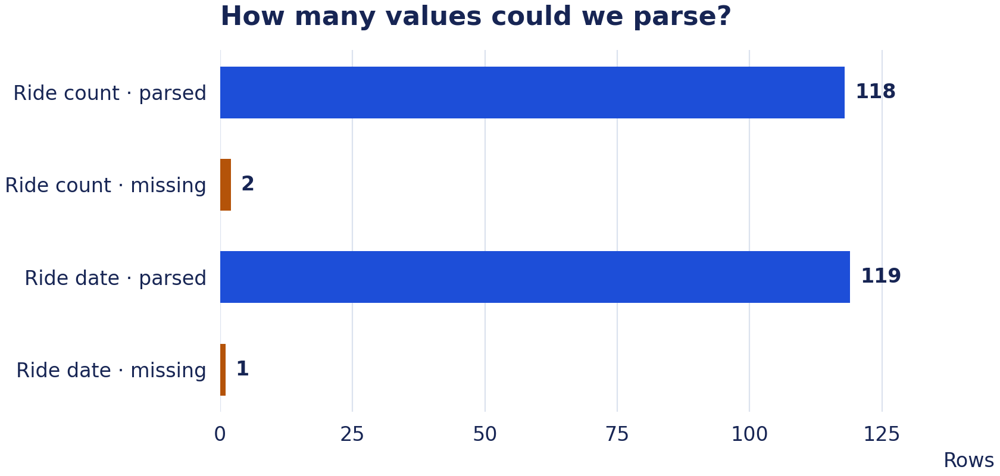
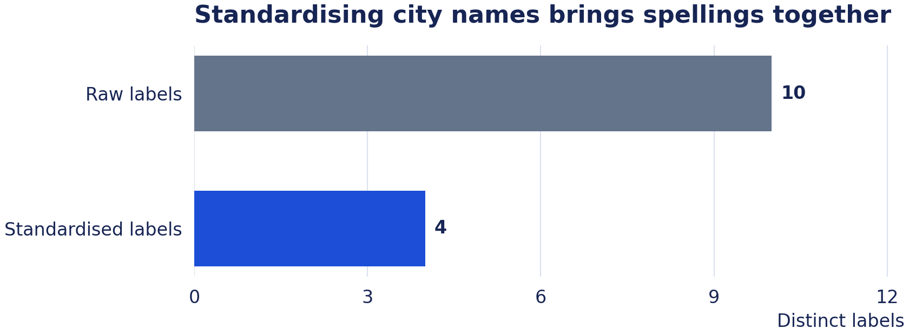
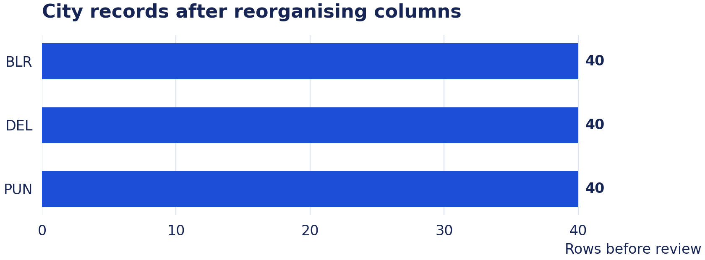
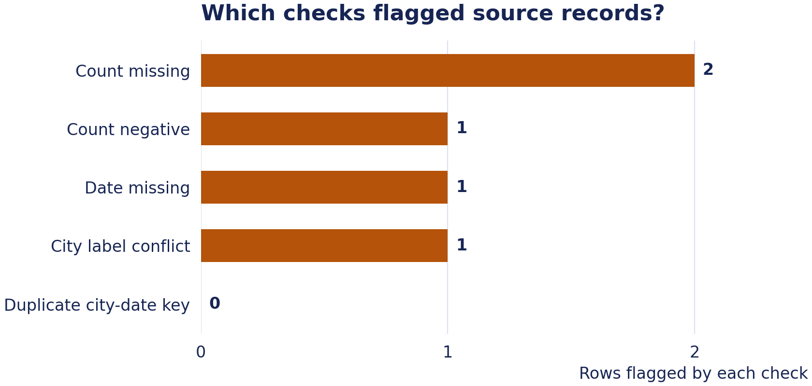
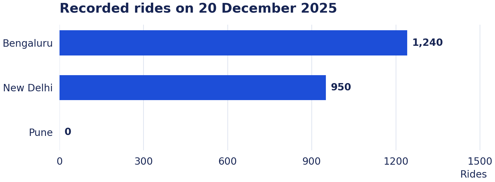

# <font color='#1d4ed8'>Lecture Script: Cleaning Data II: Type Conversions and Tidying</font>

---

## <font color='blue'>Agenda</font>

The lecture runs as four topics. Each topic ends with a quiz.

| Topic | What we do | Learning objectives covered | Minutes |
|:-:|:--|:--|:-:|
| 1 | Type Conversions | Convert columns to the correct data types | 29 |
| 2 | Standardise text labels | Fix inconsistent formatting and text issues | 25 |
| 3 | Tidy Data | Rename and reorganise columns for clarity | 21 |
| 4 | Cleaning Workflows | Prepare a messy real dataset for analysis | 35 |
| — | Closing: Outcome & Summary | | 10 |
| | **Total** | | **120** |

> <font color="red">**🎯 Instructor Note**</font> Use the first few minutes of Topic 1 for the scenario and prediction. Keep the column moves in Topic 3 brief and reserve 12 minutes in Topic 4 for the real-data exercise and its checks.

---

## <font color='blue'>Scenario</font>

In a Yulu-style bike-sharing service, three city teams send a daily ride count to the same operations analyst.

- **Incoming report** — `BLR | Bengaluru` and `BLR| bLR` appear as different labels. A busy day has `"1,240"` rides, while another day's count says `pending`.
- **Report the analyst needs** — One row per city and ride date, with separate fields for the city code, city name and numeric ride count. Source row IDs let the analyst trace any corrections.

> <font color="red">**🎯 Instructor Note**</font> Yulu frames the situation. The 120 rows in `data/ride_export.csv` are invented for teaching.
> Run the Python cells in order from the folder containing `data/`. Outputs were checked with Python 3.12 and pandas 2.2.3.

---

## <font color='blue'>Problem Statement</font>

The analyst sorts the 20 December report while the counts are stored as text. New Delhi's `"950"` sorts above Bengaluru's `"1,240"`. A supervisor could use that list to send extra bikes to the wrong city.

> <font color='purple'>**Which city recorded the most rides on 20 December 2025, and which rows need checking before the cleaned report is shared?**</font>

> <font color="red">**🎯 Instructor Note**</font> Poll learners on whether a record that says `pending` should count as zero or wait for review. Give learners 30 seconds to respond in chat. Reveal the answer in the Closing.

---

## <font color='blue'>What We Will Use</font>

We will use pandas to read the export, clean a copy and check it before making a comparison.

| Topic | Tools | In one line |
|:-:|:--|:--|
| 1 | `read_csv`, `to_numeric`, `to_datetime` | Read raw fields and convert ride counts and dates with explicit rules. |
| 2 | `str.split`, `str.replace`, `str.strip`, `str.casefold`, `replace`, `map` | Standardise names and check them against the city codes. |
| 3 | `rename`, column selection | Give each field a clear name and place it where readers expect it. |
| 4 | `isna`, `any`, `duplicated`, `assert` | Split records by validation result and check the cleaned table. |

---

## <font color='blue'>How: Walking Through the Ride Export</font>



---

## <font color='blue'>Topic 1: Type Conversions</font> `29 min`

> <font color='purple'>**How can we make a ride count sort by its value while keeping each row ID intact?**</font>

### <font color='green'>Example: convert counts and keep the original text</font>

> <font color='purple'>**What should pandas return for `"1,240"`, `"0"`, an empty field and `"pending"`?**</font>

A row ID identifies a source record. Keep it as text so `001` retains its leading zeros. This export uses whole counts with optional thousands commas. Check that pattern before removing commas so a typo such as `1,2` cannot become `12`. The optional minus sign lets us see which inputs parse as numbers even when they violate the count rule.

**Predict before running: What will happen?**

> <font color="red">**🎯 Instructor Note**</font> Expect `1240` and `0` to survive, a blank and `pending` to show as `<NA>`, and `-5` to parse. Ask learners which of those values the report can use.

```python
import pandas as pd
raw = pd.read_csv("data/ride_export.csv", dtype="string", keep_default_na=False)
def parse_count(series):
    text = series.str.strip()
    whole = text.str.fullmatch(r"-?([0-9]+|[0-9]{1,3}(,[0-9]{3})+)")
    return pd.to_numeric(text.where(whole).str.replace(",", "", regex=False), errors="coerce").astype("Int64")
rides = parse_count(raw["Rides"])
for i in (0, 2, 3, 4, 5):
    print(raw.at[i, "Row ID"], repr(raw.at[i, "Rides"]), rides.iat[i])
print("Counts parsed", rides.count())
```

**Output**

```
001 '1,240' 1240
003 '0' 0
004 'pending' <NA>
005 '' <NA>
006 '-5' -5
Counts parsed 118
```

#### <font color='#c2410c'>Code Explanation</font>

- **Lines 1–2** Load the CSV as text. `keep_default_na=False` keeps the empty field visible in the raw table.
- **Lines 3–5** Trim the outer spaces and check the whole string. The pattern accepts plain digits or correctly grouped thousands, with an optional minus sign.
- **Line 6** Turn unmatched inputs into missing values, remove literal commas and parse the remaining values. `Int64` is a pandas whole-number type that can also store `<NA>`.
- **Lines 7–10** Convert the full column, print five raw and parsed pairs, and count the nonmissing results.

> <font color='green'>**Result**</font> We have $118$ parsed counts. Two records still need a count, and a parsed negative value still needs a business-rule check.

### <font color='green'>Extending it: use the date convention from the export</font>

> <font color='purple'>**What date does `03/01/2026` mean here, and what happens to `31/02/2026`?**</font>

The export uses day first, then month, then four-digit year. Use that stated rule when reading dates. A timestamp holds a date pandas can compare and sort.

**Predict before running: What will happen?**

> <font color="red">**🎯 Instructor Note**</font> Expect 3 January for `03/01/2026` and `NaT` for 31 February. `NaT` marks a missing datetime value.

```python
dates = pd.to_datetime(raw["Day"], format="%d/%m/%Y", errors="coerce")
print("3 January example", pd.to_datetime("03/01/2026", format="%d/%m/%Y").date())
print("Source row", raw.at[6, "Row ID"], raw.at[6, "Day"], dates.iat[6])
for field, values in (("Ride count", rides), ("Ride date", dates)):
    print(field, "parsed", values.notna().sum(), "missing after parsing", values.isna().sum())
```

**Output**

```
3 January example 2026-01-03
Source row 007 31/02/2026 NaT
Ride count parsed 118 missing after parsing 2
Ride date parsed 119 missing after parsing 1
```

#### <font color='#c2410c'>Code Explanation</font>

- **Lines 1–2** Interpret `%d` as the day, `%m` as the month and `%Y` as the four-digit year. `errors="coerce"` leaves unreadable dates as `NaT`.
- **Line 3** Trace the impossible date back to its source ID.
- **Lines 4–5** Count successful and missing conversions separately for each field.

> <font color='green'>**Result**</font> The date conversion works for $119$ rows. Each missing result stays traceable to its raw value.

<p align="center"></p>

### <font color='green'>Extending it: decide what each value means</font>

> <font color='purple'>**Which values would you keep in a ride report: `0`, `-5` or `<NA>`?**</font>

Give learners 30 seconds to respond in chat.

> <font color="red">**🎯 Instructor Note**</font> Keep the zero. Ask what evidence would allow the analyst to release either of the other two records.

#### <font color='#c2410c'>Logic Explanation</font>

Zero says the source recorded no rides. A negative integer violates the report's nonnegative count rule. A missing count needs a source correction or confirmation before it can contribute to a total.

### <font color='purple'>Quiz 1</font>

**Question:** What does `parse_count` return for `"1,240"`, `"0"` and `"pending"` in that order?

**Options:**

- A) `1240`, `0`, `0`
- B) `1240`, `0`, `<NA>`
- C) `<NA>`, `0`, `<NA>`
- D) `1240`, `<NA>`, `<NA>`

**Correct Answer:** B

**Explanation:**

- **A)** `pending` does not supply a count, so the parser leaves it missing.
- **B)** The comma is removed, the recorded zero is kept and the unreadable entry becomes missing.
- **C)** The check accepts `1,240` as correctly grouped digits.
- **D)** Zero is a valid whole count.

---

## <font color='blue'>Topic 2: Standardise text labels</font> `25 min`

> <font color='purple'>**Now that counts and dates are typed, how do we stop three spellings of the same city from appearing separately?**</font>

### <font color='green'>Example: make equivalent labels match</font>

> <font color='purple'>**What does `" NEW   DELHI "` become after spaces and letter case follow the same rules?**</font>

A pipe (`|`) separates the city code and the city label. Codes use uppercase by convention. For city labels, compress whitespace, trim the ends, then use a common case. Apply an explicit alias only when the analyst has confirmed its meaning.

**Predict before running: What will happen?**

> <font color="red">**🎯 Instructor Note**</font> Expect `" NEW   DELHI "` to become `"new delhi"`. The confirmed alias `blr` needs its own replacement to become `bengaluru`.

```python
def normalise_label(series):
    return series.str.replace(r"\s+", " ", regex=True).str.strip().str.casefold()
parts = raw["City / Code"].str.split("|", n=1, expand=True, regex=False)
city_code = parts[0].str.strip().str.upper()
city = normalise_label(parts[1]).replace({"blr": "bengaluru"})
for i in (0, 1, 3):
    print(repr(parts.iat[i, 1]), "->", city.iat[i])
print("Distinct city labels", parts[1].nunique(), "raw and", city.nunique(), "standardised")
```

**Output**

```
' Bengaluru ' -> bengaluru
' NEW   DELHI ' -> new delhi
' bLR' -> bengaluru
Distinct city labels 10 raw and 4 standardised
```

#### <font color='#c2410c'>Code Explanation</font>

- **Lines 1–2** Replace each run of whitespace with one space, trim the ends and apply a common case for comparison.
- **Lines 3–4** Split at the first literal pipe into two columns. Trim the code and use uppercase.
- **Line 5** Apply the same text rule to every name. Replace the whole label `blr` with the approved name.
- **Lines 6–8** Show changed labels and count distinct values before and after the rules.

> <font color='green'>**Result**</font> The rules bring equivalent spellings together. One label still needs checking against its city code.

<p align="center"></p>

### <font color='green'>Extending it: check the label against its code</font>

> <font color='purple'>**What would you do with the name `north depot` next to city code `PUN`?**</font>

**Predict before running: What will happen?**

> <font color="red">**🎯 Instructor Note**</font> Give learners 30 seconds to respond in chat. Expect row `012` to be flagged. The code suggests Pune, so ask the source team which field is right.

```python
city_by_code = {"BLR": "bengaluru", "DEL": "new delhi", "PUN": "pune"}
expected_city = city_code.map(city_by_code)
city_issue = expected_city.isna() | city.ne(expected_city).fillna(True)
for i in raw.index[city_issue]:
    print(raw.at[i, "Row ID"], city_code.iat[i], repr(city.iat[i]), "expected", repr(expected_city.iat[i]))
```

**Output**

```
012 PUN 'north depot' expected 'pune'
```

#### <font color='#c2410c'>Code Explanation</font>

- **Lines 1–2** Look up the approved label for each code. Unrecognised codes get a missing lookup result.
- **Line 3** Flag missing lookups and labels that differ from the approved value. `fillna(True)` also flags an unknown comparison when the label is missing.
- **Lines 4–5** Print the source ID, code, cleaned label and expected label together.

> <font color='green'>**Result**</font> The analyst can ask about one specific row without guessing which field should change.

### <font color='purple'>Quiz 2</font>

**Question:** Which rule turns `" NEW   DELHI "` into the exact label `"new delhi"`?

**Options:**

- A) Apply `str.strip()` only.
- B) Apply `str.casefold()` only.
- C) Apply `str.strip().str.casefold()` only.
- D) Collapse whitespace runs, trim the ends, then case-fold.

**Correct Answer:** D

**Explanation:**

- **A)** The three interior spaces and uppercase letters remain.
- **B)** The letters are folded to lowercase and every space remains.
- **C)** The ends are trimmed and the letters are folded, while the three interior spaces remain.
- **D)** The three operations give one interior space, clean ends and lowercase text.

---

## <font color='blue'>Topic 3: Tidy Data</font> `21 min`

> <font color='purple'>**With the code and name separated, how should we lay out the table so every row describes one city's count for one date?**</font>

### <font color='green'>Example: give each field a column and a clear name</font>

> <font color='purple'>**Which fields describe the observation, and which field helps us trace the original record?**</font>

Tidy data gives each variable its own column, each observation its own row and each value its own cell. Here the observation is a city on a date. `ride_date` and `city_code` together identify that observation. `source_row_id` points back to the input.

**Predict before running: What will happen?**

> <font color="red">**🎯 Instructor Note**</font> Expect the original four columns to become five named fields. The input has 120 rows and the new table should have 120 too.

```python
work = raw.rename(columns={"Row ID": "source_row_id"})
work["city_code"], work["city"] = city_code, city
work["ride_date"], work["rides"] = dates, rides
column_order = ["source_row_id", "ride_date", "city_code", "city", "rides"]
tidy = work[column_order].copy()
print(tidy.head(3).to_string(index=False))
print("Rows before and after", len(raw), len(tidy))
```

**Output**

```
source_row_id  ride_date city_code      city  rides
          001 2025-12-20       BLR bengaluru   1240
          002 2025-12-20       DEL new delhi    950
          003 2025-12-20       PUN      pune      0
Rows before and after 120 120
```

#### <font color='#c2410c'>Code Explanation</font>

- **Line 1** Rename a column in a new table and keep the raw data available.
- **Lines 2–3** Add one column per field with the values already prepared.
- **Lines 4–5** Select the five report columns in the requested order. The raw combined field stays in `raw`.
- **Lines 6–7** Inspect the first three observations and check that this operation preserved the row count.

> <font color='green'>**Result**</font> The table has one field per column and is arranged around a city and date. Rows with errors are still present.

### <font color='green'>Extending it: check row identity after reorganising</font>

> <font color='purple'>**How do we know the same source records survived in the same order?**</font>

**Predict before running: What will happen?**

> <font color="red">**🎯 Instructor Note**</font> Expect each code to appear 40 times and the source ID comparison to return `True`.

```python
print("Rows per code", tidy["city_code"].value_counts().sort_index().to_dict())
print("Source IDs match in order", tidy["source_row_id"].equals(raw["Row ID"]))
```

**Output**

```
Rows per code {'BLR': 40, 'DEL': 40, 'PUN': 40}
Source IDs match in order True
```

#### <font color='#c2410c'>Code Explanation</font>

- **Line 1** Count rows for each code and sort the labels for a stable display. These are row counts, including records awaiting review.
- **Line 2** Compare the source-ID columns, including their row order and indexes.

> <font color='green'>**Result**</font> Reorganising measures and labels changed the columns while preserving every source ID.

<p align="center"></p>

### <font color='purple'>Quiz 3</font>

**Question:** Which layout supports one observation per city and ride date?

**Options:**

- A) Keep one row per city and date, with separate `ride_date`, `city_code`, `city` and `rides` columns plus the source ID.
- B) Use a separate column for each date, with one row per city.
- C) Put the city code and count back in a shared cell, such as `BLR|1240`.
- D) Use one row per date and remove the city field.

**Correct Answer:** A

**Explanation:**

- **A)** A row identifies one city on one date and each field has its own column.
- **B)** Date values become column headings, and a single row spans multiple observations.
- **C)** The shared cell contains two different variables.
- **D)** Removing the city field loses the city-level comparison.

---

## <font color='blue'>Topic 4: Cleaning Workflows</font> `35 min`

> <font color='purple'>**The table has clear columns. Which rows can go into the report, and which need a source check?**</font>

### <font color='green'>Example: flag the rows that need review</font>

> <font color='purple'>**How can we keep a record of every flagged row while making a separate table for analysis?**</font>

Check the fields the report depends on. A usable row needs a parsed date, a nonnegative count, an approved city label and only one record for its city-date key. Flag both members of a duplicate pair so the source team can decide which record to use.

**Predict before running: What will happen?**

> <font color="red">**🎯 Instructor Note**</font> Expect five flagged rows. The two missing parsed counts, one impossible date, one negative count and one city conflict occur on separate rows.

```python
checks = pd.DataFrame({
    "count_missing": tidy["rides"].isna(),
    "count_negative": tidy["rides"].lt(0).fillna(False),
    "date_missing": tidy["ride_date"].isna(),
    "city_conflict": city_issue,
    "duplicate_key": tidy.duplicated(["ride_date", "city_code"], keep=False),
})
hold = checks.any(axis="columns")
ready = tidy.loc[~hold].copy()
print(checks.sum().to_dict(), "held rows", hold.sum())
```

**Output**

```
{'count_missing': 2, 'count_negative': 1, 'date_missing': 1, 'city_conflict': 1, 'duplicate_key': 0} held rows 5
```

#### <font color='#c2410c'>Code Explanation</font>

- **Lines 1–4** Create one true-or-false column per rule. An unknown count is counted as missing. The negative-count rule tests only known counts.
- **Lines 5–7** Add the known city check and flag any repeated city-date key.
- **Lines 8–9** `any(axis="columns")` checks across each row. `~hold` selects rows whose flags are all false.
- **Line 10** Count each type of issue and count distinct held rows. One row could fail several checks.

> <font color='green'>**Result**</font> We can analyse $115$ rows and send $5$ back for review.

<p align="center"></p>

### <font color='green'>Extending it: keep an audit trail</font>

> <font color='purple'>**Can we account for all 120 source rows, including the ones left out of analysis?**</font>

**Predict before running: What will happen?**

> <font color="red">**🎯 Instructor Note**</font> Learners should predict IDs `004`, `005`, `006`, `007` and `012`. Losing a flagged record would make the two tables add up to fewer than 120 rows.

```python
review = raw.loc[hold].join(checks.loc[hold])
print("Review IDs", review["Row ID"].tolist())
assert len(ready) + len(review) == len(raw)
assert not ready.duplicated(["ride_date", "city_code"]).any()
assert ready["source_row_id"].is_unique
print("Source, ready and review", len(raw), len(ready), len(review))
```

**Output**

```
Review IDs ['004', '005', '006', '007', '012']
Source, ready and review 120 115 5
```

#### <font color='#c2410c'>Code Explanation</font>

- **Lines 1–2** Align the raw flagged rows and their reasons by the original index. Display their source IDs.
- **Lines 3–5** Stop if the row counts do not reconcile, a ready city-date pair repeats or a ready source ID repeats.
- **Line 6** Print the counts after the checks pass.

> <font color='green'>**Result**</font> The review table retains the original values, and the ready table has a unique city-date key.

### <font color='green'>Extending it: prepare a real bike-share export</font>

> <font color='purple'>**Can you use the same rules to make one clean row per day and prove that the rental totals still agree?**</font>

`data/capital_bikeshare_export.csv` contains the first 120 daily records from a real Capital Bikeshare dataset. The teaching copy changes how the dates and totals are written, selects five fields and expresses the source's `workingday` flag with inconsistent text. The rental counts are unchanged. For this report the observation is one day for the whole network. Casual and registered rentals are separate count fields, and their sum should match the total.

Data credit goes to Hadi Fanaee-T (2013), *Bike Sharing*, UCI Machine Learning Repository, DOI 10.24432/C5W894. This CC BY 4.0 teaching slice uses the copy of `day.csv` hosted by Udacity. [UCI dataset](https://archive.ics.uci.edu/dataset/275/bike%2Bsharing%2Bdataset) · [CC BY 4.0](https://creativecommons.org/licenses/by/4.0/) · [CSV mirror](https://github.com/udacity/deep-learning/blob/master/first-neural-network/Bike-Sharing-Dataset/day.csv)

Ask learners to inspect the first two lines of the CSV, choose names and types for the five fields, and write one condition that would block a row from the final table. Give them time to adapt their own code before showing the worked answer.

**Predict before running: What will happen?**

> <font color="red">**🎯 Instructor Note**</font> Expect 120 rows, two day-type labels after cleaning and the first date to be 1 January 2011. The first count is 985 rentals.

```python
source = pd.read_csv("data/capital_bikeshare_export.csv", dtype="string", keep_default_na=False)
bike = source.rename(columns={"Day": "ride_date", "Day Type": "day_type", "Total Rentals": "rentals",
                              "Casual": "casual_rentals", "Registered": "registered_rentals"})
bike["ride_date"] = pd.to_datetime(bike["ride_date"], format="%d/%m/%Y", errors="coerce")
bike["day_type"] = normalise_label(bike["day_type"])
count_columns = ["casual_rentals", "registered_rentals", "rentals"]
for column in count_columns:
    bike[column] = parse_count(bike[column])
bike = bike[["ride_date", "day_type", *count_columns]].copy()
print(bike.head(2).to_string(index=False))
```

**Output**

```
 ride_date        day_type  casual_rentals  registered_rentals  rentals
2011-01-01 non-working day             331                 654      985
2011-01-02 non-working day             131                 670      801
```

#### <font color='#c2410c'>Code Explanation</font>

- **Lines 1–3** Load the export as text and name each field for the report.
- **Lines 4–5** Parse the stated day-first dates and standardise the day-type labels.
- **Lines 6–8** Apply the same count parser to all three count columns.
- **Lines 9–10** Put the date and label first, followed by the count columns, and inspect two rows.

> <font color='green'>**Result**</font> There is one row per date, with the fields needed for a daily comparison.

### <font color='green'>Extending it: validate the real-data result</font>

> <font color='purple'>**Would you share the rental table if one day had an impossible date or a total that disagreed with its two counts?**</font>

**Predict before running: What will happen?**

> <font color="red">**🎯 Instructor Note**</font> Expect zero invalid rows and 120 unique dates. Ask learners how they would locate an offending date if the check failed.

```python
category_ok = bike["day_type"].isin(["working day", "non-working day"])
complete = bike.notna().all(axis="columns")
nonnegative = bike[count_columns].ge(0).fillna(False).all(axis="columns")
totals_ok = bike["rentals"].eq(bike["casual_rentals"] + bike["registered_rentals"]).fillna(False)
valid = category_ok & complete & nonnegative & totals_ok & ~bike["ride_date"].duplicated(keep=False)
print("Day types", sorted(bike["day_type"].unique()))
print("Ready dates", valid.sum(), "rows for review", (~valid).sum())
assert len(bike) == len(source) and valid.all()
```

**Output**

```
Day types ['non-working day', 'working day']
Ready dates 120 rows for review 0
```

#### <font color='#c2410c'>Code Explanation</font>

- **Lines 1–3** Check the approved categories, required fields and nonnegative counts.
- **Lines 4–5** Compare the stored total with the sum of the two count fields and require one row per date. If a check fails, `bike.loc[~valid]` identifies the affected rows.
- **Lines 6–8** Report the labels and validation counts. Stop if a source row was lost or any check failed.

> <font color='green'>**Result**</font> All $120$ public-data observations pass the checks and are ready for a daily rental comparison.

### <font color='purple'>Quiz 4</font>

**Question:** A city-date row contains a valid source ID and a known city code. Its count reads `pending` and becomes `<NA>`. What should the workflow do?

**Options:**

- A) Use zero and include it so every city appears in the comparison.
- B) Delete the row from both the cleaned table and the original export.
- C) Retain its original value and source ID in the review table and exclude it from the analysis until confirmed.
- D) Include it as a ready row because its ID and code are valid.

**Correct Answer:** C

**Explanation:**

- **A)** A zero would assert something the source never recorded.
- **B)** Removing the original evidence would make the problem harder to investigate.
- **C)** This preserves the evidence and keeps an unverified count out of the result.
- **D)** A valid ID and code do not supply the missing count.

---

## <font color='blue'>Closing: Outcome & Summary</font> `10 min`

Return to the analyst's 20 December report. Use the validated rows to compare the three cities and send the review IDs back with the original values.

> <font color='purple'>**1. Which cleaned fields make the comparison possible?**</font>

The report uses an actual date and numeric counts (Topic 1), standard city labels (Topic 2) and separate columns for the date, code and measure (Topic 3).

> <font color='purple'>**2. Which city recorded the most rides on that date, using only the rows that passed the checks?**</font>

**Predict before running: What will happen?**

> <font color="red">**🎯 Instructor Note**</font> Ask learners to compare `1240` with `950` as numbers. Expect Bengaluru to lead, and the recorded zero for Pune to remain in the report.

```python
target_day = pd.Timestamp("2025-12-20")
report = ready.loc[ready["ride_date"].eq(target_day), ["city_code", "city", "rides"]]
report = report.sort_values(["rides", "city"], ascending=[False, True])
print(report.to_string(index=False))
print("Rows to send for review", review["Row ID"].tolist())
```

**Output**

```
city_code      city  rides
      BLR bengaluru   1240
      DEL new delhi    950
      PUN      pune      0
Rows to send for review ['004', '005', '006', '007', '012']
```

#### <font color='#c2410c'>Code Explanation</font>

- **Line 1** Set the report date as a pandas timestamp (Topic 1).
- **Line 2** Use the ready table (Topic 4) and select the separated code, standardised label and count (Topics 2 and 3).
- **Lines 3–5** Sort by numeric counts, use the name to order any ties, then display the actual values and source review IDs.

<p align="center"></p>

### <font color='green'>Outcome</font>

| Measure | Result |
|:--|:--|
| 20 December 2025 | Bengaluru recorded $1{,}240$ rides, New Delhi $950$ and Pune $0$. All three city records for that date passed the checks. |
| Ready for analysis across the full export | $115$ of $120$ rows |
| Hold for source review | `004` and `005` for counts, `006` for a negative count, `007` for its date and `012` for the city label |

> <font color='green'>**Therefore,**</font> Bengaluru recorded the most rides on 20 December. Share that comparison with the verified rows and keep the five flagged records in the review table. Any comparison for a date with a held row must account for the city data still missing.

> <font color="red">**🎯 Instructor Note**</font> Reveal the poll. Hold `pending` for review because the source count is unknown. Pune's zero is an actual observation and belongs in the report.

### <font color='green'>Summary</font>

| Learning objective | Takeaway |
|:--|:--|
| Convert columns to the correct data types | Parse counts and dates with explicit rules and keep identifiers as text. |
| Fix inconsistent formatting and text issues | Normalise spaces and case, apply confirmed aliases and check what remains against a reference. |
| Rename and reorganise columns for clarity | Use one field per column and define what one row means before choosing the column order. |
| Prepare a messy real dataset for analysis | Preserve the input, test the cleaned values and key, and account for every row before using the result. |
| **Practical value** | Produce a numeric comparison colleagues can check against the original report. |

---

# <font color='red'>Launch the Feedback Poll</font>

> <font color="red">**🎯 Instructor Note**</font> Launch the feedback poll now to collect learner feedback.
