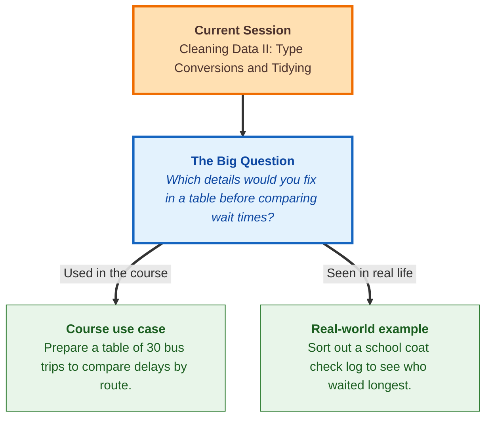

## <span style="color:#2F7DDE">Cleaning Data II: Type Conversions and Tidying</span>

### <span style="color:#2F7DDE">Mental Map</span>



---

### <span style="color:#2F7DDE">What You'll Learn</span>

Have you ever wondered how the coat check team works out which guest waited longest?

By the end of this session, you will be able to:

- <span style="color:#D9660B">**Use**</span> numbers in place of the typed Time entries so you can compare waits in minutes.
- <span style="color:#D9660B">**Apply**</span> the same rules for capital letters and spacing to each item name.
- <span style="color:#D9660B">**Demonstrate**</span> how to give Time a clearer name and move it next to Ticket.
- <span style="color:#D9660B">**Build**</span> a table that lets you compare waits by rack across the full coat check log.

> <span style="color:#2F7DDE">**Topics you will meet:**</span> Type Conversions, Tidy Data, Cleaning Workflows.
>
> Join the session to learn each of these in detail.

---

### <span style="color:#2F7DDE">Why You Are Learning This Topic</span>

You help run the coat check at a school show. The line grows when the show ends. One friend writes down which rack each item came from. Another types the wait into the same log. You open it the next morning to see where the line slowed down.

A <span style="color:#D9660B">**tidy table**</span> means each pickup has one row and each detail has its own column.

In this course, you will get tables ready to answer questions like the one your team has about the line.

> <span style="color:#2F7DDE">**Think about it:**</span> What could you learn if you could group the waits by rack?

---

### <span style="color:#2F7DDE">The Coat Check Puzzle</span>

Here are three entries from a sample log, with the typed Time values shown in quotes.

| Ticket | Item / Rack | Time |
|:------:|:------------|:----:|
| 014 | `Coat / A` | `"5"` |
| 022 | `bag / B` | `"12"` |
| 031 | `COAT  / A` | `"3 "` |

<span style="color:#D9660B">**What you want to happen:**</span>

- Compare the waits in minutes.
- Count coats under a single name.
- Find the rack for each ticket at a glance.

Here is how it might start. You do not need to understand it yet.

```python
wait_entries = {"014": "5", "022": "12", "031": "3 "}
print(repr(wait_entries["031"]))
```

> <span style="color:#D9660B">**Wonder about this:**</span>
>
> - Could two entries show the same wait and still look different to a computer?
> - What would make it easier to find all pickups from rack A?

---

### <span style="color:#2F7DDE">Think It Through</span>

There is no wrong first try. Keep your guesses for the session.

**1. Which heading would tell a new helper what Time measures?**

Hint: Think about the unit a new helper would need.

**2. How could you check that the ticket numbers stayed the same while you fixed the waits?**

Hint: Look closely at the start of each ticket number.

**3. What would you look for in the full log before deciding where to put an extra helper?**

Hint: A rack can appear on more than one line.

---

### <span style="color:#2F7DDE">One Question to Carry Into the Session</span>

> <span style="color:#2F7DDE">**How would you tell whether the cleaned log still tells the same story as the original?**</span>
>
> What would you check first before sharing it with the coat check team?
