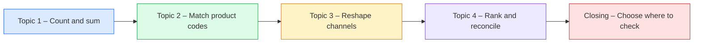
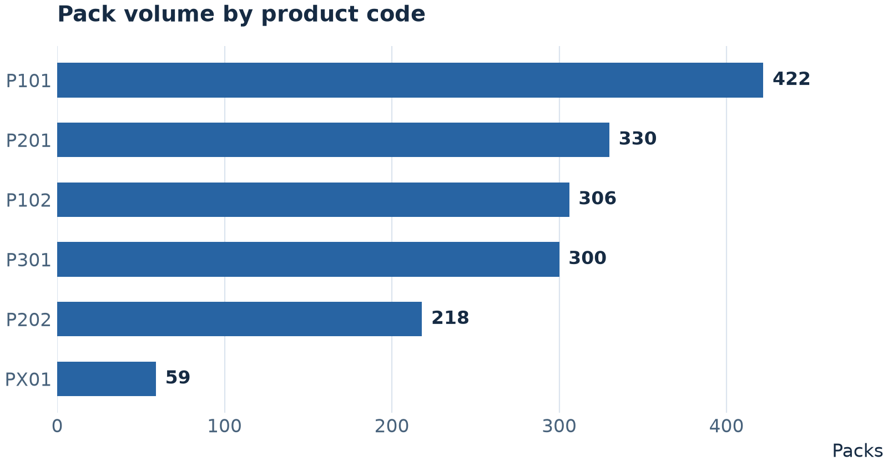
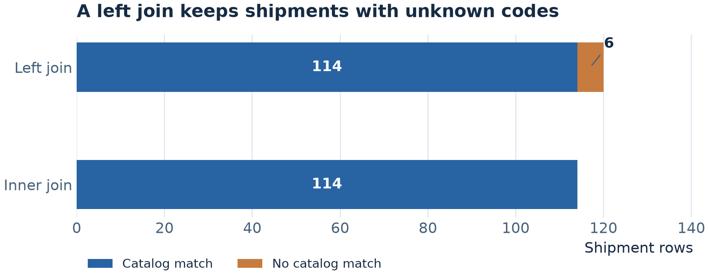
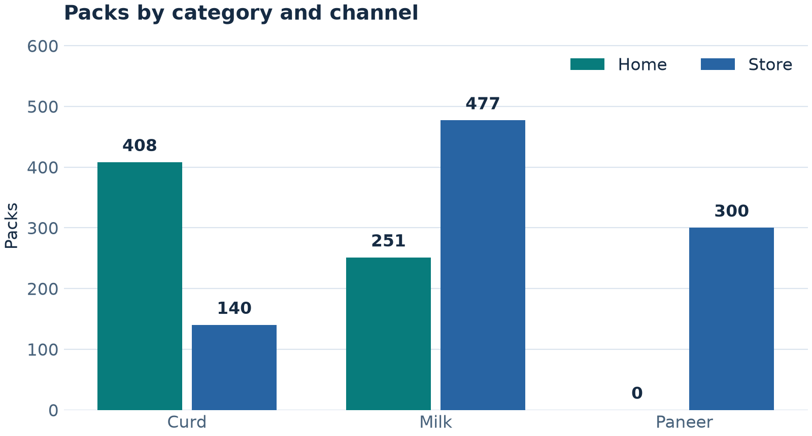
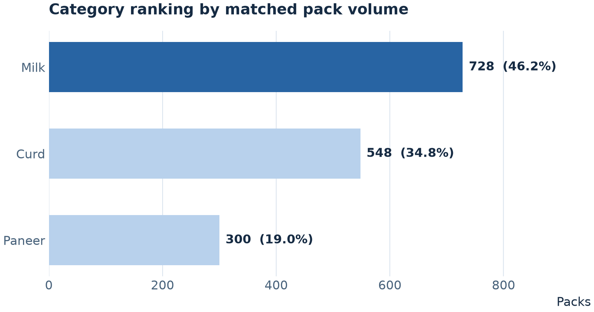
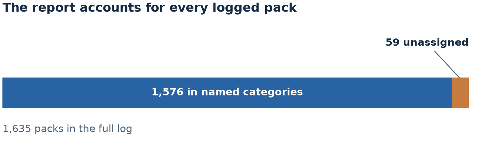

# <font color='#1d4ed8'>Lecture Script: Aggregating and Combining: groupby, merge, and reshape</font>

---

## <font color='blue'>Agenda</font>

The lecture runs as four topics. Each topic ends with a quiz.

| Topic | What we do | Learning objectives covered | Minutes |
|:-:|:--|:--|:-:|
| 1 | Count Shipments and Sum Packs | Group and aggregate data with groupby | 25 |
| 2 | Attach Product Categories and Audit Matches | Combine DataFrames with merge, mirroring SQL joins | 35 |
| 3 | Put Channels in Columns and Back in Rows | Reshape data with pivot_table or melt | 30 |
| 4 | Rank Categories and Reconcile the Report | Summarise a dataset by category for reporting | 22 |
| — | Closing: Outcome & Summary | | 8 |
| | **Total** | | **120** |

> <font color="red">**🎯 Instructor Note**</font> Use Topic 1's first five minutes for the setup and opening poll. Have learners predict which rows survive each join before showing the counts.

---

## <font color='blue'>Scenario</font>

At the end of a dispatch week, Meera, the shift lead at an Amul-style dairy depot, has one shipment log and a separate product catalog.
The log gives her a product code, a channel and the number of packs on each shipment row. The catalog tells her which codes belong to each product category.
She has a few spare crates and wants to check the category moving the most packs first, then the busier channel in that category.

> <font color="red">**🎯 Instructor Note**</font> Amul is the setting. The data were invented for teaching. Run the Python examples in order in one session with its working directory set to this folder.
> Use pandas 2.2.3 for the displayed outputs. The inputs are [shipments.csv](data/shipments.csv) and [product_catalog.csv](data/product_catalog.csv).

---

## <font color='blue'>Problem Statement</font>

Meera's first report quietly drops shipments whose product code is absent from the catalog. That leaves part of the week's dispatch out of the figures she gives the depot team. She needs to know where to check for extra crates and how many packs still need a category.

> <font color='purple'>**Which category and channel should Meera check first, and how many packs should she flag for a catalog check?**</font>

> <font color="red">**🎯 Instructor Note**</font> Poll question — if a shipment code is absent from the catalog, should its packs disappear from the report or stay visible as unassigned? Give learners 30 seconds to respond in chat. Reveal the answer in the Closing.

---

## <font color='blue'>What We Will Use</font>

We will use pandas to turn the dispatch log into a category report.

| Topic | Tools | In one line |
|:-:|:--|:--|
| 1 | `groupby`, `agg`, `size`, `sum` | Count shipment rows and add packs for each group. |
| 2 | `merge`, `indicator`, `validate` | Attach categories by product code and check what matched. |
| 3 | `pivot_table`, `melt` | Turn channel values into columns, then stack those columns into rows. |
| 4 | `groupby`, `sort_values`, totals and shares | Rank categories and account for every logged pack. |

---

## <font color='blue'>How: Walking Through the Dairy Dispatch Report</font>



---

## <font color='blue'>Topic 1: Count Shipments and Sum Packs</font> `25 min`

> <font color='purple'>**What moved this week if we put all shipment rows for the same product code together?**</font>

> <font color="red">**🎯 Instructor Note**</font> Use five minutes for the opening through the flow, ten for the example, seven for the two-key variation and three for the quiz.

### <font color='green'>Example: one row per product code</font>

> <font color='purple'>**Which code moved the most packs, and is it also the code with the most shipment rows?**</font>

A shipment row represents a dispatch of one product. `groupby` splits rows by a key, and `agg` calculates a result for each group. Here we want two measures, because a dispatch with one pack and a dispatch with many packs each count as one shipment.

$$\boxed{\text{packs for a code} = \sum_{\text{shipment rows for that code}} \text{units}}$$

**Predict before running: What will happen?**

> <font color="red">**🎯 Instructor Note**</font> Ask learners to name the keys and measures before running. Expect one row per code. P301 has the most shipment rows, and P101 has the most packs.

```python
import pandas as pd
shipments = pd.read_csv("data/shipments.csv")
catalog = pd.read_csv("data/product_catalog.csv")
by_product = shipments.groupby("product_code", as_index=False).agg(
    shipments=("shipment_id", "size"), units=("units", "sum")
)
print(by_product.to_string(index=False))
```

**Output**

```
product_code  shipments  units
        P101         24    422
        P102         18    306
        P201         26    330
        P202         18    218
        P301         28    300
        PX01          6     59
```

#### <font color='#c2410c'>Code Explanation</font>

- **Lines 1–3** load pandas and read the log and catalog as DataFrames.
- **Line 4** forms one group per `product_code`. `as_index=False` keeps the code as a regular column in the result.
- **Line 5** names two output columns. `size` counts rows in each group. `sum` adds that group's values in `units`.
- **Lines 6–7** finish the calculation and display the result without row index labels.

> <font color='green'>**Result**</font> P101 moved the most packs, $422$, while P301 had the most shipment rows, $28$.

<p align="center"></p>

### <font color='green'>Extending it: add a second group key</font>

> <font color='purple'>**What changes when Store and Home shipments for the same code get their own rows?**</font>

The `channel` column records whether the depot sent packs to a store or to homes.

**Predict before running: What will happen?**

> <font color="red">**🎯 Instructor Note**</font> Give learners 30 seconds to respond in chat. Expect two P101 rows and a steady total for the whole log.

```python
by_product_channel = shipments.groupby(["product_code", "channel"], as_index=False).agg(
    shipments=("shipment_id", "size"), units=("units", "sum")
)
print(by_product_channel.loc[by_product_channel["product_code"].eq("P101")].to_string(index=False))
print("Units before and after:", shipments["units"].sum(), by_product_channel["units"].sum())
```

**Output**

```
product_code channel  shipments  units
        P101    Home          8    142
        P101   Store         16    280
Units before and after: 1635 1635
```

#### <font color='#c2410c'>Code Explanation</font>

- **Lines 1–3** group by each observed combination of product code and channel and calculate the same two measures.
- **Line 4** selects the P101 rows for display. `.eq("P101")` produces the true-or-false condition for the selection.
- **Line 5** sums the full log and the full grouped table to check that the packs agree.

> <font color='green'>**Result**</font> P101 splits into $142$ Home packs and $280$ Store packs. The sum for the whole log remains $1{,}635$ packs.

### <font color='purple'>Quiz 1</font>

**Question:** Which pair of values should one P101 summary row show for shipment rows and packs?

**Options:**

- A) $24$ shipment rows and $422$ packs
- B) $16$ shipment rows and $280$ packs
- C) $2$ shipment rows and $422$ packs
- D) $422$ shipment rows and $24$ packs

**Correct Answer:** A

**Explanation:**

- **A)** The two channels give $8+16=24$ shipment rows and $142+280=422$ packs.
- **B)** These are the Store figures for P101 alone.
- **C)** The $2$ counts channel groups, so it understates shipment rows.
- **D)** This swaps the shipment count and the sum of packs.

---

## <font color='blue'>Topic 2: Attach Product Categories and Audit Matches</font> `35 min`

> <font color='purple'>**The totals are labelled by product code. How can Meera attach a category and still see which shipments need a lookup?**</font>

> <font color="red">**🎯 Instructor Note**</font> Use three minutes to trace a code across the two tables, eleven for the left join, ten to compare join choices, seven to test duplicate keys and four for the quiz.

### <font color='green'>Example: keep every shipment with a left join</font>

> <font color='purple'>**How many shipments get a category when the log supplies the rows to keep?**</font>

A join key is the column used to match rows. The log can repeat a product code across many shipments. In the catalog, each product code should occur once. In SQL terms, a left join starts with the left table and attaches right-table fields where keys match.

**Predict before running: What will happen?**

> <font color="red">**🎯 Instructor Note**</font> Draw the log on the left and the catalog on the right. Ask what happens to a left-hand code with no right-hand match. Expect $120$ rows after the left join, including $6$ without a catalog match.

```python
linked = shipments.merge(
    catalog, on="product_code", how="left", validate="many_to_one", indicator=True
)
unmatched = linked.loc[linked["_merge"].eq("left_only")]
matched = linked.loc[linked["_merge"].eq("both")]
print("Input, matched, unmatched:", len(shipments), len(matched), len(unmatched))
print("Unmatched codes:", unmatched["product_code"].unique().tolist())
print("Unmatched units:", unmatched["units"].sum())
```

**Output**

```
Input, matched, unmatched: 120 114 6
Unmatched codes: ['PX01']
Unmatched units: 59
```

#### <font color='#c2410c'>Code Explanation</font>

- **Lines 1–3** match on `product_code`. The log is on the left. `validate="many_to_one"` enforces unique keys on the right. `indicator=True` adds the `_merge` column to record row origins.
- **Lines 4–5** put shipment rows with no catalog match in `unmatched` and rows with a match in `matched`.
- **Lines 6–8** compare row counts, list the unrecognized code once, and add the units on those exception rows.

> <font color='green'>**Result**</font> All $120$ shipment rows remain visible. The catalog identifies $114$ shipments. The $6$ PX01 shipments have an empty category and carry $59$ packs.

### <font color='green'>Extending it: compare inner, left and full outer joins</font>

> <font color='purple'>**Which join would hide the unknown shipment code, and which would also show a catalog code with zero shipments?**</font>

**Predict before running: What will happen?**

> <font color="red">**🎯 Instructor Note**</font> Ask learners to predict all three row counts. Expect $114$ inner rows, $120$ left rows and $121$ outer rows. The extra outer row is the catalog-only code P401.

```python
inner = shipments.merge(catalog, on="product_code", how="inner", validate="many_to_one")
outer = shipments.merge(
    catalog, on="product_code", how="outer", validate="many_to_one", indicator=True
)
catalog_only = outer.loc[outer["_merge"].eq("right_only"), "product_code"]
print("Inner, left, outer rows:", len(inner), len(linked), len(outer))
print("Catalog-only codes:", catalog_only.tolist())
```

**Output**

```
Inner, left, outer rows: 114 120 121
Catalog-only codes: ['P401']
```

#### <font color='#c2410c'>Code Explanation</font>

- **Line 1** keeps only matched keys, as an SQL inner join would.
- **Lines 2–4** keep matches and keys present on either side, as an SQL full outer join would.
- **Line 5** finds catalog-only rows by the `right_only` indicator.
- **Lines 6–7** compare counts and show the catalog code without a shipment.

> <font color='green'>**Result**</font> The inner join drops the $6$ unmatched shipments. The full outer join adds one catalog-only row for P401, a Lassi code with no shipment in the log.

<p align="center"></p>

### <font color='green'>Extending it: catch a duplicated catalog code</font>

> <font color='purple'>**What would happen to shipment totals if P101 appeared twice in the catalog?**</font>

**Predict before running: What will happen?**

> <font color="red">**🎯 Instructor Note**</font> Give learners 30 seconds to respond in chat. Expect all $24$ P101 shipment rows to match twice. Ask what a report would show if both copies were counted.

```python
duplicate_catalog = pd.concat([catalog, catalog.loc[catalog["product_code"].eq("P101")]])
unchecked = shipments.merge(duplicate_catalog, on="product_code", how="left")
print("Unchecked rows and units:", len(unchecked), unchecked["units"].sum())
try:
    shipments.merge(duplicate_catalog, on="product_code", how="left", validate="many_to_one")
except pd.errors.MergeError as error:
    print(type(error).__name__)
```

**Output**

```
Unchecked rows and units: 144 2057
MergeError
```

#### <font color='#c2410c'>Code Explanation</font>

- **Line 1** stacks a single extra P101 record under a copy of the catalog using `pd.concat`. The original catalog stays available.
- **Lines 2–3** run the join without the uniqueness check and display its inflated totals.
- **Lines 4–7** run the join with the check. The `except` handler prints the error type when pandas rejects the duplicate key.

> <font color='green'>**Result**</font> The unchecked join adds $24$ rows and $422$ packs to the output. The uniqueness check catches the duplicate before a report can use the inflated figures.

> <font color='#b45309'>**Common mistake**</font> A left join can multiply left rows when the right key repeats. Check the intended key relationship and resolve conflicting catalog entries before reporting.

### <font color='purple'>Quiz 2</font>

**Question:** Meera wants to see all shipments and flag only the ones with no catalog match. Which result gives her both?

**Options:**

- A) An inner join with an indicator, then select `left_only`
- B) A left join with an indicator, then select `left_only` for the exception list
- C) An outer join with an indicator, then select `right_only` for the exception list
- D) A left join with an indicator, then select `both` for the exception list

**Correct Answer:** B

**Explanation:**

- **A)** The inner join keeps matched rows, so it has no `left_only` rows to flag.
- **B)** The left join keeps the entire shipment log, including the $6$ unmatched rows identified by `left_only`.
- **C)** `right_only` identifies the catalog rows with no shipment, such as P401.
- **D)** `both` identifies the $114$ shipment rows with a catalog match.

---

## <font color='blue'>Topic 3: Put Channels in Columns and Back in Rows</font> `30 min`

> <font color='purple'>**Now that most rows have categories, how can Meera compare their Store and Home volume side by side?**</font>

> <font color="red">**🎯 Instructor Note**</font> Use three minutes to sketch the desired table, twelve for the pivot, ten to stack the columns back into rows and five for the quiz.

### <font color='green'>Example: pivot matched shipments into a channel comparison</font>

> <font color='purple'>**Which cells belong in a grid with categories down the side and channels across the top?**</font>

Multiple shipment rows can share a category and channel. `pivot_table` can combine those rows into one number per cell. For a pack total, specify `aggfunc="sum"` because the default is the mean.

**Predict before running: What will happen?**

> <font color="red">**🎯 Instructor Note**</font> Ask learners to place Store and Home on the grid and predict the Paneer–Home cell. Give learners 30 seconds to respond in chat. Expect $0$ because the matched data has no shipments for that pair.

```python
wide = matched.pivot_table(
    index="category", columns="channel", values="units", aggfunc="sum", fill_value=0
)
print(wide.reset_index().rename_axis(columns=None).to_string(index=False))
```

**Output**

```
category  Home  Store
    Curd   408    140
    Milk   251    477
  Paneer     0    300
```

#### <font color='#c2410c'>Code Explanation</font>

- **Line 1** starts from shipments already linked to a product category.
- **Lines 2–3** make a row per observed category and a column per observed channel. Sum `units` in each cell. `fill_value=0` displays zero where an observed category and channel have no matching shipment rows.
- **Line 4** prints the wide grid with `category` as a column and without extra index or axis labels.

> <font color='green'>**Result**</font> The Store column shows $477$ Milk packs, $140$ Curd packs and $300$ Paneer packs. The Home column shows $251$, $408$ and $0$, respectively.

<p align="center"></p>

> <font color='#b45309'>**Common mistake**</font> The zero refers to a missing category–channel combination in the matched data. The $6$ unmatched shipment rows remain an exception, and categories with no matched rows at all never enter this pivot.

### <font color='green'>Extending it: make one row per category and channel</font>

> <font color='purple'>**If another tool expects a channel column, how can we deliver the same totals in that shape?**</font>

**Predict before running: What will happen?**

> <font color="red">**🎯 Instructor Note**</font> Expect $6$ category–channel rows. Ask whether the Paneer–Home value is still visible. It remains $0$ on its own row.

```python
long = wide.reset_index().melt(
    id_vars="category", value_vars=["Home", "Store"],
    var_name="channel", value_name="units"
)
print(long.sort_values(["category", "channel"]).to_string(index=False))
print("Units before and after:", matched["units"].sum(), long["units"].sum())
```

**Output**

```
category channel  units
    Curd    Home    408
    Curd   Store    140
    Milk    Home    251
    Milk   Store    477
  Paneer    Home      0
  Paneer   Store    300
Units before and after: 1576 1576
```

#### <font color='#c2410c'>Code Explanation</font>

- **Line 1** uses `reset_index()` to make `category` a regular column and starts the reshape.
- **Lines 2–4** keep `category` on each row, turn the Home and Store column labels into values of `channel`, and put their cell values in `units`.
- **Line 5** sorts the long table so each category's channels appear together.
- **Line 6** verifies that the reshaped totals sum to the matched shipment total.

> <font color='green'>**Result**</font> The long table has $6$ category–channel rows and still accounts for $1{,}576$ matched packs. Its rows describe totals, so the original shipment IDs cannot be recovered from it.

### <font color='purple'>Quiz 3</font>

**Question:** Which row belongs in the long table after melting the wide channel totals?

**Options:**

- A) Milk, both channels, $728$ packs
- B) P101, Store, $280$ packs
- C) Milk, Store, $477$ packs
- D) Paneer, Home, $300$ packs

**Correct Answer:** C

**Explanation:**

- **A)** The long table has a separate row for each channel, so the combined category total has no row.
- **B)** The pivot used categories rather than individual product codes.
- **C)** The Milk row's Store cell becomes a Milk–Store row with the same $477$ packs.
- **D)** The $300$ packs are in Paneer's Store cell. Its Home cell is $0$.

---

## <font color='blue'>Topic 4: Rank Categories and Reconcile the Report</font> `22 min`

> <font color='purple'>**The channel view shows where packs went. How can Meera rank categories by workload and show which packs still need a lookup?**</font>

> <font color="red">**🎯 Instructor Note**</font> Use two minutes to name the report's audience and measures, eleven for the ranking, six for reconciliation and three for the quiz.

### <font color='green'>Example: rank categories and label the denominator</font>

> <font color='purple'>**Which category shipped the most packs, and what share of matched packs did it move?**</font>

Count shipment rows and add pack volume. Meera is deciding where to check crate capacity by pack volume, so sort by packs. State the denominator alongside the percentages.

$$\boxed{\text{share of matched packs (\%)} = 100 \times \frac{\text{packs for the category}}{\text{packs with a matched category}}}$$

**Predict before running: What will happen?**

> <font color="red">**🎯 Instructor Note**</font> Ask learners to predict the category with the most shipped packs and the category with the most shipment rows. Expect Milk to lead by packs and Curd to lead by shipment rows.

```python
report = matched.groupby("category", as_index=False).agg(
    shipments=("shipment_id", "size"), units=("units", "sum")
).sort_values(["units", "category"], ascending=[False, True])
reported_units = report["units"].sum()
report["share_pct"] = (100 * report["units"] / reported_units).round(1)
print(report.to_string(index=False))
```

**Output**

```
category  shipments  units  share_pct
    Milk         42    728       46.2
    Curd         44    548       34.8
  Paneer         28    300       19.0
```

#### <font color='#c2410c'>Code Explanation</font>

- **Lines 1–3** group matched shipments by category, count rows, sum packs and sort by pack volume descending. If two unit totals tie, the category name puts them in a stable alphabetical order.
- **Line 4** sums the category pack totals for the denominator.
- **Line 5** calculates each percentage and rounds it to one decimal place for display.
- **Line 6** prints one row per category.

> <font color='green'>**Result**</font> Milk leads by volume with $728$ packs, $46.2\%$ of matched packs. Curd leads by number of shipments with $44$ rows.

> <font color="red">**🎯 Instructor Note**</font> Point to the first row of the sorted table. Show `report.iloc[0]["category"]`, which returns `Milk`. Explain that `.iloc[0]` selects the first row by position after sorting.

<p align="center"></p>

### <font color='green'>Extending it: reconcile the pack totals</font>

> <font color='purple'>**Can Meera account for the difference between the category report and the full shipment log?**</font>

**Predict before running: What will happen?**

> <font color="red">**🎯 Instructor Note**</font> Ask learners to calculate the gap from the two totals before revealing it. Expect $59$ packs.

```python
print("Reported + unassigned = logged:",
      f'{reported_units} + {unmatched["units"].sum()} = {shipments["units"].sum()}')
print("All logged units accounted for:",
      reported_units + unmatched["units"].sum() == shipments["units"].sum())
```

**Output**

```
Reported + unassigned = logged: 1576 + 59 = 1635
All logged units accounted for: True
```

#### <font color='#c2410c'>Code Explanation</font>

- **Lines 1–2** print the matched, unassigned and full-log totals together.
- **Lines 3–4** test whether the matched packs and the exception packs reconcile to the original log.

> <font color='green'>**Result**</font> The categories explain $1{,}576$ packs. PX01 explains the remaining $59$, bringing the accounted total to $1{,}635$. Meera can publish those $59$ as unassigned and ask someone to check the catalog.

### <font color='purple'>Quiz 4</font>

**Question:** Which wording accurately describes Milk's share in the category report?

**Options:**

- A) About $44.5\%$ of matched packs
- B) About $46.2\%$ of all logged packs
- C) About $36.8\%$ of matched packs
- D) About $46.2\%$ of matched packs

**Correct Answer:** D

**Explanation:**

- **A)** $728/1{,}635 \approx 44.5\%$ uses all logged packs.
- **B)** The $46.2\%$ uses the matched subtotal of $1{,}576$ packs.
- **C)** $42/114 \approx 36.8\%$ is Milk's share of matched shipment rows.
- **D)** $728/1{,}576 \approx 46.2\%$ uses Milk's packs and the total matched packs.

---

## <font color='blue'>Closing: Outcome & Summary</font> `8 min`

> <font color="red">**🎯 Instructor Note**</font> Spend two minutes tracing the totals, three asking learners to reproduce the decision and three reviewing the outcome and revealing the poll.

> <font color='purple'>**1. How many packs are in the shipment log?**</font>

The product-code totals add to $1{,}635$ packs.

> <font color='purple'>**2. How many packs are outside the named categories?**</font>

The left join shows $59$ packs on $6$ PX01 shipments with no catalog match.

> <font color='purple'>**3. Where should Meera check first?**</font>

Read the top category from the ranked report and find its larger channel in the reshaped table.

**Predict before running: What will happen?**

> <font color="red">**🎯 Instructor Note**</font> Ask for the category, channel and unassigned pack total before showing the output. Expect Milk on Store at $477$ packs, with $59$ packs still unassigned.

```python
lead_category = report.iloc[0]["category"]
channel_units = long.loc[long["category"].eq(lead_category)]
lead_channel = channel_units.sort_values(["units", "channel"], ascending=[False, True]).iloc[0]
print(f'{lead_category}: {lead_channel["channel"]}, {lead_channel["units"]} packs')
print("Keep unassigned packs visible:", unmatched["units"].sum())
```

**Output**

```
Milk: Store, 477 packs
Keep unassigned packs visible: 59
```

#### <font color='#c2410c'>Code Explanation</font>

- **Line 1** uses the first-row selection from Topic 4 to take the leading category in the report.
- **Lines 2–3** use the long channel table (Topic 3) to find that category's busiest channel. The channel name orders ties.
- **Line 4** displays the category, channel and pack count.
- **Line 5** keeps the packs identified by the left join in view (Topic 2).

<p align="center"></p>

### <font color='green'>Outcome</font>

| Category | Home packs | Store packs | Total packs |
|:--|--:|--:|--:|
| Milk | $251$ | $477$ | $728$ |
| Curd | $408$ | $140$ | $548$ |
| Paneer | $0$ | $300$ | $300$ |
| **Matched packs** | **$659$** | **$917$** | **$1{,}576$** |

| Reconciliation | Packs |
|:--|--:|
| Matched packs | $1{,}576$ |
| Unassigned packs on PX01 | $59$ |
| **All logged packs** | **$1{,}635$** |

> <font color='green'>**Therefore,**</font> Meera should check Store shipments for Milk first among the named categories. Milk moved $728$ matched packs, including $477$ to stores. Flag the $59$ unassigned packs for a catalog check before treating the rankings as complete.

> <font color="red">**🎯 Instructor Note**</font> Reveal the opening poll. Keep the unmatched packs visible as unassigned so the category report ties back to the dispatch log.

### <font color='green'>Summary</font>

| Learning objective | Takeaway |
|:--|:--|
| Group and aggregate data with groupby | Name the grouping keys and choose the calculation that answers the question, such as row count or pack sum. |
| Combine DataFrames with merge, mirroring SQL joins | Choose which rows to keep, validate the key relationship and use a merge indicator to see who matched. |
| Reshape data with pivot_table or melt | Use a wide pivot to compare columns side by side or a long table to store one row per category and channel. |
| Summarise a dataset by category for reporting | Rank by the measure used in the decision, name the share denominator and reconcile to the source. |
| **Practical value** | A depot lead can act on the ranked figures and still see which records need attention. |

---

# <font color='red'>Launch the Feedback Poll</font>

> <font color="red">**🎯 Instructor Note**</font> Launch the feedback poll now to collect learner feedback.
