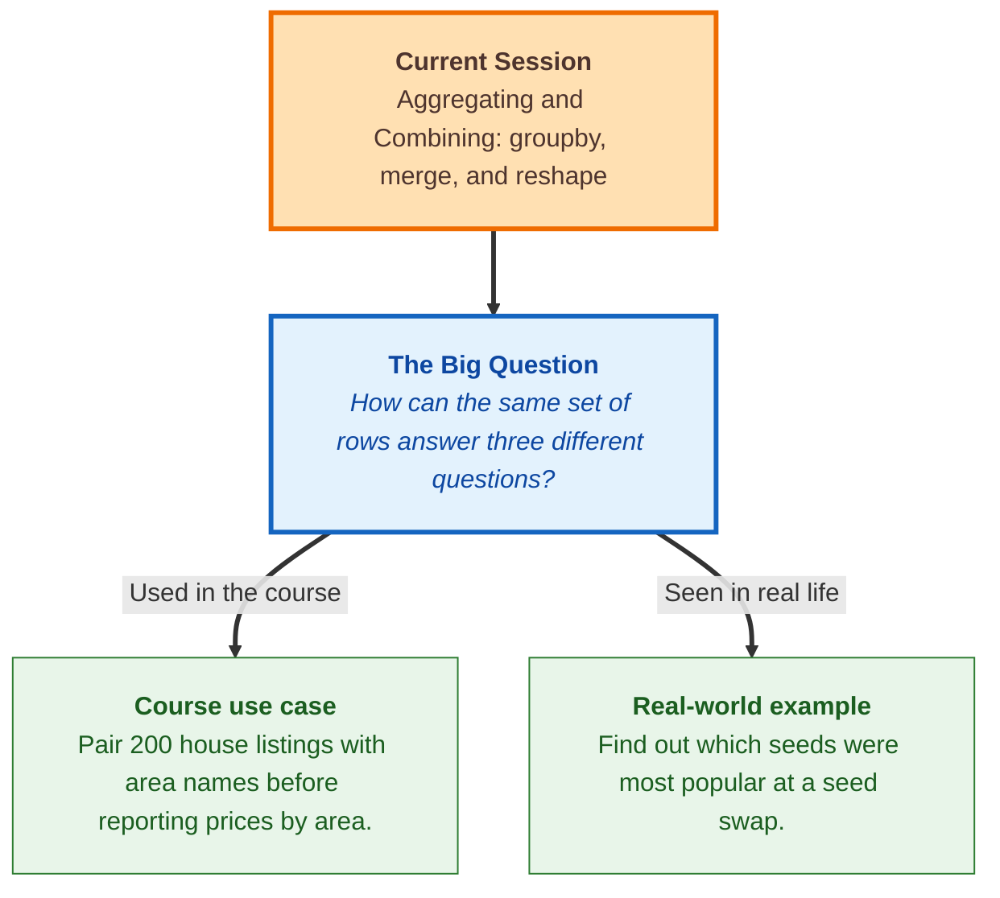

## <span style="color:#2F7DDE">Aggregating and Combining: groupby, merge, and reshape</span>

### <span style="color:#2F7DDE">Mental Map</span>



---

### <span style="color:#2F7DDE">What You'll Learn</span>

Have you ever wondered how a seed swap team knows which packets to bring more of next time?

By the end of this session, you will be able to:

- <span style="color:#D9660B">**Calculate**</span> the total packets given out for each seed code, such as B1.
- <span style="color:#D9660B">**Use**</span> the shared seed code to bring names from the seed list into the swap log.
- <span style="color:#D9660B">**Demonstrate**</span> how to show Saturday and Sunday side by side or list the days down one column.
- <span style="color:#D9660B">**Build**</span> a short report that shows one total for each named seed.

> <span style="color:#2F7DDE">**Topics you will meet:**</span> groupby, merge, reshape, Combining DataFrames.
>
> Join the session to learn each of these in detail.

---

### <span style="color:#2F7DDE">Why You Are Learning This Topic</span>

You help out at a weekend seed swap. As each tray is cleared away, a friend notes the number of packets given out. The friend uses short codes from the tray labels. Seed names live on a separate sheet. On Sunday you need to tell the team what to stock next time.

<span style="color:#D9660B">**Aggregation**</span> means turning a set of values into a summary, such as a total.

In this course, you will use those totals to answer questions that are hard to see in the original rows.

> <span style="color:#2F7DDE">**Think about it:**</span> What could go wrong if the swap log and seed list were paired by row order?

---

### <span style="color:#2F7DDE">The Seed Swap Puzzle</span>

Here is the swap log, with one row per tray counted.

| Day | Seed code | Packets given out |
|:----|:----------|------------------:|
| Saturday | B1 | 6 |
| Saturday | M2 | 4 |
| Saturday | B1 | 3 |
| Sunday | B1 | 5 |
| Sunday | M2 | 7 |

<span style="color:#D9660B">**What you want to happen:**</span>

- Add up packet counts by seed code.
- Add the names Basil and Marigold from the separate seed list.
- Compare the two days at a glance before you order more seeds.

Here is how it might start. You do not need to understand it yet.

```python
print(swap_log.groupby("seed_code")["packets"].sum())
```

> <span style="color:#D9660B">**Wonder about this:**</span>
>
> - If a seed code appears twice on Saturday, how should both rows count?
> - Which part of your table would give each day its own place?

---

### <span style="color:#2F7DDE">Think It Through</span>

There is no wrong first try. Keep your guesses for the session.

**1. Which log rows would you look at to find Saturday's total for B1?**

Hint: Look at both the day and the seed code.

**2. How could you add the seed names if the seed list came in a different order?**

Hint: Look for a detail both lists share.

**3. Where would M2's Sunday count go if the days were shown side by side?**

Hint: Think about what each row and column could stand for.

---

### <span style="color:#2F7DDE">One Question to Carry Into the Session</span>

> <span style="color:#2F7DDE">**How would you turn the log into a report that helps the team stock the next swap?**</span>
>
> What would you check before sharing the report?
