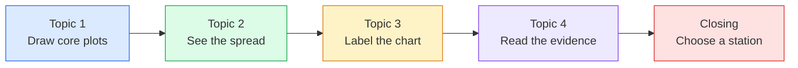
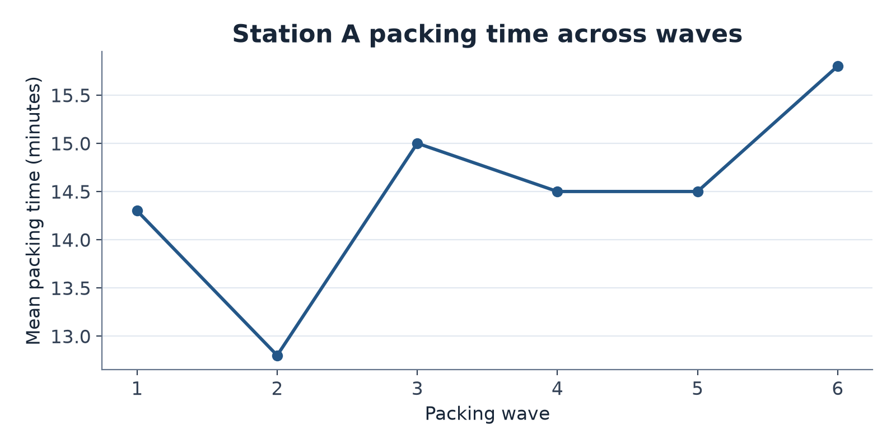
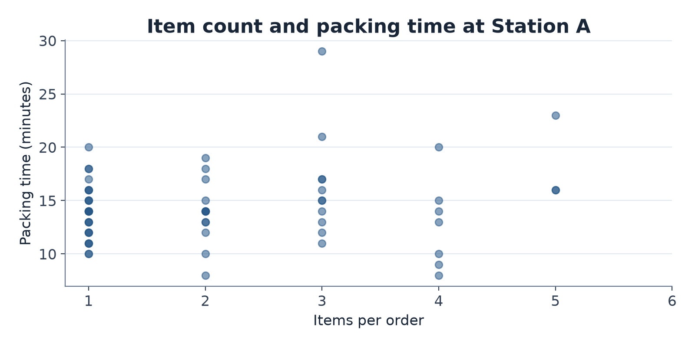
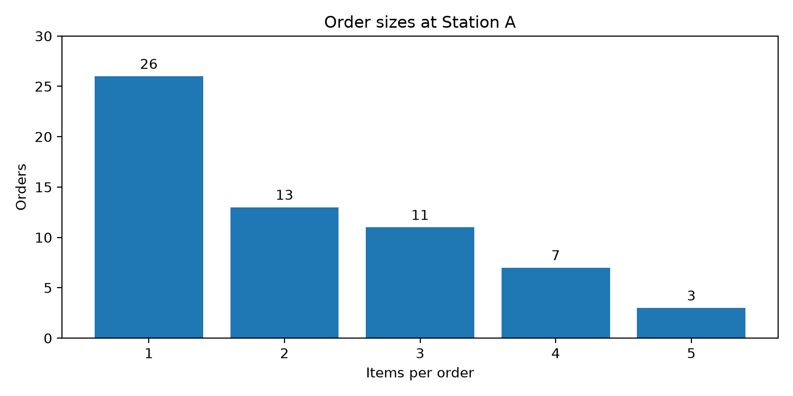
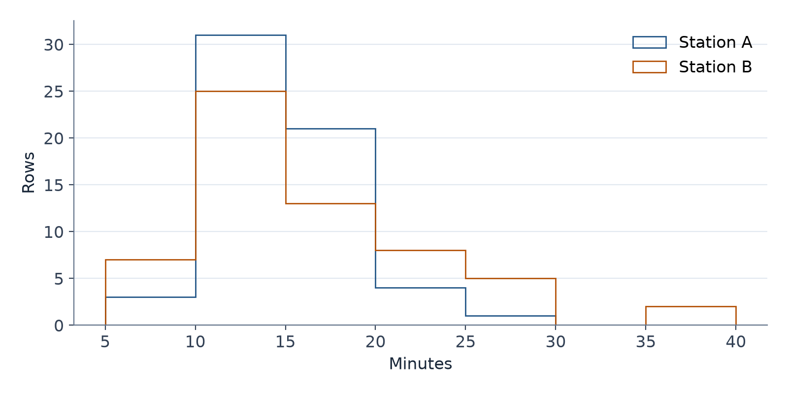
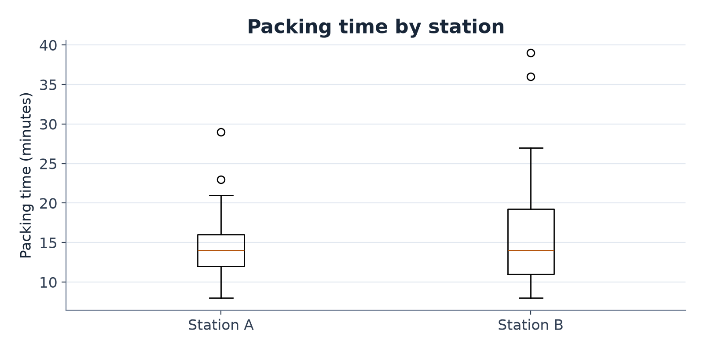
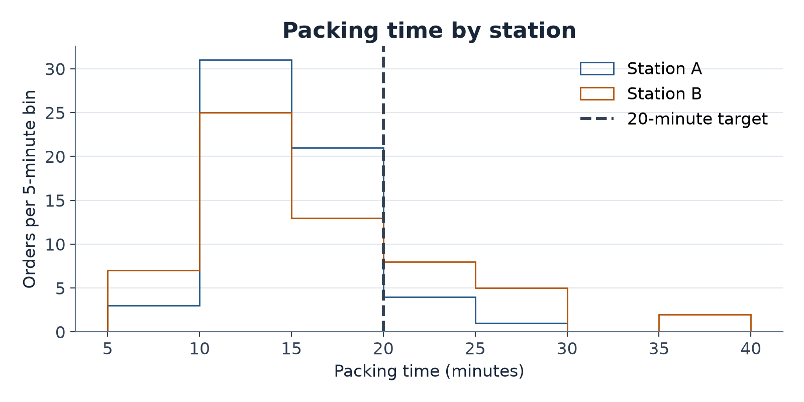
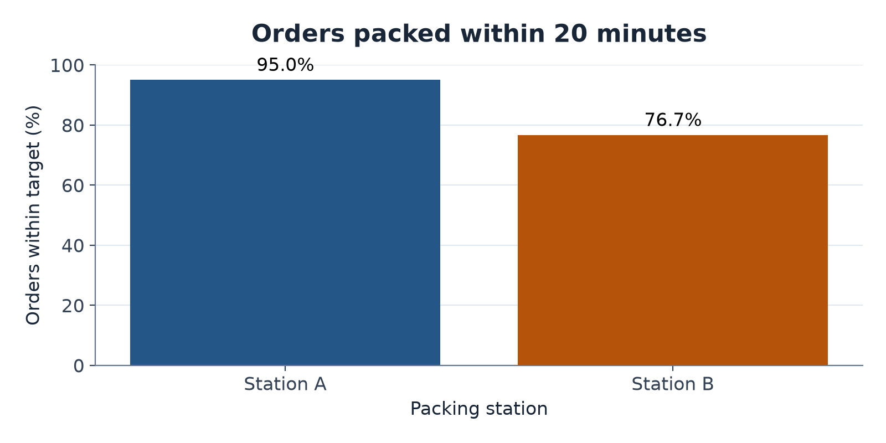

# <font color='#1d4ed8'>Lecture Script: Visualising Data I: Matplotlib and Distributions</font>

---

## <font color='blue'>Agenda</font>

The lecture runs as four topics. Each topic ends with a quiz.

| Topic | What we do | Learning objectives covered | Minutes |
|:-:|:--|:--|:-:|
| 1 | Draw line, scatter and bar plots with Matplotlib | Create core plots with Matplotlib | 26 |
| 2 | Examine distributions with histograms and boxplots | Visualise a distribution with histograms and boxplots | 36 |
| 3 | Make chart anatomy clear | Label and title a chart for clarity | 20 |
| 4 | Read the evidence and choose what to investigate | Read a chart to draw a conclusion | 28 |
| — | Closing: Outcome & Summary | | 10 |
| | **Total** | | **120** |

> <font color="red">**🎯 Instructor Note**</font> Pace Topic 1 at 8 minutes for the line, 7 for scatter, 5 for bars and plot choice, and 6 for the quiz. Use 12 minutes for each histogram and boxplot comparison in Topic 2, 6 for the bin-width variation and 6 for the quiz.
> In Topic 3 spend 14 minutes on the chart edits and 6 on the quiz. In Topic 4 spend 12 minutes reading the charts, 10 on the evidence sentence and 6 on the quiz.

---

## <font color='blue'>Scenario</font>

| What the shift lead sees | What she needs to decide |
|:--|:--|
| At a Nykaa-style warehouse, two packing stations have each logged sixty orders across six waves. The shift dashboard shows one middle packing time for each station. | The shift lead has time to investigate just one station before the next wave. Her target is to pack each order within twenty minutes. |

> <font color="red">**🎯 Instructor Note**</font> Nykaa is the setting. The 120 orders in [packing_times.csv](data/packing_times.csv) were invented for teaching.
> Run the cells in order in one notebook with inline Matplotlib plots and this folder as the working directory. The examples were checked with Python 3.12 and Matplotlib 3.11.2.

---

## <font color='blue'>Problem Statement</font>

At the end of the shift, the two stations report the same middle packing time. The lead treats them as tied and picks a station at random. If one station kept more orders waiting past the target, she could spend her only review slot in the wrong place.

> <font color='purple'>**Which station should the lead investigate first to understand why orders took more than twenty minutes to pack?**</font>

> <font color="red">**🎯 Instructor Note**</font> Ask, “If the middle times match, must the stations have the same number of orders past twenty minutes?” Give learners 30 seconds to respond in chat. Reveal the answer in the Closing.

---

## <font color='blue'>What We Will Use</font>

Each chart answers a different question about the same packing log.

| Topic | Tools | In one line |
|:-:|:--|:--|
| 1 | `plt.subplots`, `ax.plot`, `ax.scatter`, `ax.bar` | Plot a value per wave, a pair per order or a count per group. |
| 2 | `ax.hist`, `ax.boxplot` | See where values gather and how they spread. |
| 3 | `ax.set`, `ax.axvline`, `ax.legend` | Name the quantities, their units and the target. |
| 4 | Row counts and percentages | Compare how often the stations met the target. |

---

## <font color='blue'>How: Walking Through the Packing Log</font>



---

## <font color='blue'>Topic 1: Draw Line, Scatter and Bar Plots with Matplotlib</font> `26 min`

> <font color='purple'>**The dashboard combines the whole shift. How can we see how Station A's packing times changed from wave to wave?**</font>

### <font color='green'>Example: follow the waves in order</font>

> <font color='purple'>**Did the average packing time increase from the first wave to the last at Station A?**</font>

An order row has a station, a wave number, an item count and an elapsed packing time in whole minutes. A wave is a numbered batch of orders released together. The mean for a wave is the sum of its packing times divided by its number of orders. A Matplotlib Figure holds the drawing. An Axes is the plot area within the Figure. We use `ax` as the variable name for that plot area.

**Predict before running: What will happen?**

> <font color="red">**🎯 Instructor Note**</font> Ask learners to predict whether the line rises overall. Wave six is above wave one, with a rise from wave two to three and a fall into wave four.

```python
import csv
from statistics import mean
import matplotlib.pyplot as plt
with open("data/packing_times.csv", newline="", encoding="utf-8") as file:
    rows = list(csv.DictReader(file))
station_a = [row for row in rows if row["station"] == "Station A"]
wave_means = [mean(int(r["packing_minutes"]) for r in station_a if int(r["wave"]) == w) for w in range(1, 7)]
fig, ax = plt.subplots(figsize=(8, 4))
ax.plot(range(1, 7), wave_means, marker="o")
print(wave_means)
```

**Output**

```
[14.3, 12.8, 15, 14.5, 14.5, 15.8]
```

#### <font color='#c2410c'>Code Explanation</font>

- **Lines 1 to 3** Import the CSV reader, the mean function and Matplotlib.
- **Lines 4 and 5** Read the log into a list of dictionaries keyed by the column names. The CSV reader returns text, so convert numeric fields with `int` when using them as numbers.
- **Lines 6 and 7** Select Station A's rows and take the mean of its packing times for each wave from one through six.
- **Lines 8 and 9** Create a Figure and an Axes, then draw a marker at each wave mean and join the markers in wave order.
- **Line 10** Print the values used for the markers. The notebook also displays the Figure.

> <font color='green'>**Result**</font> Station A's mean went from $14.3$ minutes in wave one to $15.8$ in wave six. The line rises from wave two to wave three and falls into wave four. The saved chart adds a title and axis labels.

<p align="center"></p>

### <font color='green'>Extending it: plot one position per order</font>

> <font color='purple'>**For Station A orders with two items, did every order take the same number of minutes?**</font>

**Predict before running: What will happen?**

> <font color="red">**🎯 Instructor Note**</font> Ask learners where to look for every two-item order. Give learners 30 seconds to respond in chat. Expect several heights above the tick at two.

```python
desks = ["Station A", "Station B"]
items = [int(row["item_count"]) for row in station_a]
times_a = [int(row["packing_minutes"]) for row in station_a]
fig, ax = plt.subplots(figsize=(8, 4))
ax.scatter(items, times_a, alpha=0.55)
ax.set(xlabel="Items per order", ylabel="Packing time (minutes)")
two_item_times = [t for n, t in zip(items, times_a) if n == 2]
print("Two-item range (min):", min(two_item_times), "to", max(two_item_times))
```

**Output**

```
Two-item range (min): 8 to 19
```

#### <font color='#c2410c'>Code Explanation</font>

- **Line 1** Keep the station names in a fixed order for comparison.
- **Lines 2 and 3** Read the item counts and the elapsed times from Station A's rows in matching order.
- **Lines 4 to 6** Draw one mark per order and label the axes. Partial transparency helps reveal overlapping marks.
- **Lines 7 and 8** Pair each item count with its time, then check the smallest and largest time for orders with two items.

> <font color='green'>**Result**</font> Two-item orders took different amounts of time. Identical pairs share a position, so counting visible dots can undercount orders.

<p align="center"></p>

### <font color='green'>Extending it: count orders in each item-count group</font>

> <font color='purple'>**How can we show how many Station A orders had each item count, including orders whose dots covered one another?**</font>

**Predict before running: What will happen?**

> <font color="red">**🎯 Instructor Note**</font> Ask whether two-item orders make the tallest bar. The one-item group is largest, with twenty-six orders.

```python
sizes = sorted(set(items))
size_counts = [items.count(size) for size in sizes]
fig, ax = plt.subplots(figsize=(8, 4))
bars = ax.bar(sizes, size_counts)
ax.set(title="Order sizes at Station A", xlabel="Items per order",
       ylabel="Orders", xticks=sizes, ylim=(0, 30))
ax.bar_label(bars, labels=[str(count) for count in size_counts], padding=3)
print(size_counts)
```

**Output**

```
[26, 13, 11, 7, 3]
```

#### <font color='#c2410c'>Code Explanation</font>

- **Lines 1 and 2** Find the observed item counts in order and count how many orders had each size.
- **Lines 3 to 6** Draw one bar per size. Each bar starts at zero and its height is the count for that group. The vertical scale leaves space for the labels.
- **Lines 7 and 8** Convert the counts to text and use `bar_label` to place them above the bars. Print the counts beneath the cell too.

> <font color='green'>**Result**</font> Station A had $26$ one-item orders and $13$ two-item orders. Use bars to compare one count per group, a line to follow ordered waves and a scatter plot to examine pairs of measurements.

<p align="center"></p>

### <font color='purple'>Quiz 1</font>

**Question:** The lead wants to put each order's item count on the horizontal axis and its packing time on the vertical axis. Which call draws one marker per pair without joining the orders?

**Options:**

- A) `ax.plot(items, times_a)`
- B) `ax.scatter(items, times_a)`
- C) `ax.scatter(times_a, items)`
- D) `ax.bar(items, times_a)`

**Correct Answer:** B

**Explanation:**

- **A)** `plot` draws a line through the pairs in order with its default style.
- **B)** `scatter` places a marker at each matching item count and packing time.
- **C)** This puts time on the horizontal axis and item count on the vertical axis.
- **D)** This draws bars from zero with packing time as their height. Orders with the same item count can draw bars over one another.

---

## <font color='blue'>Topic 2: Examine Distributions with Histograms and Boxplots</font> `36 min`

> <font color='purple'>**The scatter plot shows that packing times vary even among two-item orders. Where do all the times bunch up at each station, and how far do they spread?**</font>

### <font color='green'>Example: count orders in five-minute bins</font>

> <font color='purple'>**Which time range contains the most orders at each station?**</font>

A distribution describes where the values gather and how they spread. A histogram sorts a numeric measure into ranges called bins. We use equal-width bins and count orders in each one. The bin from $15$ to $20$ minutes includes $15$ and ends just before $20$. Matplotlib includes both ends of the final bin.

**Predict before running: What will happen?**

> <font color="red">**🎯 Instructor Note**</font> Ask learners to assign a twenty-minute order to a bin before running. It belongs in the $20$-to-$25$ bin.

```python
times_b = [int(r["packing_minutes"]) for r in rows if r["station"] == desks[1]]
times_by_station = [times_a, times_b]
bins = list(range(5, 41, 5))
fig, ax = plt.subplots(figsize=(8, 4))
for station, times in zip(desks, times_by_station):
    counts, _, _ = ax.hist(times, bins=bins, histtype="step", label=station)
    print(station, counts.astype(int).tolist())
ax.set(xlabel="Minutes", ylabel="Rows", xticks=bins)
ax.legend()
```

**Output**

```
Station A [3, 31, 21, 4, 1, 0, 0]
Station B [7, 25, 13, 8, 5, 0, 2]
```

#### <font color='#c2410c'>Code Explanation</font>

- **Lines 1 and 2** Collect Station B's times and keep both lists in station order.
- **Line 3** Give both stations identical bin edges from $5$ through $40$ minutes.
- **Lines 4 to 7** Draw each histogram as an outline so both stay visible. `hist` returns counts, edges and drawn objects. Here we keep the counts and print them as whole numbers.
- **Lines 8 and 9** Label the two axes, mark each bin edge and identify the two outlines with a legend.

> <font color='green'>**Result**</font> Both stations have their highest count from $10$ up to $15$ minutes. Station B alone has orders in the final $35$-to-$40$ bin.

<p align="center"></p>

### <font color='green'>Extending it: narrow the bins</font>

> <font color='purple'>**How many Station B orders took exactly twenty minutes, and how many took twenty-one through twenty-four minutes?**</font>

**Predict before running: What will happen?**

> <font color="red">**🎯 Instructor Note**</font> First ask learners to read the $20$-to-$25$ bin aloud. The original height is eight and combines several whole-minute values.

```python
minute_edges = list(range(5, 41))
fig, ax = plt.subplots(figsize=(8, 4))
counts_b, edges_b, _ = ax.hist(times_b, bins=minute_edges)
ax.set(xlabel="Packing time (minutes)", ylabel="Orders")
for left, count in zip(edges_b, counts_b):
    if 20 <= left < 25:
        print(int(left), int(count))
```

**Output**

```
20 1
21 0
22 4
23 1
24 2
```

#### <font color='#c2410c'>Code Explanation</font>

- **Lines 1 to 4** Make one-minute bins, draw a histogram for Station B and label the axes. For these whole-minute records, a bin starting at twenty contains times of exactly twenty.
- **Lines 5 to 7** Pair each left edge with its count and print the bins starting from twenty through twenty-four minutes.

> <font color='green'>**Result**</font> The original height of $8$ combines $1$ order at exactly twenty minutes and $7$ orders from twenty-one to twenty-four. The narrower bins reveal where the orders fall within that range.

> <font color='#b45309'>**Common mistake**</font> Comparing different bin widths or edges can alter the appearance of a distribution. Use the same edges when comparing stations.

### <font color='green'>Extending it: compare the middle and spread with boxplots</font>

> <font color='purple'>**Do the stations also look alike when we compare the middle half and the flagged points?**</font>

The line inside a box marks the median, the middle of the sorted values. With an even number of values, it averages the two middle values. The box runs from the first quartile $Q_1$ (the 25th percentile) to the third quartile $Q_3$ (the 75th percentile), marking the middle half by rank. A quartile can land between two recorded times, so a box edge can be fractional. The box length is the interquartile range.

$$\boxed{\mathrm{IQR} = Q_3-Q_1}$$

For this default boxplot, each whisker extends to the outermost observed value on its side within $1.5 \times \mathrm{IQR}$ of the adjacent box edge. Points beyond those whiskers are shown separately. They are observations to inspect.

**Predict before running: What will happen?**

> <font color="red">**🎯 Instructor Note**</font> Ask whether the median lines will line up and which station will have a wider box. Give learners 30 seconds to respond in chat. Both medians are fourteen minutes and Station B's box is wider.

```python
fig, ax = plt.subplots(figsize=(8, 4))
box = ax.boxplot(times_by_station)
ax.set_xticks([1, 2], desks)
ax.set(ylabel="Packing time (minutes)", title="Packing time by station")
for station, mid, dots in zip(desks, box["medians"], box["fliers"]):
    print(station, "median:", float(mid.get_ydata()[0]), "flagged:", sorted(dots.get_ydata().tolist()))
```

**Output**

```
Station A median: 14.0 flagged: [23, 29]
Station B median: 14.0 flagged: [36, 39]
```

#### <font color='#c2410c'>Code Explanation</font>

- **Lines 1 and 2** Draw one box per list of times. `box` also holds the drawn median lines and the marks beyond the whiskers, called fliers.
- **Lines 3 and 4** Match the station names to the box positions and say what the vertical axis measures.
- **Lines 5 and 6** Read the height of each median line and the values of the dots from the plotted objects.

> <font color='green'>**Result**</font> Both median lines sit at $14$ minutes. Read the box edges next. Station A's IQR is $16 - 12 = 4$ minutes, and Station B's is $19.25 - 11 = 8.25$ minutes. Station B has the wider box and the higher flagged values.

<p align="center"></p>

### <font color='purple'>Quiz 2</font>

**Question:** An order took exactly $20$ minutes. In the five-minute histogram, which bin includes that order?

**Options:**

- A) $15$ up to $20$ minutes
- B) Both bins that meet at $20$
- C) $20$ up to $25$ minutes
- D) Neither bin, because the time falls on a boundary

**Correct Answer:** C

**Explanation:**

- **A)** The bin that starts at $15$ excludes its right edge.
- **B)** Each observation belongs to one bin.
- **C)** The bin that starts at $20$ includes its left edge.
- **D)** An interior edge value is included in the bin that starts there.

---

## <font color='blue'>Topic 3: Make Chart Anatomy Clear</font> `20 min`

> <font color='purple'>**The two outlines show how packing times spread. Could someone reading the chart on its own tell what was measured and counted?**</font>

### <font color='green'>Example: replace vague labels with quantities and units</font>

> <font color='purple'>**How can we name the chart and its axes so the shift lead can read a bin without opening the CSV?**</font>

The title states what is being compared. The horizontal axis gives the measurement and its unit. The vertical axis states what the height counts. Tick labels mark the scale. The legend identifies the two outlines.

**Predict before running: What will happen?**

> <font color="red">**🎯 Instructor Note**</font> Let pairs draft a title and both axis labels before showing the code. Expect packing minutes on the horizontal axis and orders per bin on the vertical axis.

```python
fig, ax = plt.subplots(figsize=(8, 4))
for station, times in zip(desks, times_by_station):
    ax.hist(times, bins=bins, histtype="step", label=station)
ax.set(title="Packing time by station", xlabel="Packing time (minutes)",
       ylabel="Orders per 5-minute bin", xticks=bins)
ax.legend()
print(ax.get_title(), ax.get_xlabel(), ax.get_ylabel(), sep="\n")
```

**Output**

```
Packing time by station
Packing time (minutes)
Orders per 5-minute bin
```

#### <font color='#c2410c'>Code Explanation</font>

- **Lines 1 to 3** Rebuild the chart with the same data and edges.
- **Lines 4 and 5** Set the title, axis labels and tick positions. Each height counts orders over a five-minute range.
- **Lines 6 and 7** Show the station names in a legend and print the text the reader sees.

> <font color='green'>**Result**</font> The title and axis labels identify the comparison, the time unit and the unit of each bin height.

### <font color='green'>Extending it: identify the target on the chart</font>

> <font color='purple'>**Where can the reader see the twenty-minute target on the histogram?**</font>

**Predict before running: What will happen?**

> <font color="red">**🎯 Instructor Note**</font> Ask where the dashed line will appear. It belongs at twenty on the time axis, and its name should appear alongside the two station names.

```python
ax.axvline(20, color="#334155", linestyle="--", label="20-minute target")
legend = ax.legend()
print([label.get_text() for label in legend.get_texts()])
fig
```

**Output**

```
['Station A', 'Station B', '20-minute target']
```

#### <font color='#c2410c'>Code Explanation</font>

- **Line 1** Draw a dashed vertical line at twenty minutes and give it a label.
- **Lines 2 and 3** Refresh the legend and print the names it contains.
- **Line 4** Display the updated Figure in the notebook.

> <font color='green'>**Result**</font> The target is easy to locate on the horizontal scale. The dashed line has a legend entry so readers can distinguish it from the station outlines.

<p align="center"></p>

### <font color='purple'>Quiz 3</font>

**Question:** Which title and axis labels let a reader interpret the five-minute histogram without seeing the data table?

**Options:**

- A) Packing time by station / Packing time (minutes) / Orders per 5-minute bin
- B) Packing time by station / Orders / Packing time (minutes)
- C) Packing time by station / Packing time / Values
- D) Packing time by station / Packing time (minutes) / Percentage of orders

**Correct Answer:** A

**Explanation:**

- **A)** The title names the comparison. The axes give the time unit and the count represented by a bin height.
- **B)** This swaps the horizontal measure and the vertical count.
- **C)** The horizontal label omits minutes and the vertical label leaves the count ambiguous.
- **D)** The vertical scale shows raw counts. A percentage would require dividing by the station total.

---

## <font color='blue'>Topic 4: Read the Evidence and Choose What to Investigate</font> `28 min`

> <font color='purple'>**The dashed line marks the target. Can we use the chart and the rows together to decide which station needs attention first?**</font>

### <font color='green'>Example: check the chart against the exact target</font>

> <font color='purple'>**Which station missed the twenty-minute target more often among the logged orders?**</font>

Read the title, units and legend first. Both stations peak in the same five-minute bin. Station B has more orders in the bins starting at $25$ minutes or later and a longer observed upper end. Read the $20$-to-$25$ bin carefully. Orders at exactly $20$ minutes meet the target and share that bin with orders that took longer. The rows give the exact count.

$$\boxed{\text{Percentage within target} = 100 \times \frac{\text{orders taking } t \le 20\text{ minutes}}{\text{orders at that station}}}$$

Here $t$ is an order's packing time in minutes. We use the station's own total as the denominator.

**Predict before running: What will happen?**

> <font color="red">**🎯 Instructor Note**</font> Ask learners to circle the mixed bin and decide whether an order logged at twenty minutes meets the target. It does.

```python
within = [sum(t <= 20 for t in times) for times in times_by_station]
totals = [len(times) for times in times_by_station]
percentages = [100 * count / total for count, total in zip(within, totals)]
for station, count, total, percent in zip(desks, within, totals, percentages):
    print(f"{station}: {count}/{total} within target ({percent:.1f}%), {total - count} over")
```

**Output**

```
Station A: 57/60 within target (95.0%), 3 over
Station B: 46/60 within target (76.7%), 14 over
```

#### <font color='#c2410c'>Code Explanation</font>

- **Line 1** Count orders at or below the target for each station. Each true comparison contributes one.
- **Lines 2 and 3** Count the orders at each station and turn the within-target counts into percentages.
- **Lines 4 and 5** Print the count, the total, the percentage rounded for display and the number of orders over the target.

> <font color='green'>**Result**</font> Station B had $14$ of $60$ orders over the target. Station A had $3$ of $60$ over the target.

### <font color='green'>Extending it: write a conclusion the data can support</font>

> <font color='purple'>**What can the shift lead say in one sentence, and what would she still need to investigate?**</font>

> <font color="red">**🎯 Instructor Note**</font> Ask learners to include the threshold, both counts and the scope of the comparison. Give learners 30 seconds to respond in chat.

#### <font color='#c2410c'>Logic Explanation</font>

- The boxplots show the same median. That describes the centre and leaves the frequency of misses open.
- The histogram shows a longer upper end at Station B. The row count confirms the difference at the actual target.
- The log covers six waves. Finding a cause would require checking what happened on the orders that ran long.

> <font color='green'>**Result**</font> In the six logged waves, $14$ Station B orders and $3$ Station A orders took more than twenty minutes, out of $60$ at each station. Start the investigation at Station B.

### <font color='purple'>Quiz 4</font>

**Question:** Which sentence is supported by both the charts and the exact counts?

**Options:**

- A) The stations missed the target equally often because both medians were fourteen minutes.
- B) Eight orders at Station B missed the target because eight appear in its $20$-to-$25$ bin.
- C) The charts show that staffing caused Station B's longer packing times.
- D) In the logged waves, Station B had more orders over twenty minutes than Station A, with fourteen versus three out of sixty at each station.

**Correct Answer:** D

**Explanation:**

- **A)** A shared median gives a shared centre. The counts above twenty minutes differ.
- **B)** The bin includes a twenty-minute order that met the target, and later bins contain more late orders.
- **C)** The log measures elapsed times here and gives no evidence that staffing caused the difference.
- **D)** The sentence uses the exact threshold counts and stays within the observed waves.

---

## <font color='blue'>Closing: Outcome & Summary</font> `10 min`

The shift lead can choose where to review first and show the reason on one chart.

> <font color='purple'>**1. Which plot gives each station one mark, and what did the distribution plots add?**</font>

A bar chart gives each station one bar for its percentage of orders within the target. The histograms and boxplots explain why that comparison is worth making. The medians match, and Station B has the longer upper tail.

> <font color='purple'>**2. Which labels let the next shift read the bars, and what does the comparison support?**</font>

**Predict before running: What will happen?**

> <font color="red">**🎯 Instructor Note**</font> Ask learners to predict the shorter bar and which axis should show percentages. Expect a shorter Station B bar and percentages on the vertical axis.

```python
fig, ax = plt.subplots(figsize=(8, 4))
bars = ax.bar(desks, percentages, color=["#245788", "#b45309"])
ax.set(title="Orders packed within 20 minutes", xlabel="Packing station",
       ylabel="Orders within target (%)", ylim=(0, 100))
labels = [f"{value:.1f}%" for value in percentages]
ax.bar_label(bars, labels=labels, padding=3)
print(labels)
```

**Output**

```
['95.0%', '76.7%']
```

#### <font color='#c2410c'>Code Explanation</font>

- **Lines 1 and 2** Reuse the Figure and Axes pattern to draw a bar for each station (Topic 1).
- **Lines 3 and 4** State the target, label the axes and set the percentage scale from zero to one hundred (Topic 3).
- **Lines 5 to 7** Use the percentage rounding from Topic 4 and place the labels above the bars as in Topic 1. Print the same labels beneath the cell. Station B has the lower within-target share.

<p align="center"></p>

### <font color='green'>Outcome</font>

| Measure | Station A | Station B |
|:--|:-:|:-:|
| Median packing time | $14$ minutes | $14$ minutes |
| Orders within $20$ minutes | $57/60$ ($95.0\%$) | $46/60$ ($76.7\%$) |
| Orders over $20$ minutes | $3/60$ | $14/60$ |

> <font color='green'>**Therefore,**</font> the lead should investigate Station B first. More of its logged orders went past the target. The time records help choose where to look for a cause.

> <font color="red">**🎯 Instructor Note**</font> Reveal the opening poll answer next to the table. The medians match at fourteen minutes. The numbers above twenty minutes differ.

### <font color='green'>Summary</font>

| Learning objective | Takeaway |
|:--|:--|
| Core plots with Matplotlib | Draw a line for wave order, a scatter plot for paired measurements and bars for one value per station. |
| Histograms and boxplots | Use shared histogram bins to compare frequencies. Use boxplots to compare medians, middle spread and flagged values. |
| Chart titles and labels | State the comparison, name the axis quantities with units, and identify the plotted groups and reference marks. |
| Conclusions from charts | Read the chart's centre and spread, check the boundary on the original rows and describe the comparison within the observed data. |
| **Practical value** | A clear chart and an exact target count help a team decide which station to review first. |

---

# <font color='red'>Launch the Feedback Poll</font>

> <font color="red">**🎯 Instructor Note**</font> Reminder: launch the feedback poll now to collect learner feedback.
