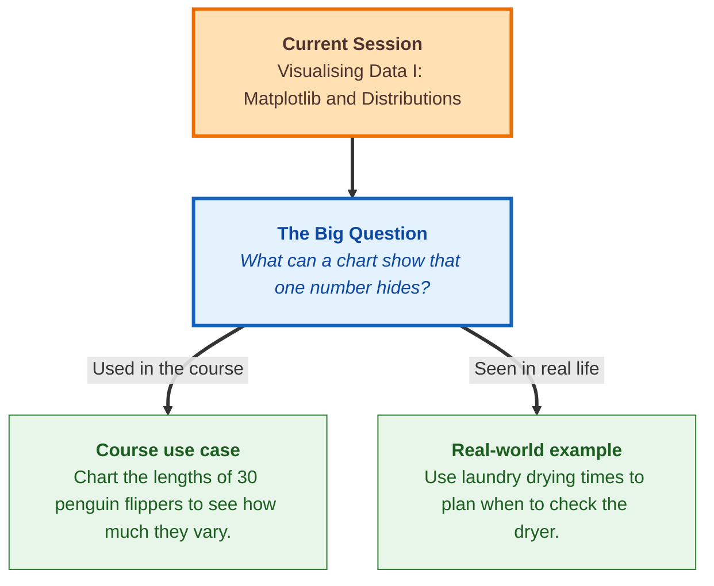

## <span style="color:#2F7DDE">Visualising Data I: Matplotlib and Distributions</span>

### <span style="color:#2F7DDE">Mental Map</span>



---

### <span style="color:#2F7DDE">What You'll Learn</span>

Have you ever wondered when to check the dryer so you can start folding your laundry?

By the end of this session, you will be able to:

- <span style="color:#D9660B">**Interpret**</span> a chart of the six loads to suggest when to check the dryer.
- <span style="color:#D9660B">**Apply**</span> clear titles and labels with units to charts of the six drying times.
- <span style="color:#D9660B">**Build**</span> a bar chart by load and a line chart of drying times in load order.
- <span style="color:#D9660B">**Design**</span> two charts of drying times, one for counts by range and one for the middle and spread.

> <span style="color:#2F7DDE">**Topics you will meet:**</span> Matplotlib, Distributions, Histograms, Chart Anatomy.
>
> Join the session to learn each of these in detail.

---

### <span style="color:#2F7DDE">Why You Are Learning This Topic</span>

You share a dryer at home. Your housemate has a load ready to go after yours. You want to tell them when the dryer might be free. You check the times you wrote down for your last six loads. Now you need a way to show what those times have in common and how they differ.

A <span style="color:#D9660B">**distribution**</span> means how often values occur and how spread out they are.

In this course, you will use charts to spot patterns before you make a claim about data.

> <span style="color:#2F7DDE">**Think about it:**</span> What might your housemate miss if you text them one time for all six loads?

---

### <span style="color:#2F7DDE">The Laundry Timer Puzzle</span>

Here are six loads from your laundry notes, in the order you dried them.

| Load | Drying time (minutes) |
|:---|---:|
| T-shirts | 31 |
| Towels | 34 |
| Pillowcases | 33 |
| Jeans | 48 |
| Bedsheets | 35 |
| Gym clothes | 32 |

<span style="color:#D9660B">**What you want to happen:**</span>

- See how long each load took.
- See where the times bunch up and how far they spread.
- Share a chart your housemate can read without seeing your notes.

Here is how it might start. You do not need to understand it yet.

```python
import matplotlib.pyplot as plt
plt.hist([31, 34, 33, 48, 35, 32], bins=[30, 35, 40, 45, 50])
plt.show()
```

> <span style="color:#D9660B">**Wonder about this:**</span>
>
> - What would a chart of counts by time range tell you about the six loads?
> - What would you check in a chart that shows the middle and spread of the times?

---

### <span style="color:#2F7DDE">Think It Through</span>

There is no wrong first try. Keep your guesses for the session.

**1. How would you show whether drying time rose or fell from one load to the next?**

Hint: Start with the order in the table.

**2. What would you label so your housemate knows what the counts and times mean?**

Hint: Think about what each side of the chart measures.

**3. What check-in time would you suggest based on these six loads?**

Hint: Think about whether one time would work for every load.

---

### <span style="color:#2F7DDE">One Question to Carry Into the Session</span>

> <span style="color:#2F7DDE">**How could your chart help your housemate decide when to check the dryer?**</span>
>
> What would you want to measure before you use it to plan a full week of laundry?
