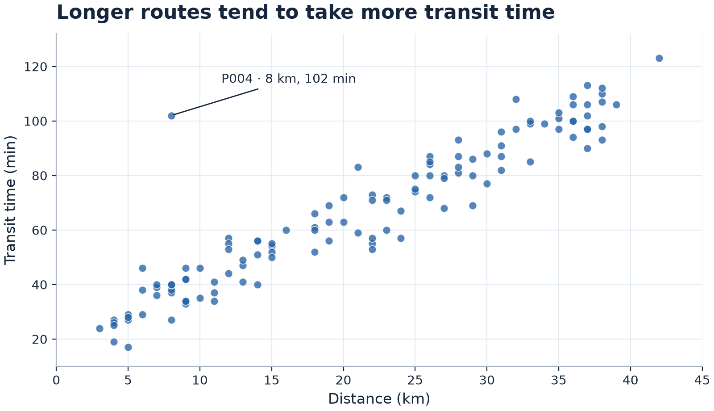
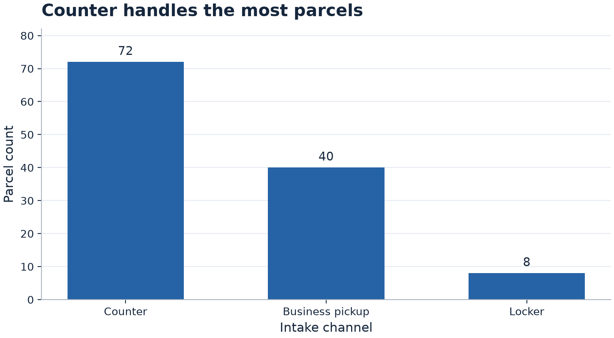
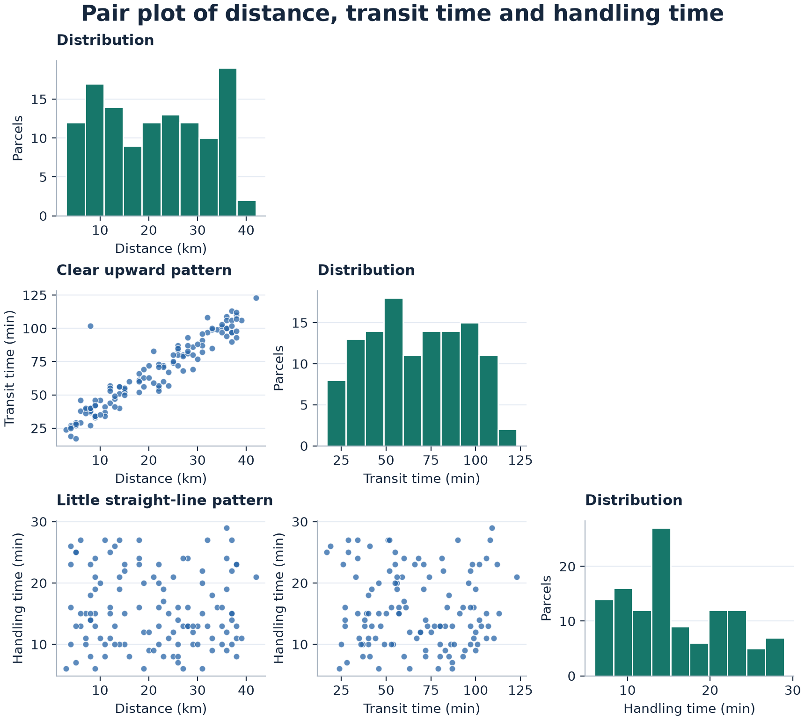
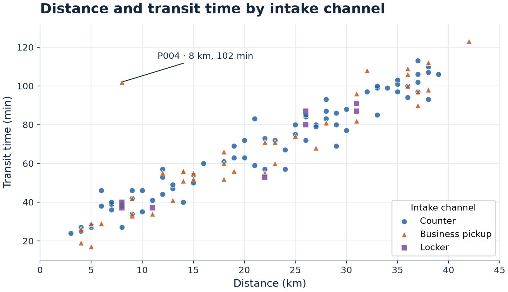
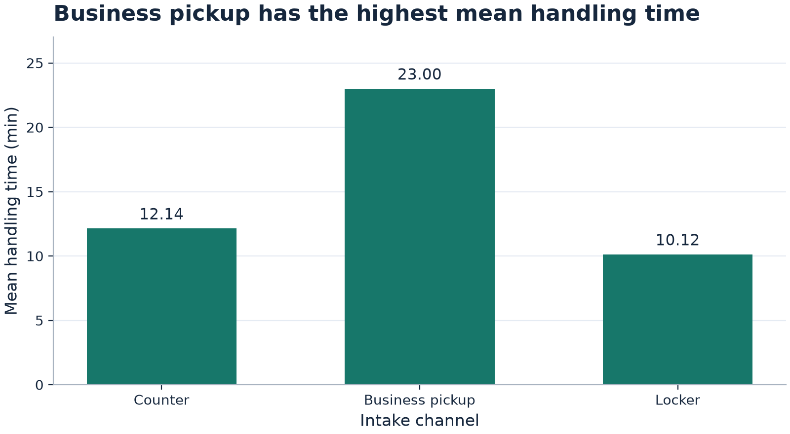
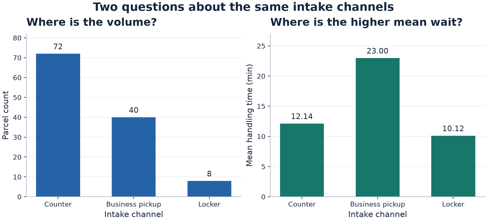

# <font color='#1d4ed8'>Lecture Script: Visualising Data II: Seaborn for Relationships and Categories</font>

---

## <font color='blue'>Agenda</font>

The lecture runs as four topics. Each topic ends with a quiz.

| Topic | What we do | Learning objectives covered | Minutes |
|:-:|:--|:--|:-:|
| 1 | Seaborn | Use Seaborn for relationship and category plots | 24 |
| 2 | Relationships | Plot correlations with scatter and pair plots | 32 |
| 3 | Categorical Plots | Compare categories with bar and count plots | 32 |
| 4 | Chart selection | Choose a chart that fits the question | 20 |
| — | Closing: Outcome & Summary | | 12 |
| | **Total** | | **120** |

> <font color="red">**🎯 Instructor Note**</font> Keep the first two Seaborn calls short. Give learners more time to read the pair grid in Topic 2 and explain the two vertical scales in Topic 3.

---

## <font color='blue'>Scenario</font>

Asha opens the dispatch log at a Blue Dart-style parcel depot. Parcels come in through a counter, a business pickup service or a locker. The log records distance to the drop-off address, handling time from the depot scan to loading, and transit time from loading to delivery. In Asha's review, “wait before loading” means the whole scan-to-loading interval, including time spent handling the parcel.

> <font color="red">**🎯 Instructor Note**</font> Blue Dart is the setting. The 120 parcel records in [parcel_dispatch.csv](data/parcel_dispatch.csv) were invented for teaching.
> Run the cells in order in a Python notebook with this folder as its working directory. Check that pandas, Matplotlib and Seaborn 0.13.2 import before the demo. The embedded Matplotlib figures use the same CSV and include labels for discussion.

---

## <font color='blue'>Problem Statement</font>

At the morning review, Asha sees that the counter handled the most parcels. She sends the team there to investigate long waits, and the team misses the channel with the longest average wait. A dispatcher also flags a short route that took unusually long.

> <font color='purple'>**How can Asha show how transit time varies with distance, which channel handled the most parcels, and where parcels spent the most time before loading on average?**</font>

> <font color="red">**🎯 Instructor Note**</font> Poll the room. Can the busiest channel and the channel with the highest average wait be different? Give learners 30 seconds to respond in chat. Reveal the answer in the Closing.

---

## <font color='blue'>What We Will Use</font>

Seaborn reads columns from a pandas table and draws plots with Matplotlib.

| Topic | Tools | In one line |
|:-:|:--|:--|
| 1 | `read_csv`, `sns.scatterplot`, `sns.countplot` | Load the parcel log and map columns to a chart. |
| 2 | `sns.pairplot`, `corr`, `hue`, `style` | Scan relationships, measure linear association and identify channel groups. |
| 3 | `sns.barplot`, `sns.countplot` | Draw a mean or a row count for each channel. |
| 4 | Question, column types, vertical-axis units | Choose a plot and check what its marks represent. |

---

## <font color='blue'>How: Walking Through the Dispatch Log</font>


---

## <font color='blue'>Topic 1: Seaborn</font> `24 min`

> <font color='purple'>**What must each row tell us to compare how far a parcel travelled and how long it took?**</font>

### <font color='green'>Example: map distance and transit time to two axes</font>

> <font color='purple'>**If two parcels travel the same distance, can their dots land at different heights?**</font>

**Predict before running: What will happen?**

> <font color="red">**🎯 Instructor Note**</font> Expect $120$ rows. Have learners identify the first parcel's channel and the two measurements that will place its dot.

```python
import pandas as pd
parcels = pd.read_csv("data/parcel_dispatch.csv")
channels = ["Counter", "Business pickup", "Locker"]
first = parcels.iloc[0]
print(f"{len(parcels)} parcels")
print(f"{first['parcel_id']} | {first['channel']} | {first['distance_km']} km | {first['transit_min']} min in transit")
```

**Output**

```
120 parcels
P001 | Counter | 12 km | 44 min in transit
```

#### <font color='#c2410c'>Code Explanation</font>

- **Lines 1–2** Import pandas as `pd` and load the CSV as a table with one row per parcel.
- **Line 3** Sets a consistent display order for the intake channels.
- **Lines 4–6** Select the first row and print the row count and key details.

Each parcel contributes one point. For P001, the horizontal position is $12$ km and the vertical position is $44$ minutes in transit. Parcels with identical coordinates can overlap.

**Predict before running: What will happen?**

> <font color="red">**🎯 Instructor Note**</font> P001 and P002 share the $12$ km horizontal position. Ask learners to point to where the $44$- and $57$-minute parcels would appear.

```python
import seaborn as sns
import matplotlib.pyplot as plt
sns.set_theme(style="whitegrid")
fig, ax = plt.subplots(figsize=(8, 4.6), layout="constrained")
sns.scatterplot(data=parcels, x="distance_km", y="transit_min", alpha=0.8, ax=ax)
ax.set(xlabel="Distance (km)", ylabel="Transit time (min)", title="Distance and transit time")
plt.show()
```

**Output**

A scatter plot. Use the reference figure to read the positions.

#### <font color='#c2410c'>Code Explanation</font>

- **Lines 1–3** Load the plotting libraries and set a light grid.
- **Line 4** Makes one set of axes for the chart.
- **Line 5** Uses distance for horizontal position and transit time for height. Partial transparency helps reveal overlapping marks.
- **Lines 6–7** Add readable labels and display the chart.

> <font color='green'>**Result**</font> The cloud rises overall. Two parcels at the same distance can still take different times.

<p align="center"></p>

### <font color='green'>Extending it: put intake channels on the axis</font>

> <font color='purple'>**What would the height represent if the only input column were the intake channel?**</font>

**Predict before running: What will happen?**

> <font color="red">**🎯 Instructor Note**</font> Ask which quantity could be built from category labels alone. Expect a parcel count for each channel.

```python
fig, ax = plt.subplots(figsize=(8, 4.4), layout="constrained")
sns.countplot(data=parcels, x="channel", order=channels, color="#2563a6", ax=ax)
ax.set(xlabel="Intake channel", ylabel="Parcel count", title="Parcels by intake channel")
plt.show()
```

**Output**

A count plot. The reference figure shows the number of parcels per channel.

#### <font color='#c2410c'>Code Explanation</font>

- **Lines 1–2** Start a fresh chart. `countplot` counts the rows with each label and places those labels in the specified order.
- **Lines 3–4** Name the vertical quantity and display the chart.

<p align="center"></p>

> <font color='green'>**Result**</font> Counter handled the most parcels in the log. The chart uses one categorical column and counts its rows.

### <font color='purple'>Quiz 1</font>

**Question:** Which calls give one dot per parcel for distance and transit time, plus one count bar per channel? Assume both calls use `data=parcels`.

**Options:**

- A) `scatterplot(x="channel", y="transit_min")` and `countplot(x="channel")`
- B) `scatterplot(x="distance_km", y="transit_min")` and `countplot(x="channel")`
- C) `scatterplot(x="distance_km", y="handling_min")` and `countplot(x="channel")`
- D) `scatterplot(x="distance_km", y="transit_min")` and `countplot(x="distance_km")`

**Correct Answer:** B

**Explanation:**

- **A)** The dots use the channel as their horizontal position, so they leave out distance.
- **B)** The dots use both requested measurements, and the bars count parcels by channel.
- **C)** The dots show time before loading, while the question asks for transit time.
- **D)** The dots answer the relationship question. The bars count rows at each recorded distance.

---

## <font color='blue'>Topic 2: Relationships</font> `32 min`

> <font color='purple'>**Distance and transit time rose together in the first scatter plot. Does handling time rise with distance too?**</font>

### <font color='green'>Example: compare three measured columns in a pair grid</font>

> <font color='purple'>**Which panel answers the question about handling time and distance?**</font>

**Predict before running: What will happen?**

> <font color="red">**🎯 Instructor Note**</font> Ask learners to sketch the three diagonal histograms. To compare handling with distance, point to the scatter panel in the handling row and distance column.

```python
measures = ["distance_km", "transit_min", "handling_min"]
grid = sns.pairplot(parcels, vars=measures, corner=True, diag_kind="hist",
                    height=2.7, plot_kws={"alpha": 0.75}, diag_kws={"bins": 10})
grid.figure.suptitle("Pairwise relationships in the dispatch log", y=0.99)
grid.figure.subplots_adjust(top=0.92)
plt.show()
```

**Output**

A pair grid with three scatter panels and three diagonal histograms. Use the reference figure to compare the shapes.

#### <font color='#c2410c'>Code Explanation</font>

- **Line 1** Names the three measurements.
- **Lines 2–3** Plot each pair once. For each scatter panel, the column supplies the horizontal variable and the row supplies the vertical variable. Each diagonal histogram counts rows in intervals of one measurement.
- **Lines 4–6** Title the grid, give the title space and display it.

<p align="center"></p>

Pearson's $r$ measures the direction and strength of a linear association on a scale from $-1$ to $+1$. Values near $-1$ and $+1$ indicate strong downward and upward linear patterns, respectively. A value near $0$ can occur when the data follow a curve. Inspect the points alongside the number.

**Predict before running: What will happen?**

> <font color="red">**🎯 Instructor Note**</font> Ask which pair should have the largest positive $r$ based on the grid.

```python
correlations = parcels[measures].corr(method="pearson")
print(f"Distance and transit: {correlations.loc['distance_km', 'transit_min']:.2f}")
print(f"Distance and handling: {correlations.loc['distance_km', 'handling_min']:.2f}")
print(f"Transit and handling: {correlations.loc['transit_min', 'handling_min']:.2f}")
```

**Output**

```
Distance and transit: 0.94
Distance and handling: -0.05
Transit and handling: -0.05
```

#### <font color='#c2410c'>Code Explanation</font>

- **Line 1** Calculates one Pearson correlation for each pair of measured columns.
- **Lines 2–4** Print each distinct pair once, rounded to two decimal places.

> <font color='green'>**Result**</font> Distance and transit time have the clearest upward linear relationship. Distance gives little indication of handling time through a straight-line pattern in this log.

### <font color='green'>Extending it: mark the intake channel on the scatter plot</font>

> <font color='purple'>**Which channel contains the parcel that took 102 minutes to travel 8 km?**</font>

**Predict before running: What will happen?**

> <font color="red">**🎯 Instructor Note**</font> Give learners 30 seconds to respond in chat. Have them match the outlying mark to the legend and name a feature that stays the same when the marks change.

```python
fig, ax = plt.subplots(figsize=(8, 4.6), layout="constrained")
sns.scatterplot(data=parcels, x="distance_km", y="transit_min",
                hue="channel", style="channel", hue_order=channels, style_order=channels,
                palette=["#2563a6", "#c15519", "#7e4a9e"], markers=["o", "^", "s"], ax=ax)
ax.set(xlabel="Distance (km)", ylabel="Transit time (min)", title="Distance and transit by intake channel")
plt.show()
```

**Output**

A scatter plot with the same coordinates and channel-specific colours and shapes. Use the reference figure and its legend.

#### <font color='#c2410c'>Code Explanation</font>

- **Lines 1–4** Draw the same two measurements. `hue` assigns colours by channel and `style` assigns marker shapes. The order arguments match each channel to its colour and marker.
- **Lines 5–6** Add labels with units and show the grouped scatter plot.

<p align="center"></p>

> <font color='green'>**Result**</font> P004 is a Business pickup parcel. The scatter plot identifies its channel and the unusual journey for the dispatcher to look up.

### <font color='green'>Extending it: check the effect of one unusual point</font>

> <font color='purple'>**How much does the distance–transit correlation change if we leave P004 out of this check?**</font>

**Predict before running: What will happen?**

> <font color="red">**🎯 Instructor Note**</font> Expect the positive correlation to get closer to $1$. Ask learners to explain which part of the cloud the unusual point was pulling away from.

```python
without_p004 = parcels.loc[parcels["parcel_id"] != "P004"]
print(f"All parcels: {correlations.loc['distance_km', 'transit_min']:.2f}")
r_without = without_p004["distance_km"].corr(without_p004["transit_min"])
print(f"Without P004: {r_without:.2f}")
```

**Output**

```
All parcels: 0.94
Without P004: 0.97
```

#### <font color='#c2410c'>Code Explanation</font>

- **Line 1** Creates a separate table for this comparison. The dispatch log still includes P004.
- **Lines 2–4** Print the original coefficient, calculate it for the smaller table and print the new coefficient.

> <font color='green'>**Result**</font> The upward relationship appears in both calculations. Check P004's record before deciding how to handle it. The scatter plot covers distances from $3$ to $42$ km, so use it to describe trips within that range.

### <font color='purple'>Quiz 2</font>

**Question:** Which reading fits the distance–transit scatter plot and its full-log Pearson correlation of $0.94$?

**Options:**

- A) Distance accounts for $94\%$ of each parcel's transit time.
- B) Once you know distance, you can read off the exact transit time.
- C) P004's position proves its intake channel caused the delay.
- D) Longer distances generally go with longer transit times in this log, and individual parcels can differ from that pattern.

**Correct Answer:** D

**Explanation:**

- **A)** Pearson's $r$ is a coefficient. It gives no percentage of an individual parcel's transit time.
- **B)** The scatter plot shows multiple times at the same distance.
- **C)** The grouped chart identifies a channel. Establishing a cause requires more evidence about the journey.
- **D)** A strong positive coefficient and an upward cloud show a tendency with exceptions.

---

## <font color='blue'>Topic 3: Categorical Plots</font> `32 min`

> <font color='purple'>**After finding a long transit time on one trip, how can Asha compare the time parcels spend before loading across all three channels?**</font>

### <font color='green'>Example: compare mean handling time by channel</font>

> <font color='purple'>**Which intake channel has the highest mean time from depot scan to loading?**</font>

$$\boxed{\text{Mean handling time for a channel} =
\frac{\text{Sum of handling minutes in the channel}}{\text{Number of parcels in the channel}}}$$

**Predict before running: What will happen?**

> <font color="red">**🎯 Instructor Note**</font> Ask what the units above the bars should be and where the counts enter the calculation. Use $920/40 = 23$ minutes for Business pickup after the reveal.

```python
mean_handling = parcels.groupby("channel")["handling_min"].mean().reindex(channels)
for channel, minutes in mean_handling.items():
    print(f"{channel}: {minutes:.2f} min")
```

**Output**

```
Counter: 12.14 min
Business pickup: 23.00 min
Locker: 10.12 min
```

#### <font color='#c2410c'>Code Explanation</font>

- **Line 1** Groups parcels by channel, finds each group's mean and puts the results in chart order.
- **Lines 2–3** Print each mean in minutes to two decimal places. Locker's exact mean is $10.125$. Python rounds this tie to the even last digit, displaying $10.12$.

**Predict before running: What will happen?**

> <font color="red">**🎯 Instructor Note**</font> Have learners predict the tallest bar and its height using the printed numbers.

```python
fig, ax = plt.subplots(figsize=(8, 4.4), layout="constrained")
sns.barplot(data=parcels, x="channel", y="handling_min", order=channels,
            estimator="mean", errorbar=None, color="#17776a", ax=ax)
ax.set(xlabel="Intake channel", ylabel="Mean handling time (min)", title="Mean handling time by channel")
plt.show()
```

**Output**

A bar plot of channel means. The reference figure labels the corresponding heights.

#### <font color='#c2410c'>Code Explanation</font>

- **Lines 1–3** Draw one bar per channel from the raw parcel rows. The estimator takes the mean of the measured column for that channel. `errorbar=None` hides the default uncertainty interval so the comparison focuses on the observed means.
- **Lines 4–5** Label the result in minutes and display it.

<p align="center"></p>

> <font color='green'>**Result**</font> Business pickup had the highest mean handling time in the log.

### <font color='green'>Extending it: check the number of parcels behind each mean</font>

> <font color='purple'>**Do the bars from the count plot rank the channels in the same order?**</font>

**Predict before running: What will happen?**

> <font color="red">**🎯 Instructor Note**</font> Ask learners to read the count heights from Topic 1 and add them up. Expect $120$ parcel rows across the three channels.

```python
parcel_counts = parcels["channel"].value_counts().reindex(channels)
for channel, count in parcel_counts.items():
    print(f"{channel}: {count} parcels")
```

**Output**

```
Counter: 72 parcels
Business pickup: 40 parcels
Locker: 8 parcels
```

#### <font color='#c2410c'>Code Explanation</font>

- **Line 1** Counts channel labels and aligns the totals with the mean bars' channel order.
- **Lines 2–3** Print the numbers that correspond to the count plot.

> <font color='green'>**Result**</font> Counter handled $72$ parcels. Business pickup handled $40$ and had the higher mean time.

> <font color='#b45309'>**Common mistake**</font> Read the units before ranking the bars. The mean chart ranks channels by minutes per parcel, and the count chart ranks them by number of parcels.

### <font color='green'>Extending it: use the group size to read a mean</font>

> <font color='purple'>**If a single logged handling time increased by $8$ minutes, which channel mean would move farther, Locker or Counter?**</font>

#### <font color='#c2410c'>Logic Explanation</font>

- Locker has $8$ parcels, so the mean would increase by $8/8 = 1$ minute.
- Counter has $72$ parcels, so its mean would increase by $8/72 \approx 0.11$ minutes.

> <font color='green'>**Result**</font> One row affects Locker's mean more in this example. Show the counts alongside the means so Asha can see how many records support each average.

### <font color='purple'>Quiz 3</font>

**Question:** Asha sees a bar at $40$ for Business pickup in the count plot and a bar at $23$ in the mean handling plot. What do they mean together?

**Options:**

- A) Business pickup handled 40 parcels with a mean handling time of 23 minutes.
- B) Business pickup handled 23 parcels with a mean handling time of 40 minutes.
- C) Business pickup's 40 parcels spent 23 minutes in handling altogether.
- D) Exactly 23 of Business pickup's parcels took 40 minutes to handle.

**Correct Answer:** A

**Explanation:**

- **A)** The count plot reports $40$ rows and the mean plot reports $23$ minutes per parcel on average.
- **B)** This reverses the units of the two plots.
- **C)** Total handling time was $40 \times 23 = 920$ minutes.
- **D)** The plots show a count and a mean. They give no count for a specific duration.

---

## <font color='blue'>Topic 4: Chart Selection</font> `20 min`

> <font color='purple'>**Counter leads in volume and Business pickup leads in mean handling time. Which plots belong in Asha's review?**</font>

### <font color='green'>Example: choose by the question and the units</font>

> <font color='purple'>**What should a reader be able to tell from one mark or panel?**</font>

Give learners 30 seconds to respond in chat. Ask for the chart and the meaning of one mark for each of the first two questions before showing the table.

| Question Asha needs answered | Chart | What to read |
|:--|:--|:--|
| Which channel handled the most parcels? | Count plot | One bar per channel, measured in parcel rows. |
| Which channel had the longest mean handling time? | Bar plot with the mean estimator | One bar per channel, measured in minutes per parcel. |
| Do longer journeys tend to take more transit time? | Scatter plot | One dot per parcel, positioned by kilometres and transit minutes. |
| Which pairs among distance, handling time and transit time show a pattern? | Pair plot | A scatter panel for each pair and a histogram for each single measurement. |

#### <font color='#c2410c'>Logic Explanation</font>

- Begin with the words in the question. “How many?” asks for a count. “How long on average?” asks for a summary of a measured column within each group.
- Pick a scatter plot for a named pair of measured columns. Use a pair plot to scan several pairs and then point readers to the panel that matters.
- For a single comparison, use the quantity and unit in the axis label. “Channel performance” leaves readers guessing what a taller bar means.

> <font color='green'>**Result**</font> Asha can bring the two channel charts to the same review and label each by the question it answers. A single distance–transit scatter plot gives the dispatcher a closer view of that relationship.

### <font color='green'>Extending it: choose a chart for a threshold question</font>

> <font color='purple'>**Asha now wants the number of parcels that waited at least $20$ minutes in each channel. What rows should the chart count?**</font>

**Predict before running: What will happen?**

> <font color="red">**🎯 Instructor Note**</font> Ask whether a parcel measured at exactly $20$ minutes belongs in the result. It does. Ask learners how to show a channel with zero qualifying rows.

```python
long_waits = parcels.loc[parcels["handling_min"] >= 20]
long_wait_counts = long_waits["channel"].value_counts().reindex(channels, fill_value=0)
for channel, count in long_wait_counts.items():
    print(f"{channel}: {count} parcels")
```

**Output**

```
Counter: 2 parcels
Business pickup: 34 parcels
Locker: 0 parcels
```

#### <font color='#c2410c'>Code Explanation</font>

- **Line 1** Keeps the rows at or above the threshold of $20$ minutes.
- **Line 2** Counts the selected rows by channel and assigns a zero to a channel with no rows in the subset.
- **Lines 3–4** Print the counts for all three channels.

> <font color='green'>**Result**</font> A count plot on the filtered rows would answer the question. Keep Locker in the category order and label it as zero in the report. Each channel's share of parcels that waited this long would be a different question with its own denominator.

### <font color='purple'>Quiz 4</font>

**Question:** A dispatcher asks, “At the same distance, do some parcels spend much longer in transit?” Which chart focuses on those two measurements and shows each parcel?

**Options:**

- A) Count plot of parcels by intake channel
- B) Bar plot of mean transit time by intake channel
- C) Scatter plot of distance against transit time, with one point per parcel
- D) Pair plot of all three measurements in the dispatch log

**Correct Answer:** C

**Explanation:**

- **A)** Counts answer a volume question and give no measured positions for individual trips.
- **B)** A channel mean hides variation among parcels at the same distance.
- **C)** Dots at the same horizontal position let the dispatcher compare their transit times directly.
- **D)** The pair plot contains the relevant comparison, but the additional panels serve a broader question.

---

## <font color='blue'>Closing: Outcome & Summary</font> `12 min`

> <font color='purple'>**1. What do the Seaborn calls use from the dispatch log?**</font>

Each row is a parcel. The scatter plot reads two measurements. The count plot takes a category column and shows how many rows carry each label.

> <font color='purple'>**2. What should the dispatcher inspect?**</font>

The pair grid points to distance and transit time as the clearest linear relationship, with $r \approx 0.94$. The scatter plot shows the specific trip worth checking: P004 took $102$ transit minutes over $8$ km.

> <font color='purple'>**3. What do the channel comparisons say?**</font>

**Predict before running: What will happen?**

> <font color="red">**🎯 Instructor Note**</font> Have learners recall the leading channel for each quantity before showing the two values side by side.

```python
for channel in channels:
    print(f"{channel}: {parcel_counts[channel]} parcels | {mean_handling[channel]:.2f} min mean handling")
```

**Output**

```
Counter: 72 parcels | 12.14 min mean handling
Business pickup: 40 parcels | 23.00 min mean handling
Locker: 8 parcels | 10.12 min mean handling
```

#### <font color='#c2410c'>Code Explanation</font>

- **Lines 1–2** Reuse the channel order from Topic 1 and put the two results from Topic 3 on the same line for each channel.

> <font color='purple'>**4. Which displays should go in the review?**</font>

Show a count plot for workload and mean bars for the before-loading wait. Use the single scatter plot when the dispatcher asks about distance and transit time.

<p align="center"></p>

### <font color='green'>Outcome</font>

| Review question | Chart | Finding in this log |
|:--|:--|:--|
| Which channel is busiest? | Count plot | Counter, $72$ parcels. |
| Which channel has the highest mean handling time? | Bar plot of means | Business pickup, $23.00$ minutes across $40$ parcels. |
| Do longer journeys tend to take longer, and which trip stands out? | Scatter plot | Transit time tends to rise with distance. P004 took $102$ minutes at $8$ km. |

> <font color='green'>**Therefore,**</font> Asha can flag Counter for the workload review, look first at Business pickup for the before-loading wait, and ask the dispatcher to inspect P004's trip record.

> <font color="red">**🎯 Instructor Note**</font> Reveal the opening poll. Yes, the busiest channel and the one with the highest average wait can differ. Ask learners to point to the units that distinguish the two.

### <font color='green'>Summary</font>

| Learning objective | Takeaway |
|:--|:--|
| Seaborn | Pass the parcel table as `data` and map column names to chart arguments. |
| Relationships | Use a scatter plot for one pair and a pair grid for several pairs. Read shape and unusual points alongside Pearson's $r$. |
| Categorical plots | Use mean bars for average minutes and count bars for numbers of parcels. |
| Chart selection | Name the question, the variables and the quantity each mark stands for. |
| **Practical value** | Separate a workload question from a waiting-time question before deciding where to investigate. |

---

# <font color='red'>Launch the Feedback Poll</font>

> <font color="red">**🎯 Instructor Note**</font> Launch the feedback poll now to collect learner feedback.
