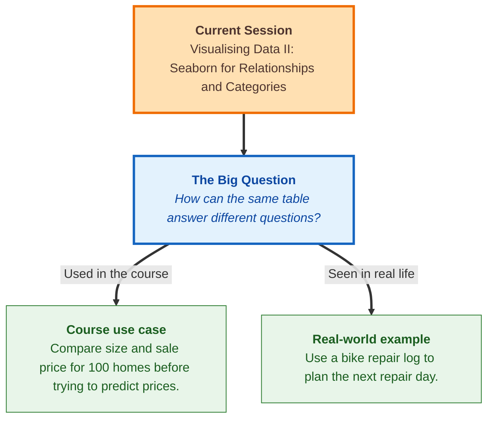

## Visualising Data II: Seaborn for Relationships and Categories

### Mental Map

---

### What You'll Learn

Have you ever wondered why one bike repair takes longer than another?

By the end of this session, you will be able to:

- **Use** a chart tool to show how repair times vary with bike age and repair type.
- **Demonstrate**, with one dot per bike, how age, repair time and parts cost relate in pairs.
- **Compare** wheel and brake jobs using bars for job counts and bars for average repair times.
- **Justify** your choice of chart for a question about the next repair day.

> **Topics you will meet:** Seaborn, Relationships, Categorical Plots.
>
> Join the session to learn each of these in detail.

---

### Why You Are Learning This Topic

You help at a bike repair stand in your neighborhood. Each time a bike comes in, you write down the job. A rider asks how long a brake fix might take. Later, a friend asks which job came up most often. You have one sheet of notes for both questions.

A **chart** means a picture that uses marks like dots or bars to show what's in your records.

In this course, you use charts to spot patterns before making a guess from your data.

> **Think about it:** Could the most common job take less time on average than another job?

---

### The Bike Repair Puzzle

Here are five jobs from the stand's first morning.

| Bike | Repair type | Bike age (years) | Repair time (minutes) | Parts cost (₹) |
|:----:|:-----------:|:----------------:|:---------------------:|:--------------:|
| Mira's | Wheel | 1 | 10 | 80 |
| Kabir's | Brake | 3 | 20 | 220 |
| Tara's | Wheel | 4 | 16 | 100 |
| Nila's | Brake | 6 | 24 | 260 |
| Dev's | Wheel | 7 | 22 | 140 |

**What you want to happen:**

- See whether older bikes tend to take longer to fix.
- See whether jobs that take longer also cost more in parts.
- Find out which job comes up more often and which takes more time on average.

> **Wonder about this:**
>
> - To compare bike age with repair time, which two numbers would you use to place Mira's dot?
> - Which pairs of numbers could you put side by side to learn more about parts costs?

---

### Think It Through

There is no wrong first try. Keep your guesses for the session.

**1. Does every older bike take longer to fix?**

Hint: Compare Tara's row with Kabir's.

**2. What would each bar need to show if you want to find the most common job?**

Hint: Look for the column with names that repeat.

**3. What would change in those bars if riders asked about average repair times?**

Hint: Look for the column that measures time.

---

### One Question to Carry Into the Session

> **Which chart would you show the person planning the next repair day?**
>
> What would you ask them before picking it?
