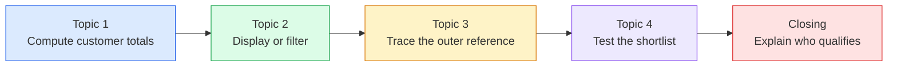
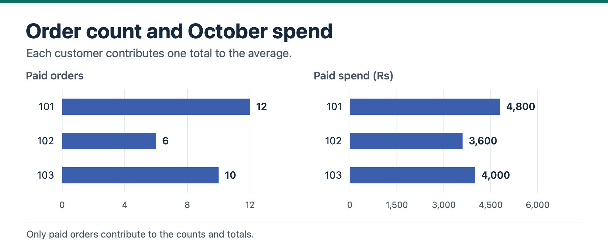
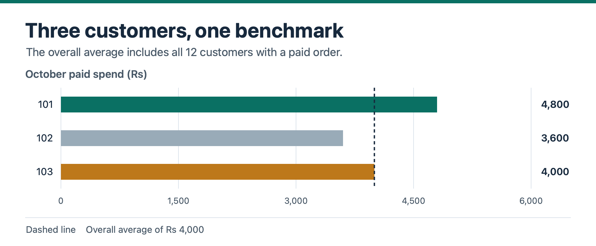
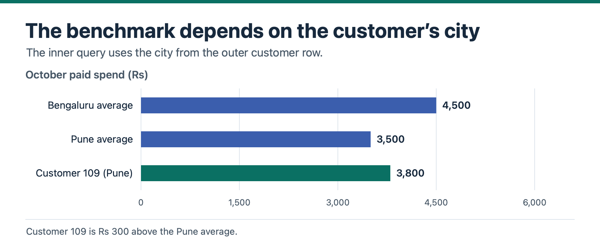
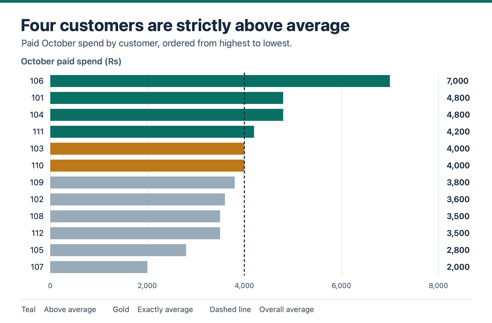
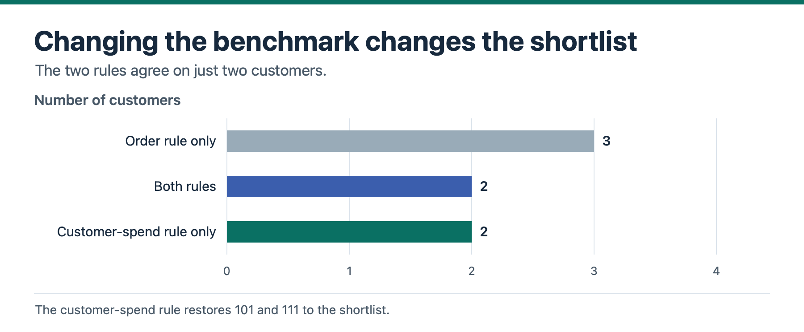

# <font color='#1d4ed8'>Lecture Script: Subqueries (MySQL)</font>

---

## <font color='blue'>Agenda</font>

The lecture runs as four topics. Each topic ends with a quiz.

| Topic | What we do | Learning objectives covered | Minutes |
|:-:|:--|:--|:-:|
| 1 | Compute one total per customer | Write a subquery to compute an intermediate result | 20 |
| 2 | Show a benchmark and filter with it | Use subqueries in WHERE and in the SELECT list | 28 |
| 3 | Trace a benchmark that depends on the outer row | Distinguish a correlated from an uncorrelated subquery, by example | 29 |
| 4 | Build and test the October shortlist | Answer a question such as customers who spend above the average | 33 |
| — | Closing: Outcome & Summary | | 10 |
| | **Total** | | **120** |

> <font color="red">**🎯 Instructor Note**</font> Count the rows in Topic 1 before calculating the average. In Topics 2 and 3, let learners trace the inner query on paper. In Topic 4, give them time to write the filter and check the tie.

---

## <font color='blue'>Scenario</font>

At a Nykaa-style beauty shop, Riya opens October's order log to prepare a customer shortlist for a loyalty offer. To get on the list, a shopper must have spent more in October than the average October spend of shoppers with at least one paid order. Cancelled orders contribute no spend. The snapshot is fixed at 31 October 2026. Each row in `beauty_orders` represents one October order, and each customer has a single city in this snapshot.

> <font color="red">**🎯 Instructor Note**</font> The shop and its 120 order rows were invented for teaching. The files are [beauty_orders.sql](data/beauty_orders.sql) and [beauty_orders.csv](data/beauty_orders.csv).
> For a MySQL 8.0 or later demonstration, use a disposable database connected by the operator and load the linked data script once. Output tables were checked against a disposable MySQL 8.4.11 database.

---

## <font color='blue'>Problem Statement</font>

Riya flags shoppers who placed an order bigger than the typical order. Customer 101 buys a little at a time and gets left out. Customer 102 makes fewer, larger purchases and gets an offer, even though they spent less across the month than customer 101.

> <font color='purple'>**Which customers spent more in October than the average customer with a paid order?**</font>

> <font color="red">**🎯 Instructor Note**</font> Poll: “Who should make the shortlist, 101 only, 102 only, both, or neither?” Give learners 30 seconds to respond in chat. Reveal the answer in the Closing.

---

## <font color='blue'>What We Will Use</font>

A subquery is a query nested inside another query. We will use the shape of its result to decide where it belongs.

| Topic | Tools | In one line |
|:-:|:--|:--|
| 1 | `SUM`, `GROUP BY`, subquery in `FROM` | Build a table with one spend total per customer. |
| 2 | `AVG`, scalar subqueries in `SELECT` and `WHERE` | Display one number beside each row or use it to filter rows. |
| 3 | Outer and inner aliases | Trace the outer value that sets the inner query's scope. |
| 4 | `>`, `ORDER BY` | Return customers strictly above the overall average in a stable order. |

---

## <font color='blue'>How: Walking Through the October Shortlist</font>



---

## <font color='blue'>Topic 1: Subqueries for Intermediate Results</font> `20 min`

> <font color='purple'>**How can we turn several order rows into one number for each shopper?**</font>

### <font color='green'>Example: average the customer totals</font>

> <font color='purple'>**What does the outer query average when its input has one row per customer?**</font>

Give a learner two slips worth Rs $400$ each and another learner one slip worth Rs $600$. Ask them to make one pile per person. The average of the two piles is $700$ rupees. The average of the three slips is about $466.67$ rupees. Grouping first changes what gets equal weight.

Give learners two minutes to write the inner query that keeps paid orders and adds the amounts for each customer. Ask them to circle the columns that identify each group before comparing their query with the example.

$$
\boxed{\text{Average customer spend} =
\frac{\text{Sum of paid order amounts}}{\text{Number of customers with a paid order}}}
$$

**Predict before running: What will happen?**

> <font color="red">**🎯 Instructor Note**</font> Ask learners to name the unit of a row inside and outside the parentheses. The inner query gives 12 customer rows and the outer query gives one row with the benchmark.

```sql
SELECT COUNT(*) AS customers, SUM(t.spend_inr) AS total_inr,
       CAST(AVG(t.spend_inr) AS DECIMAL(10, 2)) AS avg_customer_inr
FROM (
    SELECT customer_id, city, SUM(amount_inr) AS spend_inr
    FROM beauty_orders
    WHERE order_status = 'paid'
    GROUP BY customer_id, city
) AS t;
```

**Output**

```
customers  total_inr  avg_customer_inr
12         48000.00   4000.00
```

#### <font color='#c2410c'>Code Explanation</font>

- **Lines 4–7** Keep paid orders, group them by customer and city, and sum the amounts in each group. One city per customer makes each group one customer.
- **Lines 3 and 8** Use the inner result as a table named `t`. A subquery in `FROM` creates a derived table, which needs a name here.
- **Lines 1–2** Count the customer rows and calculate the total and average across them. The cast displays the average to two decimal places.

> <font color='green'>**Result**</font> Twelve customers spent a combined Rs $48{,}000$ in paid orders. The average is $48{,}000 \div 12 = 4{,}000$ rupees per customer.

### <font color='green'>Extending it: inspect three customer totals</font>

> <font color='purple'>**Can a customer with fewer orders still spend more on each order?**</font>

**Predict before running: What will happen?**

> <font color="red">**🎯 Instructor Note**</font> Expected: 101 has 12 paid orders and 102 has six. Have learners predict which customer has the higher total and which has the higher spend per order.

```sql
SELECT customer_id, COUNT(*) AS paid_orders, SUM(amount_inr) AS spend_inr
FROM beauty_orders
WHERE order_status = 'paid' AND customer_id IN (101, 102, 103)
GROUP BY customer_id
ORDER BY customer_id;
```

**Output**

```
customer_id  paid_orders  spend_inr
101          12           4800.00
102          6            3600.00
103          10           4000.00
```

#### <font color='#c2410c'>Code Explanation</font>

- **Lines 1–3** Read paid orders for the three customer IDs. For each group, count the orders and add their amounts.
- **Lines 4–5** Form a group for each customer and put the results in customer ID order.

> <font color='green'>**Result**</font> Customer 102 averaged Rs $600$ per paid order and spent Rs $3{,}600$ in total. Customer 101 averaged Rs $400$ per paid order and spent Rs $4{,}800$ in total.

<p align="center"></p>

### <font color='purple'>Quiz 1</font>

**Question:** If the benchmark population contains only customers 101 and 102, what value should the outer average return in rupees?

**Options:**

- A) $466.67$, rounded to two decimals
- B) $4{,}200$
- C) $8{,}400$
- D) $4{,}800$

**Correct Answer:** B

**Explanation:**

- **A)** Dividing $8{,}400$ by $18$ gives the average across paid orders.
- **B)** Dividing $8{,}400$ by $2$ gives the average across the two customers.
- **C)** This is the combined total before division.
- **D)** This is only customer 101's total.

---

## <font color='blue'>Topic 2: Subqueries in WHERE and SELECT</font> `28 min`

> <font color='purple'>**How can we show the Rs $4{,}000$ average beside a customer's total, then use it to keep only qualifying rows?**</font>

### <font color='green'>Example: add the benchmark as a column</font>

The data file saves the grouping query from Topic 1 as a **view** named `paid_customer_spend`. A view is a named query that can be read like a table. It gives us a way to reuse the same customer rows.

> <font color='purple'>**When we display only customers 101, 102 and 103, which customers go into the benchmark?**</font>

**Predict before running: What will happen?**

> <font color="red">**🎯 Instructor Note**</font> Ask learners to point to the scope of the outer filter. The query displays three customer rows. Each gets the average of all 12 customer totals.

```sql
SELECT c.customer_id, c.spend_inr,
       (SELECT CAST(AVG(p.spend_inr) AS DECIMAL(10, 2))
        FROM paid_customer_spend AS p) AS overall_avg_inr
FROM paid_customer_spend AS c
WHERE c.customer_id IN (101, 102, 103)
ORDER BY c.customer_id;
```

**Output**

```
customer_id  spend_inr  overall_avg_inr
101          4800.00    4000.00
102          3600.00    4000.00
103          4000.00    4000.00
```

#### <font color='#c2410c'>Code Explanation</font>

- **Line 1** Choose the fields from outer alias `c`.
- **Lines 2–3** Put the inner query in the `SELECT` list. `AVG` without `GROUP BY` gives one row and one column here, so the subquery can be used as a single value. The inner alias `p` reads the full view.
- **Lines 4–6** Read the same view as `c`, show the three requested outer rows, and sort by ID.

> <font color='green'>**Result**</font> The `SELECT` list displays the same overall benchmark for all three customer rows, including the row that matches it exactly.

<p align="center"></p>

### <font color='green'>Extending it: use the benchmark in WHERE</font>

> <font color='purple'>**Which of these three customers remains when we apply a strict comparison?**</font>

**Predict before running: What will happen?**

> <font color="red">**🎯 Instructor Note**</font> Expected: only 101. Give learners 30 seconds to respond in chat. Ask them to justify what happens to the row for 103.

```sql
SELECT c.customer_id, c.spend_inr
FROM paid_customer_spend AS c
WHERE c.customer_id IN (101, 102, 103)
  AND c.spend_inr > (SELECT AVG(p.spend_inr)
                     FROM paid_customer_spend AS p)
ORDER BY c.customer_id;
```

**Output**

```
customer_id  spend_inr
101          4800.00
```

#### <font color='#c2410c'>Code Explanation</font>

- **Lines 1–3** Limit the outer rows to the same three customers.
- **Lines 4–5** Compare each total with the scalar average. Use the average directly for the comparison so display rounding has no effect.
- **Line 6** Arrange any matching rows by customer ID.

> <font color='green'>**Result**</font> Putting the comparison in `WHERE` retains customer 101 and drops the rows at or below the cutoff.

### <font color='green'>Extending it: check the inner result shape</font>

> <font color='purple'>**What shape would the inner result have if we added `GROUP BY p.city` to the query that is used after `>`?**</font>

Give learners 30 seconds to respond in chat.

#### <font color='#c2410c'>Logic Explanation</font>

- Each of the two cities would contribute one row. A scalar comparison expects at most one row and exactly one column from the subquery. Zero rows supply `NULL` in a scalar expression, and multiple rows cause an error.
- Read the parenthesised query by itself when it refers only to its own tables. Count the columns and rows before using it as a single value.

> <font color='green'>**Result**</font> The shared benchmark uses one aggregate result, so it fits a scalar position.

### <font color='purple'>Quiz 2</font>

**Question:** Compare the two queries for customers 101, 102 and 103. What does the query that uses the average in `WHERE` return?

**Options:**

- A) All three rows stay and each gains a benchmark column.
- B) The benchmark is recalculated over only the three displayed customers.
- C) Customer 103 qualifies because its total equals the benchmark.
- D) Only customer 101 qualifies and the displayed benchmark column disappears.

**Correct Answer:** D

**Explanation:**

- **A)** This describes displaying the scalar value without applying the comparison.
- **B)** The inner query reads every row in `paid_customer_spend`.
- **C)** Equality fails the strict `>` test.
- **D)** Only Rs $4{,}800$ exceeds Rs $4{,}000$ in this sample. The `SELECT` list contains only ID and spend.

---

## <font color='blue'>Topic 3: Correlated and Uncorrelated Subqueries</font> `29 min`

> <font color='purple'>**The overall average stays the same across customers. How could each shopper see the average for their own city?**</font>

### <font color='green'>Example: trace the city from the outer row</font>

> <font color='purple'>**What city value will the inner query receive for customers 101, 102 and 109?**</font>

**Predict before running: What will happen?**

> <font color="red">**🎯 Instructor Note**</font> Point to `c.city` and ask learners to substitute the city for customer 109. Expected: 101 and 102 share the Bengaluru average. Customer 109 receives the Pune average.

```sql
SELECT c.customer_id, c.city, c.spend_inr,
       (SELECT CAST(AVG(p.spend_inr) AS DECIMAL(10, 2))
        FROM paid_customer_spend AS p
        WHERE p.city = c.city) AS city_avg_inr
FROM paid_customer_spend AS c
WHERE c.customer_id IN (101, 102, 109)
ORDER BY c.customer_id;
```

**Output**

```
customer_id  city       spend_inr  city_avg_inr
101          Bengaluru  4800.00    4500.00
102          Bengaluru  3600.00    4500.00
109          Pune       3800.00    3500.00
```

#### <font color='#c2410c'>Code Explanation</font>

- **Line 1** Read the customer ID, city and total from the current outer row.
- **Lines 2–4** Read customer totals as `p`. Match each inner city `p.city` to the outer customer city `c.city`, then average the matching totals. Each city's average includes the current customer.
- **Lines 5–7** Supply the three outer rows and sort the display by ID.

Without the city condition, the inner query refers only to `p` and is **uncorrelated**. With `p.city = c.city`, it needs a value from the outer query and is **correlated**. Trace it by substituting a city for the current row. This describes the result of the query. MySQL chooses its own execution plan.

> <font color='green'>**Result**</font> The Bengaluru average is $27{,}000 \div 6 = 4{,}500$ rupees. The Pune average is $21{,}000 \div 6 = 3{,}500$ rupees.

<p align="center"></p>

### <font color='green'>Extending it: use the city average in WHERE</font>

> <font color='purple'>**Which of the three displayed customers spend more than their own city's average?**</font>

**Predict before running: What will happen?**

> <font color="red">**🎯 Instructor Note**</font> Give learners 30 seconds to respond in chat. Expected: 101 and 109 pass. Ask why 109 passes even though their spend is below the overall benchmark.

```sql
SELECT c.customer_id, c.city, c.spend_inr
FROM paid_customer_spend AS c
WHERE c.customer_id IN (101, 102, 109)
  AND c.spend_inr > (SELECT AVG(p.spend_inr)
                     FROM paid_customer_spend AS p
                     WHERE p.city = c.city)
ORDER BY c.customer_id;
```

**Output**

```
customer_id  city       spend_inr
101          Bengaluru  4800.00
109          Pune       3800.00
```

#### <font color='#c2410c'>Code Explanation</font>

- **Lines 1–3** Keep the same three customers as outer candidates.
- **Lines 4–6** Compare each candidate with their city average. The reference to `c.city` still binds to the current outer row, even inside `WHERE`.
- **Line 7** Sort the qualifying IDs.

> <font color='green'>**Result**</font> Customer 109 is $300$ rupees above the Pune average and $200$ rupees below the overall average. The benchmark population decides which comparison they pass.

### <font color='purple'>Quiz 3</font>

**Question:** Which expression makes the city average correlated to the outer query?

**Options:**

- A) `p.city = c.city`
- B) `AVG(p.spend_inr)`
- C) `c.customer_id IN (101, 102, 109)`
- D) `ORDER BY c.customer_id`

**Correct Answer:** A

**Explanation:**

- **A)** Inside the subquery, `c.city` refers to the outer row.
- **B)** The aggregate reads the inner alias alone.
- **C)** This outer filter selects customers for display.
- **D)** This outer sort changes the order of the displayed rows.

---

## <font color='blue'>Topic 4: Nested Queries for the Shortlist</font> `33 min`

> <font color='purple'>**The offer uses the overall average. Which customers qualify when every October customer with a paid order can be considered?**</font>

### <font color='green'>Example: build the full shortlist</font>

> <font color='purple'>**How can we build the shortlist and give customers with equal totals a stable display order?**</font>

Ask learners to write the inner query first and state what its one number means. Then give them three minutes to write the outer predicate and the sort. A cancelled-only customer such as 113 has no paid rows and is outside the benchmark population.

**Predict before running: What will happen?**

> <font color="red">**🎯 Instructor Note**</font> Expected: four rows, with customers 101 and 104 tied at Rs 4,800. Ask learners how to keep their display order stable.

```sql
SELECT c.customer_id, c.spend_inr
FROM paid_customer_spend AS c
WHERE c.spend_inr > (SELECT AVG(p.spend_inr)
                     FROM paid_customer_spend AS p)
ORDER BY c.spend_inr DESC, c.customer_id;
```

**Output**

```
customer_id  spend_inr
106          7000.00
101          4800.00
104          4800.00
111          4200.00
```

#### <font color='#c2410c'>Code Explanation</font>

- **Lines 1–2** Read one row per eligible customer.
- **Lines 3–4** Compare the outer total with the uncorrelated average of all eligible customer totals. The condition keeps a row only when its total is greater.
- **Line 5** Sort by spend from highest to lowest and use the customer ID to break ties.

> <font color='green'>**Result**</font> Customers 106, 101, 104 and 111 cleared the Rs $4{,}000$ cutoff.

<p align="center"></p>

### <font color='green'>Extending it: move the boundary to at least average</font>

> <font color='purple'>**Which rows change if the offer includes customers spending exactly the average?**</font>

**Predict before running: What will happen?**

> <font color="red">**🎯 Instructor Note**</font> Expected: the four qualifying IDs stay. Customers 103 and 110 join them because each total is exactly Rs 4,000.

```sql
SELECT c.customer_id, c.spend_inr
FROM paid_customer_spend AS c
WHERE c.spend_inr >= (SELECT AVG(p.spend_inr)
                      FROM paid_customer_spend AS p)
ORDER BY c.spend_inr DESC, c.customer_id;
```

**Output**

```
customer_id  spend_inr
106          7000.00
101          4800.00
104          4800.00
111          4200.00
103          4000.00
110          4000.00
```

#### <font color='#c2410c'>Code Explanation</font>

- **Lines 1–2** Read the same customer totals as before.
- **Lines 3–4** Change the operator to `>=` so that equality passes. Keep the same inner benchmark.
- **Line 5** Sort the two new equal values by customer ID.

> <font color='green'>**Result**</font> “At least average” yields six customers. The offer says “above average,” so its comparison is `>`.

### <font color='green'>Extending it: test the original order rule</font>

> <font color='purple'>**Who would Riya select by looking for any paid order above the average paid order?**</font>

**Predict before running: What will happen?**

> <font color="red">**🎯 Instructor Note**</font> Ask learners for one customer whose result will change. All paid orders from 101 are at most Rs 410, below the per-order average of about Rs 421.05.

```sql
SELECT DISTINCT o.customer_id
FROM beauty_orders AS o
WHERE o.order_status = 'paid'
  AND o.amount_inr > (SELECT AVG(p.amount_inr)
                      FROM beauty_orders AS p WHERE p.order_status = 'paid')
ORDER BY o.customer_id;
```

**Output**

```
customer_id
102
104
106
109
112
```

#### <font color='#c2410c'>Code Explanation</font>

- **Lines 2–3** Read the order log and limit the candidates to paid orders.
- **Lines 4–5** Compare individual order amounts with the average over paid orders.
- **Lines 1 and 6** `DISTINCT` shows each qualifying customer once. Sort by customer ID.

> <font color='green'>**Result**</font> The per-order rule checks for one large purchase. The two rules overlap on customers 104 and 106. The customer-spend rule also finds 101 and 111.

### <font color='purple'>Quiz 4</font>

**Question:** Which rule answers the October offer question?

**Options:**

- A) Keep a customer if any paid order exceeds the average paid order.
- B) Keep a customer if their paid total is at least the average of the customer totals.
- C) Sum paid orders by customer, average those customer totals, then keep only totals strictly above that average.
- D) Keep a customer if their paid total exceeds the average total of customers in their own city.

**Correct Answer:** C

**Explanation:**

- **A)** This weights individual orders and misses customers 101 and 111.
- **B)** This adds customers 103 and 110, whose totals equal the average.
- **C)** This gives each eligible customer one total in the benchmark and selects exactly the four above it.
- **D)** This changes the comparison group and would include customer 109.

---

## <font color='blue'>Closing: Outcome & Summary</font> `10 min`

> <font color='purple'>**What is the input to the benchmark, and which customers count?**</font>

The inner grouping makes one October total per customer who placed a paid order. The overall average across those rows is Rs $4{,}000$.

> <font color='purple'>**Can we show each shortlisted customer's city benchmark while keeping the overall cutoff?**</font>

**Predict before running: What will happen?**

> <font color="red">**🎯 Instructor Note**</font> Expected: the same four IDs. The displayed city benchmark is Rs 4,500 for the three Bengaluru customers and Rs 3,500 for the Pune customer.

```sql
SELECT c.customer_id, c.spend_inr,
       (SELECT CAST(AVG(p.spend_inr) AS DECIMAL(10, 2))
        FROM paid_customer_spend AS p WHERE p.city = c.city) AS city_avg_inr
FROM paid_customer_spend AS c
WHERE c.spend_inr > (SELECT AVG(p.spend_inr) FROM paid_customer_spend AS p)
ORDER BY c.spend_inr DESC, c.customer_id;
```

**Output**

```
customer_id  spend_inr  city_avg_inr
106          7000.00    4500.00
101          4800.00    4500.00
104          4800.00    4500.00
111          4200.00    3500.00
```

#### <font color='#c2410c'>Code Explanation</font>

- **Line 4** Reuse the one-row-per-customer result from Topic 1.
- **Lines 1–3** Display a scalar value in the `SELECT` list as in Topic 2. The reference `c.city` makes this value dependent on the customer as in Topic 3.
- **Lines 5–6** Apply Topic 4's strict comparison to the shared overall average, then sort by total and ID.

<p align="center"></p>

### <font color='green'>Outcome</font>

| | Any order above the paid-order average | Customer total above the paid-customer average |
|:--|:--|:--|
| Benchmark | About Rs $421.05$ per paid order | Rs $4{,}000$ per customer with paid orders |
| Customers selected | 102, 104, 106, 109, 112 | 106, 101, 104, 111 |
| Customer 101 | Left out | Included |
| Customer 102 | Included | Left out |

> <font color='green'>**Therefore,**</font> send the loyalty offer to customers 106, 101, 104 and 111. Each has a total greater than Rs $4{,}000$ in paid October spend.

> <font color="red">**🎯 Instructor Note**</font> Reveal the opening poll: 101 only. Compare their Rs 4,800 with customer 102's Rs 3,600 and the Rs 4,000 cutoff.

### <font color='green'>Summary</font>

| Learning objective | Takeaway |
|:--|:--|
| Intermediate result | Group paid orders into one total per customer, then make those totals the input to the outer query. |
| Subqueries in WHERE and SELECT | Put a scalar subquery in the `SELECT` list to show its value. Use it in `WHERE` to decide which rows qualify. |
| Correlated and uncorrelated | Look inside the parentheses for a reference to the outer query, such as `c.city`. That reference makes the subquery correlated. |
| Customers above average | Use the average of eligible customer totals and a strict `>` comparison. |
| **Practical value** | Check the unit of a row and the benchmark population before using a shortlist to act. |

---

# <font color='red'>Launch the Feedback Poll</font>

> <font color="red">**🎯 Instructor Note**</font> Launch the feedback poll now to collect learner feedback.
