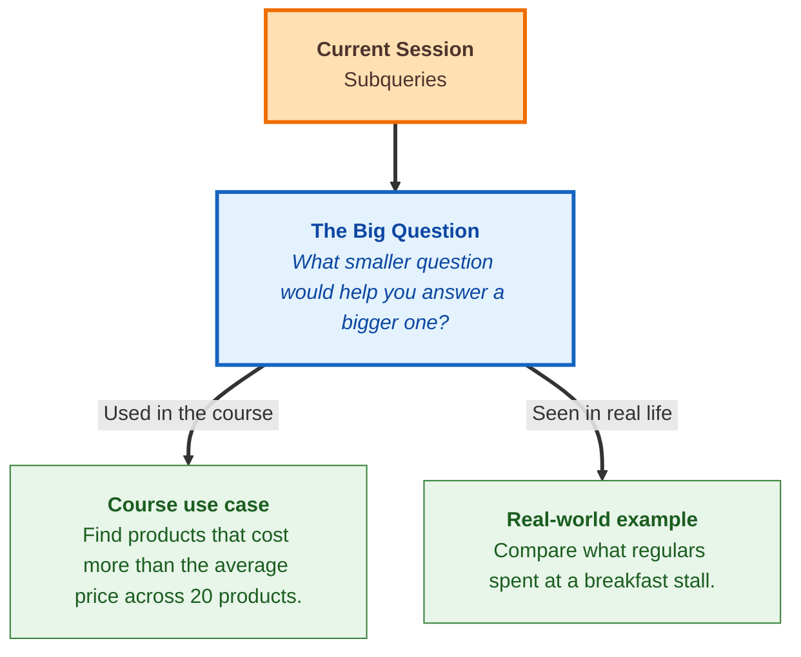

## Subqueries

### Mental Map

---

### What You'll Learn

Have you ever wondered how a breakfast stall owner spots who spent more than the group average?

By the end of this session, you will be able to:

- **Use** today's average both to pick names and to show the average beside each bill.
- **Determine** which of the three regulars spent above today's average.
- **Compare** one average shared by all three regulars with a last bill that depends on whose name you're reading.
- **Write** a smaller question that finds today's average for the three regulars so a larger question can use it.

> **Topics you will meet:** Subqueries, Nested Queries.
>
> Join the session to learn each of these in detail.

---

### Why You Are Learning This Topic

You stop at the same stall for breakfast before class. Today you add a cup of tea to your order. The owner writes down each regular's total after they pay. She wants to see whose bill was above the average for those regulars today. She also wonders who spent more than on their own last visit.

A **subquery** means a question inside a larger request for data, where the larger request uses its answer.

In this course, you'll use smaller questions like these to decide what belongs in a report.

> **Think about it:** What number would the owner need before deciding whether your bill was above today's average?

---

### The Breakfast Stall Puzzle

Each row gives one regular's bill from their last visit and their bill from today, in rupees.

| Regular | Last visit (₹) | Today (₹) |
|:-------:|:--------------:|:---------:|
| Asha | 80 | 90 |
| Isha | 150 | 130 |
| Dev | 140 | 170 |

**What you want to happen:**

- Keep only the names with bills above today's average.
- Show today's average beside each regular's bill in a full list.
- Match each regular's bill today to their own last bill.

> **Wonder about this:**
>
> - Should a bill equal to the average make the first list?
> - Whose last bill would you look up when you reach Dev's row?

---

### Think It Through

There is no wrong first try. Keep your guesses for the session.

**1. What is the average bill for the three regulars today?**

Hint: Add today's three bills and share the total equally.

**2. Which names would you keep if the owner wants bills above that average?**

Hint: Check each amount in the Today column against your first answer.

**3. Would Asha make the list if each regular had to spend more than on their last visit?**

Hint: Look at the two bills in Asha's row.

---

### One Question to Carry Into the Session

> **How can one request ask for a number and use it to decide which names to show?**
>
> What changes if the number you need depends on whose row you're reading?
