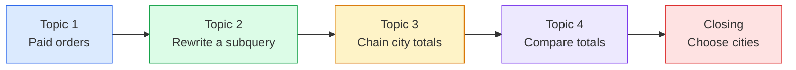
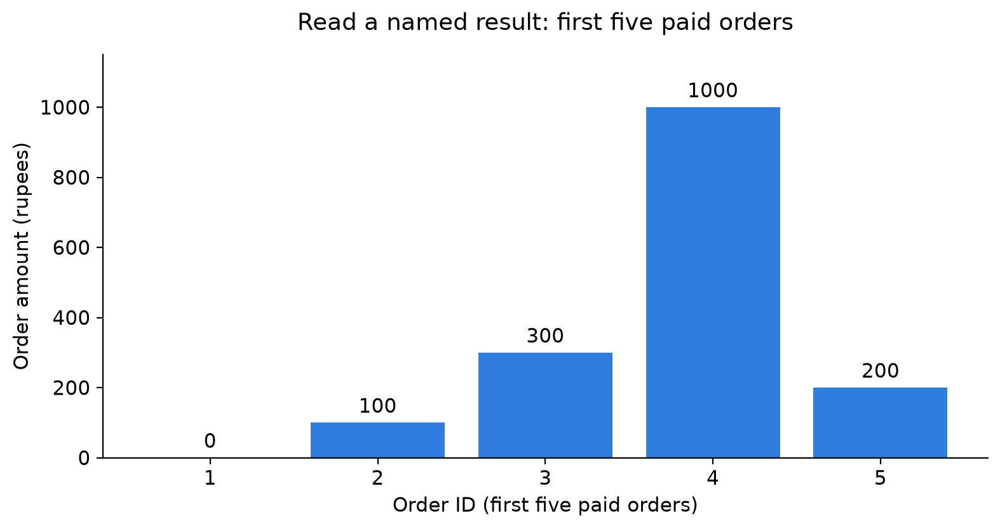
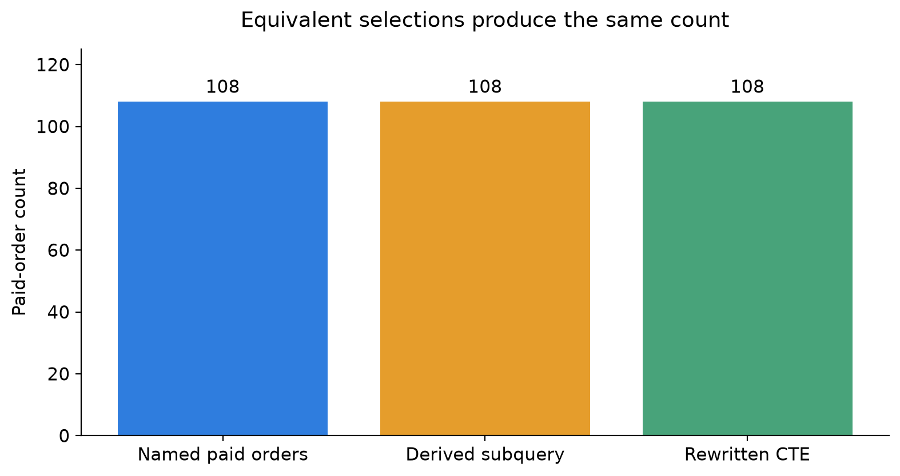
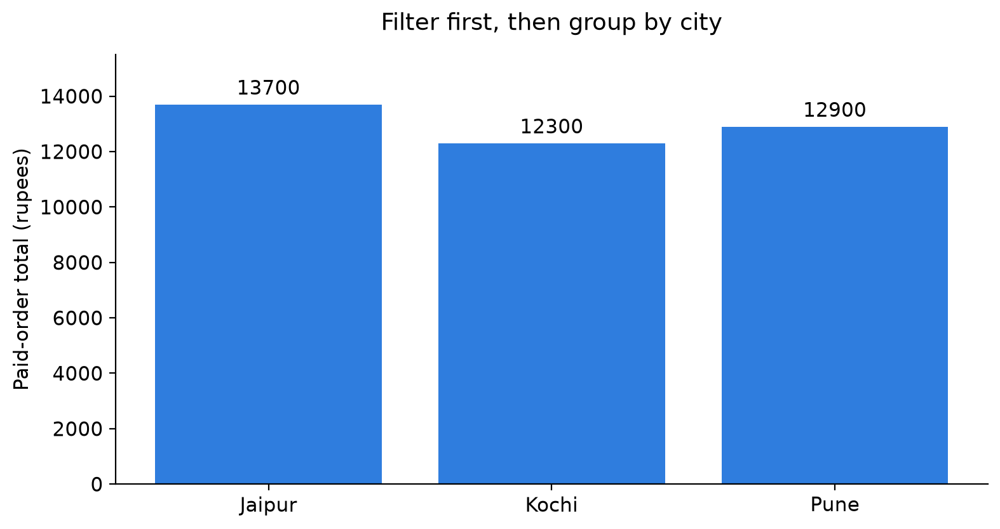
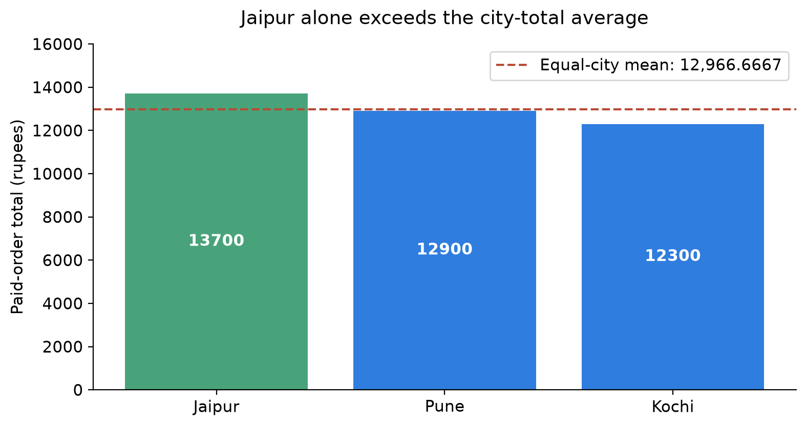

# <font color='#1d4ed8'>Lecture Script: Common Table Expressions (CTEs) (MySQL)</font>

## <font color='blue'>Agenda</font>

| Topic | What we do | Learning objectives covered | Minutes |
|:-:|:--|:--|:-:|
| 1 | Name an intermediate result | Use a CTE to structure a complex query into readable steps | 25 |
| 2 | Replace a nested subquery | Rewrite a nested subquery as a clearer CTE | 25 |
| 3 | Chain named results | Chain multiple CTEs in one query | 30 |
| 4 | Build an analysis | Build a stepwise analytical query with CTEs | 30 |
| — | Closing: Outcome & Summary | | 10 |
| | **Total** | | **120** |

> <font color="red">**🎯 Instructor Note**</font> Spend the most time tracing the chained queries; keep the introductory syntax check brief.

---

## <font color='blue'>Scenario</font>

A BigBasket-style grocery shop has an invented order snapshot. A mentor and learners will help a regional manager choose which city totals deserve a closer look. Each row represents one order; `amount` is its value in rupees and `status` says whether it was paid or cancelled.

> <font color="red">**🎯 Instructor Note**</font> All data is invented for teaching; no claim is made about the company. Use MySQL 8.0 or later and the supplied [order fixture](data/orders.sql) in an isolated database. The snapshot is fixed at 30 November 2026; no query depends on today's date.

---

## <font color='blue'>Problem Statement</font>

A manager includes cancelled orders in a city sales comparison. The resulting list may send the team to the wrong city. The team needs a clear way to show which orders count and how the city comparison was made.

> <font color='purple'>**How can the team make a readable list of cities whose paid-order total is above the average city total?**</font>

> <font color="red">**🎯 Instructor Note**</font> Poll: “Should cancelled orders count as paid sales?” Give learners 30 seconds to respond in chat. Reveal the answer in the Closing.

---

## <font color='blue'>What We Will Use</font>

We will use named query results to make each part of the comparison visible.

| Topic | Tools | In one line |
|:-:|:--|:--|
| 1 | `WITH`, `SELECT`, `WHERE` | Name and read paid orders. |
| 2 | Subquery and CTE | Express the same calculation in two forms. |
| 3 | Multiple CTEs, `GROUP BY` | Pass a filtered result to a city summary. |
| 4 | `AVG`, comparison | Compare each city total with the average. |

---

## <font color='blue'>How: Walking Through the city comparison</font>



---

## <font color='blue'>Topic 1: Name a result with WITH</font> `25 min`

> <font color='purple'>**Which rows should the manager include before comparing cities?**</font>

A common table expression (CTE) is a named result defined with `WITH` for use within the single statement that follows it. It is not a permanent table. The query below filters rows with `WHERE`, then reads the named result. `ORDER BY` makes the display deterministic.

### <font color='green'>Example: Read paid orders</font>

> <font color='purple'>**Which first five order IDs are paid?**</font>

**Predict before running: What will happen?**

> <font color="red">**🎯 Instructor Note**</font> The first five rows are paid; the filter excludes cancelled rows before the limit.

```sql
WITH paid_orders AS (
  SELECT order_id, city, amount FROM orders WHERE status = 'paid'
)
SELECT order_id, city, amount FROM paid_orders
ORDER BY order_id LIMIT 5;
```

**Output**

```text
order_id	city	amount
1	Pune	0
2	Pune	100
3	Pune	300
4	Pune	1000
5	Pune	200
```

#### <font color='#c2410c'>Code Explanation</font>

- Lines 1–3 define `paid_orders` using the filtered rows.
- Lines 4–5 read those columns in ID order and show at most five rows.

> <font color='green'>**Result**</font> The CTE gives the paid-order filter a name that the final query can read.

### <font color='green'>Extending it: Count the rows</font>

> <font color='purple'>**How many paid orders are in the named result?**</font>

**Predict before running: What will happen?**

```sql
WITH paid_orders AS (
  SELECT order_id FROM orders WHERE status = 'paid'
)
SELECT COUNT(*) AS paid_count FROM paid_orders;
```

**Output**

```text
paid_count
108
```

#### <font color='#c2410c'>Code Explanation</font>

- Lines 1–3 define the paid IDs; line 4 counts their rows.

> <font color='green'>**Result**</font> The count describes the filtered result, including any paid order with a zero amount.

> <font color='#b45309'>**Common mistake**</font> A CTE exists only within its statement; repeat its definition in a separate statement.

<p align="center"></p>

### <font color='purple'>Quiz 1</font>

**Question:** What does `paid_orders` represent in the first example?

**Options:**
- A) A named result available to that statement.
- B) A permanent table automatically saved in the database.
- C) A new column in every table.
- D) A filter applied after the five-row limit.

**Correct Answer:** A

**Explanation:**
- **A)** Correct: the name refers to the CTE result within the statement.
- **B)** Incorrect: defining a CTE does not create a permanent table.
- **C)** Incorrect: the name refers to a result, not a column.
- **D)** Incorrect: the filter is inside the CTE before the outer limit.

---

## <font color='blue'>Topic 2: Rewrite a nested subquery</font> `25 min`

> <font color='purple'>**Can the paid-order count be expressed when the intermediate result sits inside the FROM clause?**</font>

### <font color='green'>Example: Start with a nested result</font>

A subquery is a query inside another query. Here the inner query makes the paid rows; `p` is its required alias. The outer `COUNT(*)` counts them.

**Predict before running: What will happen?**

```sql
SELECT COUNT(*) AS paid_count
FROM (SELECT order_id FROM orders WHERE status = 'paid') AS p;
```

**Output**

```text
paid_count
108
```

#### <font color='#c2410c'>Code Explanation</font>

- Line 2 forms and names a filtered derived result; line 1 counts its rows.

> <font color='green'>**Result**</font> This count answers the same question as the previous CTE count.

### <font color='green'>Extending it: Move the subquery to WITH</font>

> <font color='purple'>**Does moving the same inner query change the count?**</font>

**Predict before running: What will happen?**

> <font color="red">**🎯 Instructor Note**</font> No: the inner selection and outer count are unchanged. A CTE improves naming and layout; it does not guarantee faster execution.

```sql
WITH p AS (
  SELECT order_id FROM orders WHERE status = 'paid'
)
SELECT COUNT(*) AS paid_count FROM p;
```

**Output**

```text
paid_count
108
```

#### <font color='#c2410c'>Code Explanation</font>

- Lines 1–3 move the same selection into `p`; line 4 counts it.

> <font color='green'>**Result**</font> The equivalent CTE puts the intermediate result before its consumer.

<p align="center"></p>

### <font color='purple'>Quiz 2</font>

**Question:** What must stay the same for this rewrite to preserve the count?

**Options:**
- A) Only the alias spelling.
- B) The selected rows and the outer count.
- C) The physical order of stored rows.
- D) A promise that the query runs faster.

**Correct Answer:** B

**Explanation:**
- **A)** Incorrect: an alias can be renamed consistently.
- **B)** Correct: the count must consume the same rows.
- **C)** Incorrect: counting rows does not depend on their physical order.
- **D)** Incorrect: a rewrite does not guarantee a speedup.

---

## <font color='blue'>Topic 3: Chain named results</font> `30 min`

> <font color='purple'>**How can the paid rows become one total per city?**</font>

### <font color='green'>Example: Filter, then group</font>

Write one `WITH`, separate CTE definitions with commas, and place the final query after the last definition. A later CTE can refer to an earlier one. `SUM` adds the amounts in each city and `GROUP BY` makes one row per city.

**Predict before running: What will happen?**

```sql
WITH paid_orders AS (
  SELECT city, amount FROM orders WHERE status = 'paid'
), city_totals AS (
  SELECT city, SUM(amount) AS total FROM paid_orders GROUP BY city
)
SELECT city, total FROM city_totals ORDER BY city;
```

**Output**

```text
city	total
Jaipur	13700
Kochi	12300
Pune	12900
```

#### <font color='#c2410c'>Code Explanation</font>

- Lines 1–2 select paid orders.
- Lines 3–5 define city totals using that earlier CTE.
- Line 6 returns the summary in city order.

> <font color='green'>**Result**</font> Each returned city has a total based only on its paid orders.

### <font color='green'>Extending it: Keep the count alongside the total</font>

> <font color='purple'>**How can the manager see how many paid orders contributed to each total?**</font>

**Predict before running: What will happen?**

```sql
WITH paid_orders AS (
  SELECT city, amount FROM orders WHERE status = 'paid'
), city_totals AS (
  SELECT city, COUNT(*) AS orders, SUM(amount) AS total
  FROM paid_orders GROUP BY city
)
SELECT city, orders, total FROM city_totals ORDER BY city;
```

**Output**

```text
city	orders	total
Jaipur	36	13700
Kochi	36	12300
Pune	36	12900
```

#### <font color='#c2410c'>Code Explanation</font>

- Lines 1–2 select paid rows; lines 3–6 count and sum within each city.
- Line 7 presents the city summaries.

> <font color='green'>**Result**</font> The additional count gives context to each total without changing which orders qualify.

<p align="center"></p>

### <font color='purple'>Quiz 3</font>

**Question:** In this chain, what can `city_totals` read?

**Options:**
- A) Only a permanent table called `city_totals`.
- B) A later CTE defined after it.
- C) The earlier `paid_orders` CTE.
- D) A CTE from a previous, separate statement.

**Correct Answer:** C

**Explanation:**
- **A)** Incorrect: this name defines a CTE, not a permanent table.
- **B)** Incorrect: this nonrecursive chain refers to earlier definitions.
- **C)** Correct: the earlier CTE is in scope.
- **D)** Incorrect: the earlier statement's CTE has expired.

---

## <font color='blue'>Topic 4: Build the city comparison</font> `30 min`

> <font color='purple'>**Which city totals exceed the average of the city totals?**</font>

### <font color='green'>Example: Compare against a shared average</font>

The average here gives each city with at least one paid order equal weight. `AVG(total)` averages city totals, not individual orders. `CROSS JOIN` attaches the one-row average to each city row. The strict `>` excludes a city exactly equal to the average.

**Predict before running: What will happen?**

```sql
WITH paid AS (
  SELECT city, amount FROM orders WHERE status = 'paid'
), totals AS (
  SELECT city, SUM(amount) AS total FROM paid GROUP BY city
), benchmark AS (
  SELECT AVG(total) AS avg_total FROM totals
)
SELECT city, total, avg_total FROM totals CROSS JOIN benchmark
WHERE total > avg_total ORDER BY total DESC, city;
```

**Output**

```text
city	total	avg_total
Jaipur	13700	12966.6667
```

#### <font color='#c2410c'>Code Explanation</font>

- Lines 1–2 select paid rows; lines 3–4 form city totals.
- Lines 5–7 compute their average in a one-row CTE.
- Lines 8–9 attach the average, filter above it, and sort by total with city as a tie-breaker.

> <font color='green'>**Result**</font> The returned rows are the cities above the equal-city average, as confirmed by the query output.

### <font color='green'>Extending it: Inspect all cities</font>

> <font color='purple'>**How can the team inspect the comparison before filtering anyone out?**</font>

**Predict before running: What will happen?**

```sql
WITH paid AS (
  SELECT city, amount FROM orders WHERE status = 'paid'
), totals AS (
  SELECT city, SUM(amount) AS total FROM paid GROUP BY city
), benchmark AS (
  SELECT AVG(total) AS avg_total FROM totals
)
SELECT city, total, avg_total FROM totals CROSS JOIN benchmark
ORDER BY total DESC, city;
```

**Output**

```text
city	total	avg_total
Jaipur	13700	12966.6667
Pune	12900	12966.6667
Kochi	12300	12966.6667
```

#### <font color='#c2410c'>Code Explanation</font>

- Lines 1–7 create the same paid rows, totals, and benchmark.
- Lines 8–9 show every city summary alongside the benchmark in deterministic order.

> <font color='green'>**Result**</font> Removing the final filter exposes the comparisons for all cities with paid orders.

<p align="center"></p>

### <font color='purple'>Quiz 4</font>

**Question:** What does `AVG(total)` measure in this query?

**Options:**
- A) The average amount of every individual paid order.
- B) The total of cancelled orders.
- C) The number of cities with paid orders.
- D) The arithmetic average of the city totals produced by `totals`.

**Correct Answer:** D

**Explanation:**
- **A)** Incorrect: the input rows are city totals, not individual orders.
- **B)** Incorrect: cancelled rows were filtered out.
- **C)** Incorrect: `AVG` averages values rather than counting cities.
- **D)** Correct: each row of `totals` contributes one city total.

---

## <font color='blue'>Closing: Outcome & Summary</font> `10 min`

> <font color='purple'>**1. How do we keep cancelled orders out and make the calculation readable?**</font>

Name the paid rows with `WITH`, then name the city totals. The subquery rewrite showed that placing an intermediate result in a CTE can preserve the calculation; the chain adds a named average and a final comparison.

> <font color='purple'>**2. What should the manager inspect before choosing a city?**</font>

Run the final comparison from Topic 4 and inspect all city totals alongside the average. Jaipur alone exceeds the average city total of ₹12,966.6667: its paid total is ₹13,700. Pune has ₹12,900 and Kochi has ₹12,300. Each city contributes one total to the average.

### <font color='green'>Outcome</font>

| | Paid-order comparison | All-order comparison |
|:--|:--|:--|
| Rows included | Paid orders | Paid and cancelled orders |
| Suitability for paid sales | Matches the stated measure | Includes cancelled orders |

> <font color='green'>**Therefore,**</font> Use the paid-order chain to identify cities above the city average, then investigate their totals; a high total alone does not explain its cause.

> <font color="red">**🎯 Instructor Note**</font> Reveal the poll: cancelled orders should not count as paid sales in this scenario.

### <font color='green'>Summary</font>

| Learning objective | Takeaway |
|:--|:--|
| Use a CTE to structure a complex query into readable steps | Name a filtered result with `WITH`. |
| Rewrite a nested subquery as a clearer CTE | Move the inner selection into a named CTE while preserving the outer calculation. |
| Chain multiple CTEs in one query | Separate definitions with commas and refer to earlier names. |
| Build a stepwise analytical query with CTEs | Filter, aggregate, benchmark and compare in one statement. |
| **Practical value** | Colleagues can inspect the logic of each named result. |

---

# <font color='red'>Launch the Feedback Poll</font>

> <font color="red">**🎯 Instructor Note**</font> Reminder: launch the feedback poll now to collect learner feedback.
