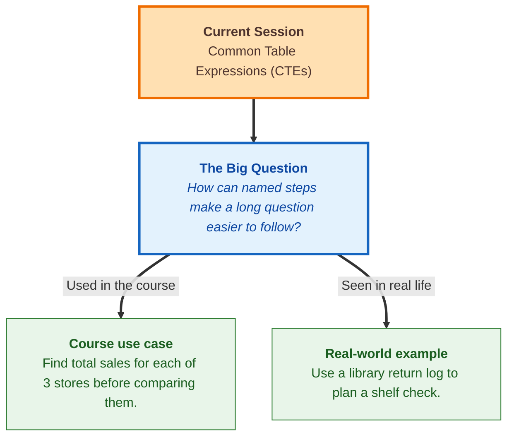

## Common Table Expressions (CTEs)

### Mental Map

---

### What You'll Learn

Have you ever wondered how a library decides which shelf needs attention first?

By the end of this session, you will be able to:

- **Use** named steps to make a long question about returned books easier to read.
- **Write** a named step in place of a question hidden inside another question.
- **Design** a chain of named steps to group and compare the returned books.
- **Build** a step-by-step way to find which shelf needs a check first.

> **Topics you will meet:** Common Table Expressions, WITH Clause.
>
> Join the session to learn each of these in detail.

---

### Why You Are Learning This Topic

You help at a library where books come back throughout the day. The return log lists each book and its shelf. You want to count the books waiting for each shelf. Then you want to find which shelf has the largest pile. A long question can hide these smaller steps inside one another.

A **common table expression** means a named temporary result used within one question to the data.

In this course, you can use named results to make your work with data easier to follow.

> **Think about it:** How might names help someone else follow your steps?

---

### Library Return Puzzle

The log shows four books waiting to go back on shelves.

| Book | Shelf |
|:----:|:-----:|
| Moon Garden | Nature |
| River Birds | Nature |
| Star Voyage | Space |
| Ocean Atlas | Nature |

**What you want to happen:**

- Gather the books by shelf.
- Count the books for each shelf.
- Find the shelf with the largest pile.

> **Wonder about this:**
>
> - What name could you give the shelf counts?
> - How could one named step pass its result to the next?

---

### Think It Through

There is no wrong first try. Keep your guesses for the session.

**1. Which books would you put in the same group?**
Hint: Look at the shelf names.

**2. What would you count before choosing a shelf to check?**
Hint: Think about each pile of books.

**3. How could you arrange your steps so a friend can follow them?**
Hint: Give each step a short name.

---

### One Question to Carry Into the Session

> **How can named steps help you answer a question about the library log?**
>
> What could change if one step used the result of another?
