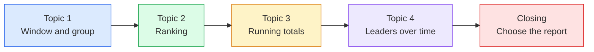
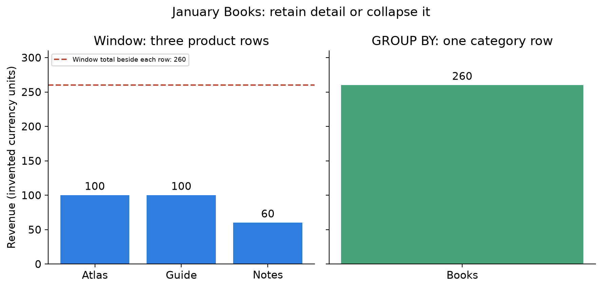
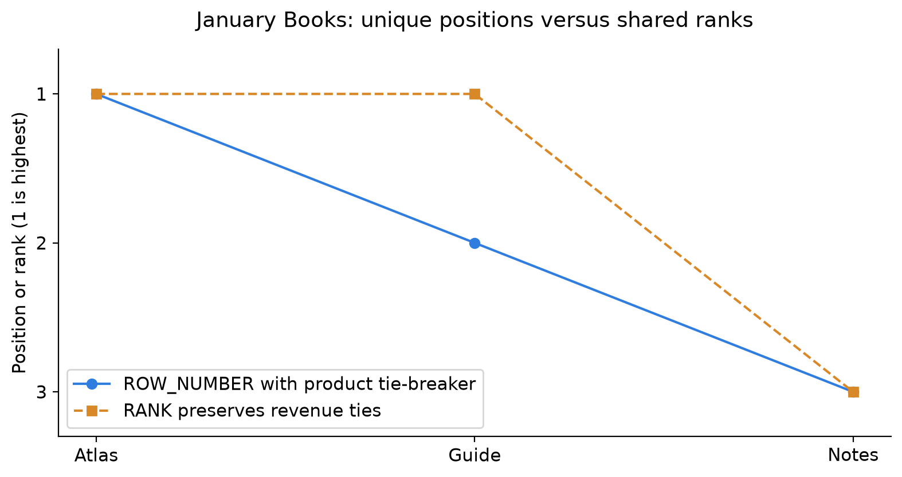
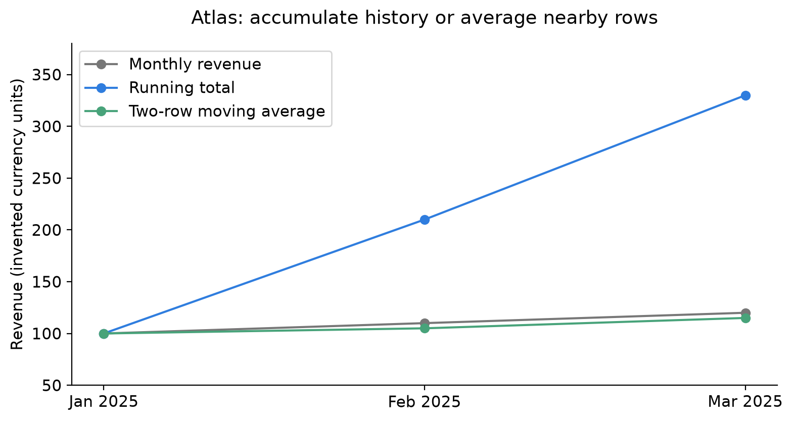
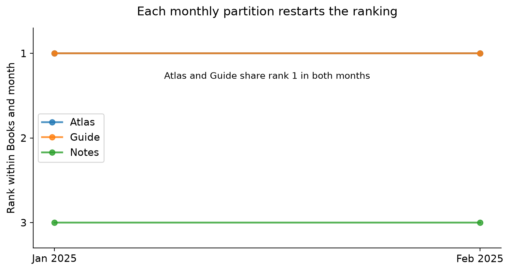

# <font color='#1d4ed8'>Lecture Script: Window Functions (MySQL)</font>

## <font color='blue'>Agenda</font>

| Topic | What we do | Learning objectives covered | Minutes |
|:-:|:--|:--|:-:|
| 1 | Compare a window with a grouped summary | Explain what a window function does versus a GROUP BY, by intuition | 25 |
| 2 | Rank rows within categories | Use ranking functions such as ROW_NUMBER and RANK with PARTITION BY | 30 |
| 3 | Measure accumulated and moving revenue | Compute running totals and moving aggregates over a window | 30 |
| 4 | Select top products and compare groups over time | Answer a ranking question such as top products per category<br>Apply window functions to cohort-style questions such as ranking within groups over time | 30 |
| — | Closing: Outcome & Summary | | 5 |
| | **Total** | | **120** |

> <font color="red">**🎯 Instructor Note**</font> Spend time on ties, the ordering inside each window, and the difference between filtering before and after ranking.

---

## <font color='blue'>Scenario</font>

Imagine a Nykaa-style shop preparing a monthly product report. The report keeps each product-month row visible so a mentor can compare products within a category and follow revenue over time.

> <font color="red">**🎯 Instructor Note**</font> This is a familiar setting only; the figures are invented for teaching and are not claims about the company. The accompanying [data script](data/sales.sql) creates `sales` in a disposable MySQL 8.0 or later database; `data/sales.csv` contains the same rows. No current date is needed.

Each row is one product's revenue for one month. There are two categories, three products per category and 20 months, from January 2025 through August 2026. Revenue is in invented currency units. The January Books values include a tie: Atlas and Guide each have 100, and Notes has 60.

---

## <font color='blue'>Problem Statement</font>

A report replaces product rows with one category total. The person choosing products for a display can no longer see which products earned that total or how their positions changed.

> <font color='purple'>**How can the report retain product detail while showing group totals, rankings and trends?**</font>

> <font color="red">**🎯 Instructor Note**</font> Poll: “Can a report show a group total beside every product row?” Give learners 30 seconds to respond in chat. Reveal the answer in the Closing.

---

## <font color='blue'>What We Will Use</font>

We will query the same `sales` table throughout.

| Topic | Tools | In one line |
|:-:|:--|:--|
| 1 | `GROUP BY`, `SUM() OVER` | Compare a summary with a value alongside each row. |
| 2 | `ROW_NUMBER`, `RANK`, `PARTITION BY` | Order products within categories and handle ties. |
| 3 | `SUM`, `AVG`, `ROWS` | Accumulate and average ordered rows. |
| 4 | Subquery, ranking windows | Select leaders and compare product positions by month. |

---

## <font color='blue'>How: Walking Through the product report</font>



---

## <font color='blue'>Topic 1: Window Functions</font> `25 min`

> <font color='purple'>**How can we keep the individual products and still see their category total?**</font>

A group summary collapses qualifying rows to one row per group. A window calculation instead attaches a value computed across related rows to each qualifying row; it does not itself collapse those rows. `PARTITION BY` defines the related rows. Here the `WHERE` clause limits the input to January before the window is calculated.

### <font color='green'>Example: Show the category total beside each product</font>

> <font color='purple'>**What total accompanies each January Books product?**</font>

**Predict before running: What will happen?**

> <font color="red">**🎯 Instructor Note**</font> Three rows remain, each with 260 as the category total.

```sql
SELECT product, revenue,
       SUM(revenue) OVER (PARTITION BY category) AS category_total
FROM sales
WHERE sale_month = '2025-01-01' AND category = 'Books'
ORDER BY product;
```

**Output**

```text
product	revenue	category_total
Atlas	100	260
Guide	100	260
Notes	60	260
```

#### <font color='#c2410c'>Code Explanation</font>

- The first two lines select each product and attach the sum within its category.
- The next two lines choose January Books rows before the window operates.
- The last line fixes display order; product names are unique within this selection.

> <font color='green'>**Result**</font> The intended report retains three product rows, each paired with the same group sum.

### <font color='green'>Extending it: Collapse the same rows</font>

> <font color='purple'>**How does a grouped total differ in shape?**</font>

**Predict before running: What will happen?**

> <font color="red">**🎯 Instructor Note**</font> Expect one Books row with 260; product details are no longer individual result rows.

```sql
SELECT category, SUM(revenue) AS category_total
FROM sales
WHERE sale_month = '2025-01-01' AND category = 'Books'
GROUP BY category
ORDER BY category;
```

**Output**

```text
category	category_total
Books	260
```

#### <font color='#c2410c'>Code Explanation</font>

- The query filters the same rows and groups them by category.
- `SUM` produces one value per group; the final line orders the result.

> <font color='green'>**Result**</font> The grouped report has one row for the category rather than one row per product.

<p align="center"></p>

### <font color='purple'>Quiz 1</font>

**Question:** What does `SUM(revenue) OVER (PARTITION BY category)` do to the number of input rows by itself?

**Options:**
- A) It keeps them and attaches a category sum to each.
- B) It reduces them to one row per category.
- C) It removes tied products.
- D) It sorts the final result.

**Correct Answer:** A

**Explanation:**
- **A)** Correct: the window adds a value to each input row.
- **B)** That is the shape of a grouped summary.
- **C)** A sum window does not remove ties.
- **D)** Use an outer `ORDER BY` for display order.

---

## <font color='blue'>Topic 2: Ranking</font> `30 min`

> <font color='purple'>**Now that each product stays visible, how can we show its position within its category?**</font>

`PARTITION BY category` restarts a ranking for each category. The window's `ORDER BY revenue DESC` ranks higher revenue first. `ROW_NUMBER` gives every row a distinct number; add product as a tie-breaker to make the choice reproducible. `RANK` gives equal revenue the same rank and leaves gaps after ties. Do not add product to the `RANK` window ordering when equal revenue must remain tied.

### <font color='green'>Example: Assign a unique position</font>

> <font color='purple'>**Which January Books row receives each position?**</font>

**Predict before running: What will happen?**

> <font color="red">**🎯 Instructor Note**</font> Atlas and Guide tie on revenue, so the product name breaks the tie: Atlas first, Guide second, Notes third.

```sql
SELECT product, revenue,
       ROW_NUMBER() OVER (PARTITION BY category
                          ORDER BY revenue DESC, product) AS position_no
FROM sales
WHERE sale_month = '2025-01-01' AND category = 'Books'
ORDER BY position_no, product;
```

**Output**

```text
product	revenue	position_no
Atlas	100	1
Guide	100	2
Notes	60	3
```

#### <font color='#c2410c'>Code Explanation</font>

- The window numbers rows separately by category, breaking equal revenues by product.
- The filter selects the January Books rows before numbering; the last line orders the displayed result.

> <font color='green'>**Result**</font> Each selected product receives a unique position.

### <font color='green'>Extending it: Preserve ties</font>

> <font color='purple'>**What changes if equal revenues should share a position?**</font>

**Predict before running: What will happen?**

> <font color="red">**🎯 Instructor Note**</font> Atlas and Guide share rank 1; Notes has rank 3, because two rows precede it.

```sql
SELECT product, revenue,
       RANK() OVER (PARTITION BY category ORDER BY revenue DESC) AS revenue_rank
FROM sales
WHERE sale_month = '2025-01-01' AND category = 'Books'
ORDER BY revenue_rank, product;
```

**Output**

```text
product	revenue	revenue_rank
Atlas	100	1
Guide	100	1
Notes	60	3
```

#### <font color='#c2410c'>Code Explanation</font>

- `RANK` compares revenue within the category and preserves revenue ties.
- The outer order uses product only for stable display; it does not change the rank.

> <font color='green'>**Result**</font> Tied leaders share a rank and the next rank has a gap.

> <font color='#b45309'>**Common mistake**</font> Adding product to the window ordering for `RANK` breaks equal-revenue ties. Use it only in the final display order when ties should share a rank.

<p align="center"></p>

### <font color='purple'>Quiz 2</font>

**Question:** For revenues 100, 100 and 60, what ranks does `RANK()` assign in descending order?

**Options:**
- A) 1, 2, 3
- B) 1, 1, 3
- C) 1, 1, 2
- D) 3, 3, 1

**Correct Answer:** B

**Explanation:**
- **A)** This is a possible unique row numbering, not tie-preserving rank.
- **B)** Correct: both leaders rank first and the next rank is three.
- **C)** This removes the gap that `RANK` leaves.
- **D)** Descending order gives the highest values the lowest rank numbers.

---

## <font color='blue'>Topic 3: Running Totals</font> `30 min`

> <font color='purple'>**A rank describes a position in one month; how can we follow one product across months?**</font>

A window can be ordered in time. `ROWS BETWEEN UNBOUNDED PRECEDING AND CURRENT ROW` includes all earlier rows in the partition and the current row. A moving frame can instead include only a fixed number of rows. A row frame counts observations, not calendar months; here each product has one row per month. The explicit `sale_id` tie-breaker makes the order deterministic if dates repeat.

### <font color='green'>Example: Running revenue for Atlas</font>

> <font color='purple'>**How much has Atlas earned by each of its first three months?**</font>

**Predict before running: What will happen?**

> <font color="red">**🎯 Instructor Note**</font> January through March have revenues 100, 110 and 120; their running totals are 100, 210 and 330.

```sql
SELECT sale_month, revenue,
       SUM(revenue) OVER (PARTITION BY product ORDER BY sale_month, sale_id
           ROWS BETWEEN UNBOUNDED PRECEDING AND CURRENT ROW) AS running_total
FROM sales
WHERE product = 'Atlas' AND sale_month <= '2025-03-01'
ORDER BY sale_month, sale_id;
```

**Output**

```text
sale_month	revenue	running_total
2025-01-01	100	100
2025-02-01	110	210
2025-03-01	120	330
```

#### <font color='#c2410c'>Code Explanation</font>

- The window partitions by product and orders observations by month and unique ID.
- Its explicit frame includes the current row and all prior rows in that partition.
- The filter defines the input, and the final order controls display.

> <font color='green'>**Result**</font> The running total accumulates the selected revenue through each month.

### <font color='green'>Extending it: A two-row moving average</font>

> <font color='purple'>**What average uses the current row and, when available, the previous row?**</font>

**Predict before running: What will happen?**

> <font color="red">**🎯 Instructor Note**</font> The first frame contains one row; the next two contain two. Expected values are 100, 105 and 115.

```sql
SELECT sale_month, revenue,
       AVG(revenue) OVER (PARTITION BY product ORDER BY sale_month, sale_id
           ROWS BETWEEN 1 PRECEDING AND CURRENT ROW) AS moving_avg
FROM sales
WHERE product = 'Atlas' AND sale_month <= '2025-03-01'
ORDER BY sale_month, sale_id;
```

**Output**

```text
sale_month	revenue	moving_avg
2025-01-01	100	100.0000
2025-02-01	110	105.0000
2025-03-01	120	115.0000
```

#### <font color='#c2410c'>Code Explanation</font>

- The frame contains at most the current row and its immediate predecessor.
- The first row has no predecessor, so its average uses only itself.

> <font color='green'>**Result**</font> The moving average follows nearby observations instead of accumulating all history.

> <font color='#b45309'>**Common mistake**</font> Filtering away earlier dates before the window calculation changes the running total. To display only later rows while retaining earlier history, calculate the window in an inner query and filter its result outside.

<p align="center"></p>

### <font color='purple'>Quiz 3</font>

**Question:** For 100, 110 and 120 in time order, what is the two-row moving average at the third row?

**Options:**
- A) 110
- B) 120
- C) 115
- D) 330

**Correct Answer:** C

**Explanation:**
- **A)** This averages all three rows, not the last two.
- **B)** This is the current value alone.
- **C)** Correct: the average of 110 and 120 is 115.
- **D)** This is the three-row running sum.

---

## <font color='blue'>Topic 4: Cohort-style Analysis</font> `30 min`

> <font color='purple'>**How can we select leaders fairly and compare their positions across monthly groups?**</font>

Here a cohort-style group is the set of product rows in the same category and month. It is a comparison group, not a customer acquisition cohort or a retention measure. The inner query computes ranks; the outer query filters those results. A window alias cannot be filtered in the same query's `WHERE`, because `WHERE` selects rows before the window is evaluated.

### <font color='green'>Example: Top products per category</font>

> <font color='purple'>**Which January products are tied for the highest revenue within each category?**</font>

**Predict before running: What will happen?**

> <font color="red">**🎯 Instructor Note**</font> Expect both Atlas and Guide for Books and Cup for Home. `RANK = 1` includes every tie for first.

```sql
SELECT category, product, revenue, revenue_rank
FROM (SELECT category, product, revenue,
             RANK() OVER (PARTITION BY category ORDER BY revenue DESC) AS revenue_rank
      FROM sales WHERE sale_month = '2025-01-01') AS ranked
WHERE revenue_rank = 1
ORDER BY category, product;
```

**Output**

```text
category	product	revenue	revenue_rank
Books	Atlas	100	1
Books	Guide	100	1
Home	Cup	90	1
```

#### <font color='#c2410c'>Code Explanation</font>

- The inner query ranks the January rows separately within each category.
- The outer query keeps rank one, including ties, and orders the final rows.

> <font color='green'>**Result**</font> A category may contribute more than one top product when its leaders tie.

### <font color='green'>Extending it: Rank within each monthly group</font>

> <font color='purple'>**How do Books products rank in each of the first two months?**</font>

**Predict before running: What will happen?**

> <font color="red">**🎯 Instructor Note**</font> Both months have Atlas and Guide tied at rank 1 and Notes at rank 3. The monthly partition restarts the ranking.

```sql
SELECT sale_month, product, revenue,
       RANK() OVER (PARTITION BY category, sale_month
                    ORDER BY revenue DESC) AS monthly_rank
FROM sales
WHERE category = 'Books' AND sale_month <= '2025-02-01'
ORDER BY sale_month, monthly_rank, product;
```

**Output**

```text
sale_month	product	revenue	monthly_rank
2025-01-01	Atlas	100	1
2025-01-01	Guide	100	1
2025-01-01	Notes	60	3
2025-02-01	Atlas	110	1
2025-02-01	Guide	110	1
2025-02-01	Notes	70	3
```

#### <font color='#c2410c'>Code Explanation</font>

- The partition combines category and month, creating a separate comparison group for each month.
- The outer order presents months in sequence and tied products consistently.

> <font color='green'>**Result**</font> Monthly groups can be compared over time without combining all months into one ranking.

<p align="center"></p>

### <font color='purple'>Quiz 4</font>

**Question:** Which method returns all tied top products per category for January?

**Options:**
- A) Use `GROUP BY category` alone and discard product rows.
- B) Use `ROW_NUMBER = 1` with a product tie-breaker.
- C) Rank all categories together, then keep rank one.
- D) Rank by revenue within category in an inner query, then keep rank one outside.

**Correct Answer:** D

**Explanation:**
- **A)** A grouped total alone does not identify each tied product.
- **B)** This selects one row per category and excludes any tied second row.
- **C)** A global rank does not find a leader in each category.
- **D)** Correct: category partitions preserve group boundaries and `RANK` keeps ties.

---

## <font color='blue'>Closing: Outcome & Summary</font> `5 min`

> <font color='purple'>**1. How can the report retain product detail and show the category total?**</font>

Use the Topic 1 window sum alongside the product rows; a grouped summary instead reduces them to one row per category.

> <font color='purple'>**2. How does the report choose and follow leaders?**</font>

Use Topic 2 rankings with the desired tie rule. Topic 3's ordered frames show cumulative revenue or a moving average. Topic 4 ranks within each category and month and filters the computed ranks in an outer query to select leaders.

### <font color='green'>Outcome</font>

| | Grouped summary | Window report |
|:--|:--|:--|
| January Books result shape | One category row | Three product rows |
| Top products visible directly | No | Yes, after ranking and filtering |

> <font color='green'>**Therefore,**</font> Keep product rows with window calculations for a product display decision; use the grouped summary when only a compact category total is needed. A tie-preserving top rank can return more than one product.

> <font color="red">**🎯 Instructor Note**</font> Reveal the poll: yes, a window sum can place the group total beside every product row.

### <font color='green'>Summary</font>

| Learning objective | Takeaway |
|:--|:--|
| Window versus GROUP BY | A window attaches a group value while retaining rows; grouping reduces them. |
| Ranking within partitions | `ROW_NUMBER` assigns unique positions; `RANK` preserves ties and leaves gaps. |
| Running and moving aggregates | Explicit ordered row frames control which observations contribute. |
| Top products per category | Compute a category rank first, then filter it outside. |
| Group ranking over time | Partition by category and month to compare products within each monthly group. |
| **Practical value** | Keep a detailed report while comparing groups and changes over time. |

---

# <font color='red'>Launch the Feedback Poll</font>

> <font color="red">**🎯 Instructor Note**</font> Reminder: launch the feedback poll now to collect learner feedback.
