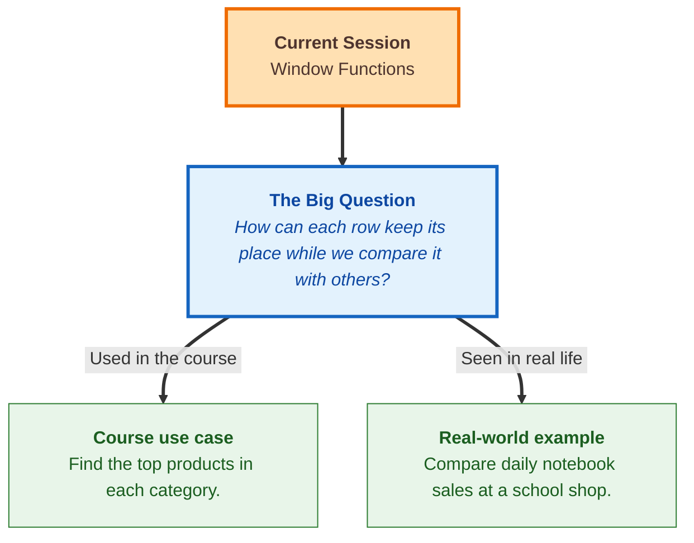

## <span style="color:#2F7DDE">Window Functions</span>

### <span style="color:#2F7DDE">Mental Map</span>



---

### <span style="color:#2F7DDE">What You'll Learn</span>

Have you ever wondered how a shop finds its most popular notebook each day?

By the end of this session, you will be able to:

- <span style="color:#D9660B">**Explain**</span> how keeping each notebook row differs from replacing rows with one group total.
- <span style="color:#D9660B">**Use**</span> two ways to give notebooks a place within each category, including tied sales.
- <span style="color:#D9660B">**Calculate**</span> a total so far and an average across a changing set of days.
- <span style="color:#D9660B">**Determine**</span> the top notebook in each category from its sales.
- <span style="color:#D9660B">**Trace**</span> how notebooks from the same arrival group compare across days.

> <span style="color:#2F7DDE">**Topics you will meet:**</span> Window Functions, Ranking, Running Totals, Cohort-style Analysis.
>
> Join the session to learn each of these in detail.

---

### <span style="color:#2F7DDE">Why You Are Learning This Topic</span>

A school shop sells notebooks in different categories. The shopkeeper records each day's sales. She wants to see each entry beside its neighbours. She also wants to notice ties and changes over time. You can help her keep the details while comparing them.

A <span style="color:#D9660B">**window function**</span> makes a calculation using related rows while keeping each row visible.

In this course, you will use that idea to answer questions about records.

> <span style="color:#2F7DDE">**Think about it:**</span> What might a single total hide about the notebooks?

---

### <span style="color:#2F7DDE">School Shop Puzzle</span>

These entries show notebooks from one arrival group, recorded over two days.

| Day | Category | Notebook | Sold |
|:---:|:--------:|:--------:|:----:|
| Monday | Ruled | Maple | 4 |
| Monday | Ruled | Cedar | 4 |
| Monday | Plain | Birch | 3 |
| Tuesday | Ruled | Maple | 2 |
| Tuesday | Plain | Birch | 5 |

<span style="color:#D9660B">**What you want to happen:**</span>

- Keep every entry while comparing sales within each category.
- Find the leaders, including any ties, and track sales as days pass.
- Compare the arrival group's notebooks over time.

Here is how it might start. You do not need to understand it yet.

```python
sales = [4, 4, 3, 2, 5]
print(sales)
```

> <span style="color:#D9660B">**Wonder about this:**</span>
>
> - How could equal sales affect the places notebooks receive?
> - How might a total so far differ from an average over the latest two days?

---

### <span style="color:#2F7DDE">Think It Through</span>

There is no wrong first try. Keep your guesses for the session.

**1. What detail would you lose if you kept only the total for each category?**
Hint: Look at the separate notebook names and days.

**2. How might you choose a leader when two notebooks sell equally well?**
Hint: Look at the two ruled entries on Monday.

**3. What could you compare for the arrival group as another day passes?**
Hint: Follow the notebook names across the days.

---

### <span style="color:#2F7DDE">One Question to Carry Into the Session</span>

> <span style="color:#2F7DDE">**How can each shop entry stay visible while you compare it with its neighbours?**</span>
>
> How would your answer change if you only needed one total per category?
